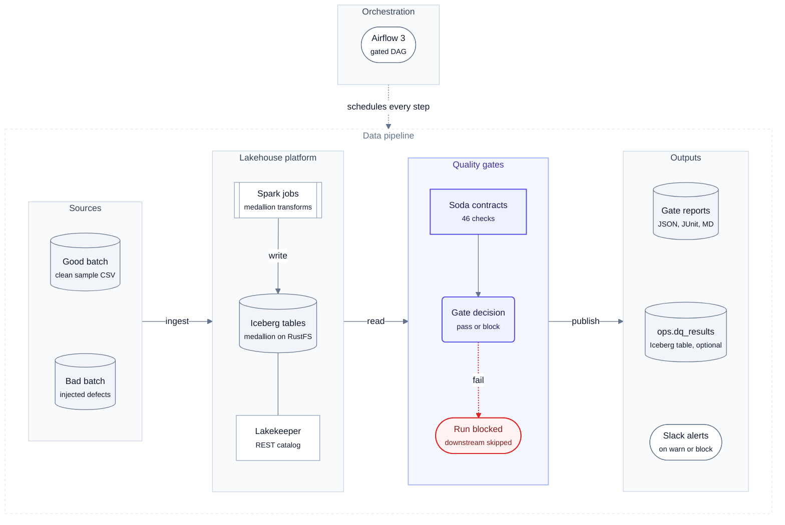

<div align="center">

# lakehouse-quality-gates

**Data contracts as quality gates for an open lakehouse: bad data never reaches gold.**

[Soda Core v4](https://docs.soda.io/) contracts run between bronze, silver and gold on Apache Iceberg,
using DuckDB or Trino, and are orchestrated by Airflow, for
[local-data-lakehouse](https://github.com/santoshshinde2012/local-data-lakehouse).

[](https://github.com/santoshshinde2012/lakehouse-quality-gates/actions/workflows/ci.yml)
[](https://github.com/santoshshinde2012/lakehouse-quality-gates/releases/tag/v0.3.2)
[](https://www.python.org/)
[](LICENSE)
[](https://github.com/astral-sh/ruff)
[](https://mypy-lang.org/)
[](docs/results/README.md)
[](https://docs.soda.io/)

[Why](#why) · [Architecture](#architecture) · [Quickstart](#quickstart) · [Results](#results) · [Documentation](#documentation) · [Roadmap](#roadmap)

</div>

---

## Why

**The problem.** In a medallion lakehouse, every layer trusts the one before it. A duplicated order, an
orphan customer id or a negative amount that lands in bronze is faithfully transformed into silver and
aggregated into gold, and the dashboards are wrong before anyone notices. Checks that run *after*
publishing only tell you about the damage.

**The solution.** Put a **gate** between the layers. Each layer has a declarative
[Soda data contract](docs/guides/contracts.md) covering schema, completeness, validity, uniqueness, freshness,
referential integrity and reconciliation. The gate runs right after the layer is built. If the contract
fails, the Airflow task fails and the next layer is never built from bad data. Warnings are recorded but
do not block.

## Key features

- 🛡️ **5 contracts, 46 checks** over the retail medallion: schema, row count, freshness, missing,
  invalid (sets, regex, ranges, referential integrity), duplicate, `failed_rows` and a silver-to-gold
  `metric` reconciliation.
- ⚙️ **Three engines, one set of contracts.** DuckDB attaches to the Lakekeeper Iceberg REST catalog
  (default). Trino 483 is optional. `duckdb-local` builds the same medallion from CSV files with no Docker.
- 🚦 **Explicit gate policy.** A failed check, an execution error or a not-evaluated check blocks. A warning is
  logged. `DQ_FAIL_ON_WARN=true` makes warnings block too.
- 🧾 **Reports and alerts.** JSON, JUnit XML and Markdown for every run, an optional Iceberg table
  `ops.dq_results`, console output, and Slack alerts on problems.
- 🌀 **Airflow-native.** A gated DAG, `lakehouse_retail_medallion_dq`, sits next to the lakehouse's original
  DAG, which is left untouched. An `inject_bad_batch` switch shows a gate blocking for real.
- 🐳 **Hardened runner container.** Non-root, read-only root filesystem, `cap_drop: ALL`, digest-pinned base images.
- 🧱 **Clean architecture.** Ports and adapters with a single composition root. ruff, `mypy --strict`,
  107 tests at 99% coverage.

## Architecture

A **gate** runs after each layer is built: it verifies that layer's Soda **contracts** and either passes
(the next layer is built) or **blocks** (the Airflow task fails and nothing downstream runs).

<!-- diagram:system-architecture -->

<!-- /diagram -->

**How to read it:** data flows left to right (Sources → Lakehouse platform → Quality gates → Outputs);
indigo is this project; the red dotted path is a block; Airflow schedules every step.

More views (system context, code architecture, domain model, ports and adapters, data model, gate policy, gate run
sequence, Airflow DAG, deployment, write-audit-publish) are in
the [architecture pages](docs/architecture/README.md); the end-to-end design is [docs/system-design.md](docs/system-design.md).

## Quickstart

No Docker needed; requires [uv](https://docs.astral.sh/uv/):

<!-- include:docs/guides/quickstart.md#quickstart -->
```bash
git clone https://github.com/santoshshinde2012/lakehouse-quality-gates.git && cd lakehouse-quality-gates
uv sync --all-extras            # Python 3.12 venv: Soda Core 4.26.0, DuckDB 1.5.6, dev tools
make validate                   # Soda parses every contract
make demo                       # good batch: all gates pass; bad batch: every gate blocks
open reports/*_retail_silver.md # what was caught, and why (use xdg-open on Linux)
```
<!-- /include -->

Against the live lakehouse (DuckDB or Trino), in the runner container or in Airflow:
[quickstart guide](docs/guides/quickstart.md). Commands, exit codes and `DQ_*` settings:
[configuration](docs/guides/configuration.md).

## Results

| Verified on macOS, 2026-10-13 | Result |
|---|---|
| ruff · mypy --strict · markdownlint · link check | ✅ clean |
| pytest | ✅ 107 passed, 99% coverage |
| Good / bad batch, no Docker | ✅ 3/3 gates passed / 3/3 blocked |
| Live DuckDB and Trino 483 on Lakekeeper Iceberg | ✅ 46/46 checks passed · bad batch blocked |
| Runner container and Airflow DAG | ✅ good run succeeds · bad run stops at `dq_bronze` |

Benchmarks on an Apple M1 Pro laptop against the live stack:

<!-- include:docs/benchmarks/README.md#headline -->
| Headline | Value |
|---|---|
| Gate latency, host DuckDB, warm p50 per layer | 0.4–0.6 s up to 1M orders · 0.5–2.0 s at 5M |
| Worst warm p95 (DuckDB host or container) | 3.56 s (container, bronze, 5M) |
| Gate time as a share of the Spark job (lakehouse sample) | 4–5 % per layer |
| Peak gate memory at 5M orders | 780 MiB (container), 684 MiB (host) |
| Detection accuracy (7 defect types × 3 rates + clean) | 66/66 verdicts, precision 1.0, recall 1.0 |
| Same six checks at 1M rows | Soda 0.44 s, Pointblank 0.47 s, datacontract-cli 1.08 s, Pandera 2.83 s, GX Core 11.5 s |
<!-- /include -->

> [!WARNING]
> Trino on the lakehouse's default 1 GiB heap cannot evaluate the order checks at 5M orders, so those gates
> block. Details, variance and caveats: [benchmarks](docs/benchmarks/README.md). Raw logs and reports:
> [docs/results](docs/results/README.md).

## Documentation

Start at the **[documentation hub](docs/README.md)**: it says who should read what, and in which order.

| Need | Go to |
|---|---|
| Understand the problem | [Use case](docs/overview/use-case.md) · [Glossary](docs/overview/glossary.md) |
| See the design | [System design](docs/system-design.md) · [Architecture pages](docs/architecture/README.md) · [ADRs](docs/adr/README.md) |
| Run and operate it | [Quickstart](docs/guides/quickstart.md) · [Contracts](docs/guides/contracts.md) · [Runbook](docs/guides/runbook.md) · [Troubleshooting](docs/guides/troubleshooting.md) |
| Check the numbers | [Benchmarks](docs/benchmarks/README.md) · [Research](docs/research/README.md) |

## Roadmap

- [ ] **Write-Audit-Publish with Iceberg branches.** Write each layer to an audit branch, gate it, then
  fast-forward `main`, so readers never see unaudited snapshots. Designed in
  [write-audit-publish](docs/architecture/write-audit-publish.md); publish must run on Spark
  because Trino 483 cannot create or fast-forward branches.
- [ ] Gate the lakehouse's second pipeline (renewal features).
- [ ] OpenLineage events from gate runs, so quality is visible next to lineage.
- [ ] Contract drift checks in CI against the live schema.
- [ ] Dashboard over `ops.dq_results` (trend of failures per check).

## Contributing

Contributions are welcome. See [CONTRIBUTING.md](CONTRIBUTING.md). In short: `uv sync --all-extras && uv run pre-commit install`,
then make sure `make check validate demo` passes, which is exactly what CI runs.

## License

[MIT](LICENSE) © 2026 Santosh Shinde.

> [!NOTE]
> Soda Core v4 is licensed under the Elastic License 2.0 (source-available, not OSI). Internal use is allowed;
> this project accepts the trade-off on purpose ([ADR 0001](docs/adr/0001-soda-core-v4-proprietary-licence.md)).
> Soda Cloud is not used, and Soda telemetry is off by default.

## Acknowledgements

Built on [Soda Core](https://github.com/sodadata/soda-core), [Apache Iceberg](https://iceberg.apache.org/),
[Lakekeeper](https://github.com/lakekeeper/lakekeeper), [DuckDB](https://duckdb.org/),
[Trino](https://trino.io/), [Apache Spark](https://spark.apache.org/), [Apache Airflow](https://airflow.apache.org/),
[RustFS](https://github.com/rustfs/rustfs) and [uv](https://github.com/astral-sh/uv). The README structure
takes cues from dbt, Great Expectations, Dagster and soda-core.
