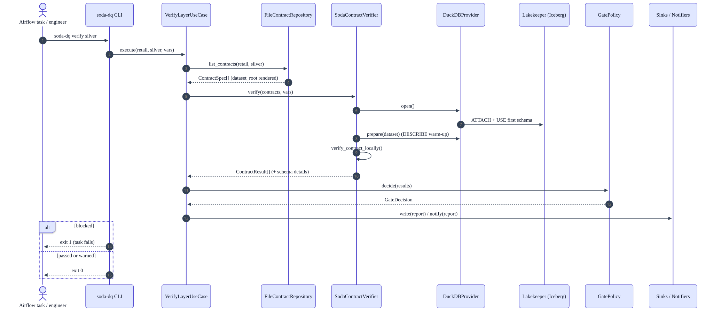

# soda-lakehouse-dq

[](https://github.com/santoshshinde2012/lakehouse-quality-gates/actions/workflows/ci.yml)
[](https://www.python.org/)
[](LICENSE)
[](https://github.com/astral-sh/ruff)
[](https://mypy-lang.org/)
[](https://docs.soda.io/)
[](docs/results/README.md)

**Contract-gated medallion for [local-data-lakehouse](https://github.com/santoshshinde2012/local-data-lakehouse):
[Soda Core v4](https://docs.soda.io/) data contracts run as quality gates between bronze, silver and gold, so
bad data never gets promoted.**

```
land >> bronze >> [dq_bronze] >> silver >> [dq_silver] >> gold >> [dq_gold] >> query
                      ▲ a failed contract fails the Airflow task and stops promotion
```

- **5 contracts, 46 checks** over the retail medallion (`contracts/retail/{bronze,silver,gold}`). They cover
  schema, row count, freshness, missing, invalid (sets, regex, ranges, referential integrity), duplicate
  (one or more columns), `failed_rows` and a `metric` reconciliation between silver and gold.
- **Engines.** By default DuckDB attaches to the lakehouse's Iceberg REST catalog through the repo's own
  `lakehouse_client.duckdb_connect()`, and Soda reuses that connection (`from_existing_cursor`). Trino is
  optional. A Docker-free `duckdb-local` engine builds the same medallion from CSV files.
- **Gate policy.** A failure, an execution error or an unevaluated check blocks. A warning is logged but
  does not block (`DQ_FAIL_ON_WARN=true` makes warnings block too).
- **Reports.** Each run writes JSON, JUnit XML and Markdown. An Iceberg table `ops.dq_results` is optional.
  Notifications go to the console by default and to Slack when a webhook is set.
- **Orchestration.** A new Airflow DAG, `lakehouse_retail_medallion_dq`, sits next to the original one.
  The lakehouse repo is not modified.
- **Design.** Ports and adapters with a single composition root (SOLID). The code passes ruff and
  `mypy --strict`, and has 94 tests at 99% coverage, including real Soda runs on DuckDB.

> Soda Core 4.x is **proprietary**: free to use, but not OSI-licensed. This project accepts that
> trade-off on purpose. See [ADR 0001](docs/adr/0001-soda-core-v4-proprietary-licence.md). Soda Cloud is
> not used, and telemetry is switched off (`SODA_CORE_TELEMETRY_ENABLED=false`).


## Architecture at a glance







All seven diagrams are in [docs/architecture.md](docs/architecture.md), and the SOLID mapping is in [docs/design-principles.md](docs/design-principles.md).

## Results

Verified on macOS on 2026-10-13. Full artefacts are in [docs/results](docs/results/README.md).

| Check | Result |
|---|---|
| ruff · mypy --strict | ✅ clean |
| pytest | ✅ 94 passed, 99% coverage ([HTML](docs/results/coverage/html/index.html)) |
| Contracts (`soda-dq validate`) | ✅ 5/5 |
| Good batch | ✅ bronze 14 · silver 21 · gold 11 passed |
| Bad batch | ✅ all three gates blocked |
| Live lakehouse (DuckDB → Lakekeeper Iceberg) | ✅ 46/46 passed |
| Trino · Docker image · Airflow DAG | ✅ verified (see the runbook) |

## Quick start (no Docker, about a minute)

```bash
uv sync --all-extras            # Python 3.12 venv with Soda Core 4.26.0, DuckDB 1.5.6, dev tools
make validate                   # Soda parses every contract
make demo                       # good batch: all gates pass; bad batch: every gate blocks
open reports/*_retail_silver.md # what was caught, and why
```

## Against the real lakehouse

```bash
cp .env.example .env            # set DQ_LDL_REPO_PATH to your local-data-lakehouse checkout
(cd "$DQ_LDL_REPO_PATH" && make up-light && make demo-light)   # tables exist in Lakekeeper
DQ_ENGINE=duckdb uv run soda-dq run                            # host DuckDB -> Iceberg REST
# Trino (lakehouse: make up-full TRINO=1):
DQ_ENGINE=trino uv run soda-dq run
```

## With Airflow

```bash
(cd "$DQ_LDL_REPO_PATH" && make up-full)
make airflow-dq-up              # ldl-soda runner on ldl-net + lakehouse Airflow + the gated DAG
make airflow-dq-trigger         # runs lakehouse_retail_medallion_dq and waits
```

## CLI

| Command | What it does |
|---|---|
| `soda-dq verify <layer> [-e engine] [--set K=V]` | Gate one layer. Exit 0 = passed, 1 = blocked, 2 = configuration error |
| `soda-dq run [-e engine]` | Gate bronze, then silver, then gold. Stops at the first blocked layer |
| `soda-dq validate` | Soda syntax check of every contract, without touching data |
| `soda-dq list [-e engine]` | Contracts and their dataset names after rendering |

## Layout

```
contracts/retail/{bronze,silver,gold}/*.yml   Soda v4 data contracts ({{ dataset_root }} token per engine)
datasources/trino.yml                         Soda data source for Trino
src/soda_lakehouse_dq/
  domain/        models, ports (Protocols), errors: no third-party imports
  application/   GatePolicy, VerifyLayerUseCase, RunMedallionUseCase
  adapters/      Soda verifier, DuckDB/Trino providers, contract repository, sinks, notifiers, clock
  container.py   composition root      cli.py  Typer CLI      settings.py  pydantic-settings (DQ_*)
airflow/dags/    lakehouse_retail_medallion_dq.py + dq_operators.py
docker/          Dockerfile, docker-compose.dq.yml (ldl-net), docker-compose.airflow-dq.yml (overlay)
fixtures/        good_batch (repo sample data), bad_batch (injected defects, see its README)
tests/           unit (fakes for every port) + integration (real Soda on DuckDB, CLI end to end)
docs/            architecture, use case, contracts, runbook, ADRs
```

## Docs

- [Design principles](docs/design-principles.md): SOLID mapped to classes
- [Results](docs/results/README.md): verification artefacts
- [Architecture](docs/architecture.md): seven Mermaid diagrams (system context, components, medallion gates, gate sequence, Airflow DAG, deployment, domain classes), with rendered SVGs in `docs/diagrams/`
- [Use case](docs/use-case.md): why gates, what each layer guarantees, demo walkthrough
- [Contracts](docs/contracts.md): every check, the conventions, how to add one
- [Runbook](docs/runbook.md): operating, triaging a blocked gate, configuration, troubleshooting
- [ADRs](docs/adr/): the decisions and their trade-offs
- [CHANGELOG](CHANGELOG.md)

Licence: MIT for this project (see [LICENSE](LICENSE)). Soda's packages keep their own licence.
