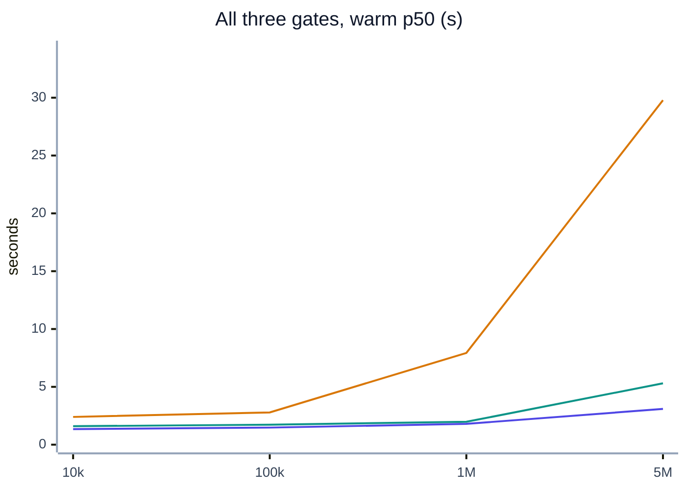

<div align="center">

# lakehouse-quality-gates

**Soda data contracts for bronze, silver and gold, with audited snapshot publication.**

[](https://github.com/santoshshinde2012/lakehouse-quality-gates/actions/workflows/ci.yml)
[](https://github.com/santoshshinde2012/lakehouse-quality-gates/releases/tag/v1.0.0)
[](https://www.python.org/)
[](LICENSE)
[](docs/results/README.md)
[](https://docs.soda.io/)

</div>

## What it does

Each layer of the [local-data-lakehouse](https://github.com/santoshshinde2012/local-data-lakehouse) medallion gets a
declarative [Soda Core v4](https://docs.soda.io/) contract (53 checks in total). A gate verifies the contract right after
the layer is built, on DuckDB or Trino over Apache Iceberg. If it fails, the Airflow task fails and nothing downstream
is built from bad data. With **write-audit-publish**, each layer is first written to an Iceberg audit branch and only
fast-forwarded to `main` when its gate passes. Publication uses the exact audited snapshots; each table
advances separately. Quality guarantees cover the checks declared in the contracts.

## Architecture

<!-- diagram:system-architecture -->

<!-- /diagram -->

Data flows left to right; indigo is this project and the red dotted path is a blocked run. More views:
[architecture](docs/architecture/README.md).

## Quick start

<!-- include:docs/guides/quickstart.md#quickstart -->
1. **Check the prerequisites:** [uv](https://docs.astral.sh/uv/), Git and Make. Docker is only needed for the live steps.

   ```bash
   uv --version && git --version && make --version | head -1
   ```

   Expected: three version lines (uv 0.5 or newer). uv installs Python 3.12 itself if it is missing.

2. **Clone the repository.**

   ```bash
   git clone https://github.com/santoshshinde2012/lakehouse-quality-gates.git && cd lakehouse-quality-gates
   ```

   Expected: a `lakehouse-quality-gates` folder, now your working directory.

3. **Create your `.env`.**

   ```bash
   make env
   ```

   Expected: `.env ready`. The defaults work for the local demo; every setting is documented in `.env.example`.

4. **Install.**

   ```bash
   make venv
   ```

   Expected: a `.venv` with Python 3.12, Soda Core 4.26, DuckDB and the dev tools, built from `uv.lock`.

5. **Validate the contracts.**

   ```bash
   make validate
   ```

   Expected: `ok` for each of the five contracts, exit code 0.

6. **Run the good batch.**

   ```bash
   make demo-good
   ```

   Expected: `retail/bronze`, `retail/silver` and `retail/gold` each report `passed` (53 checks in total).

7. **Run the bad batch.**

   ```bash
   make demo-bad
   ```

   Expected: `OK: bronze blocked as expected`, then the same for silver and gold. The reasons are in `reports/*.md`.
<!-- /include -->

## Run against the live lakehouse

<!-- include:docs/guides/quickstart.md#live -->
1. **Clone [local-data-lakehouse](https://github.com/santoshshinde2012/local-data-lakehouse) next to this repository.**

   ```bash
   git clone https://github.com/santoshshinde2012/local-data-lakehouse.git ../local-data-lakehouse
   ```

   Expected: `../local-data-lakehouse` exists. Docker must be running, with at least 2 GB for this step.

2. **Point `.env` at it.**

   ```bash
   echo "DQ_LDL_REPO_PATH=../local-data-lakehouse" >> .env
   ```

   Expected: no output; `scripts/e2e.sh` and the live tests read this path.

3. **Run the live end-to-end check.**

   ```bash
   make e2e-live
   ```

   Expected: a summary table ending in `RESULT: PASS` (9 steps, about a minute). The good batch passes on the live
   Iceberg tables, the bad batch is blocked at every layer, and the stack is stopped again with its volumes kept.
<!-- /include -->

## Full stack (Trino, Docker, Airflow)

<!-- include:docs/guides/quickstart.md#full -->
1. **Run the full end-to-end check** (give Docker 8 GB).

   ```bash
   make e2e-full                      # or: AIRFLOW_API_PORT=8090 make e2e-full, if port 8080 is taken
   ```

   Expected: `RESULT: PASS` after 15 steps (17 to 30 minutes): the Spark pipeline, Trino gates, the `ldl-soda`
   runner container, an Airflow run that succeeds and one that stops at `dq_bronze`.
<!-- /include -->

## Write-audit-publish

<!-- include:docs/guides/quickstart.md#wap -->
1. **Start the lakehouse with the WAP overlay**, then publish a good batch through audit branches.

   ```bash
   make wap-up
   make wap-demo-good
   ```

   Expected: bronze, silver and gold each `passed`, and one line per table such as
   `published bronze.orders_raw: main 6960… -> 6313… (22 rows)`.

2. **Send the bad batch.**

   ```bash
   make wap-demo-bad
   ```

   Expected: `retail/bronze: blocked`, `main stays <same id>`, the audit branch kept with the bad rows, and
   `OK: blocked as expected, main untouched`.

3. **Run it all with Airflow and the WAP tests.**

   ```bash
   make e2e-wap                       # or: AIRFLOW_API_PORT=8090 make e2e-wap
   ```

   Expected: `RESULT: PASS` after 11 steps (about 12 minutes), including an Airflow run where `dq_bronze` fails and
   `publish_bronze` never runs.
<!-- /include -->

How it works: [write-audit-publish](docs/architecture/write-audit-publish.md) · proof with snapshot ids:
[WAP run](docs/results/runs/2026-10-14-wap/README.md).

## Testing

| Command | Tier | Needs | Time |
|---|---|---|---|
| `make test-all` | Lint, mypy, unit + integration tests, contract validation, demo | Python | about 20 s |
| `make e2e-live` | Gates on the live light stack, good and bad batch | Docker | about 1 min |
| `make e2e-full` | Spark, Trino, runner container, Airflow good and bad runs | Docker, 8 GB | 17 to 30 min |
| `make e2e-wap` | Write-audit-publish: CLI and Airflow, good and bad batch, `main` unchanged after the bad one | Docker, 8 GB | about 15 min |
| `make bench-all` | Latency, accuracy and tool comparison benchmarks | Full stack | about 2 h |

Every target, expected output and pass criterion: [running and testing](docs/guides/running-and-testing.md).

## Results at a glance

The recorded benchmark timings used the earlier contracts with 46 checks. The current contracts have 53 checks;
the performance benchmarks have not been rerun for this change.

| Measure | Result | Source |
|---|---|---|
| Tests and coverage | 359 passed, 97% line coverage | [source review](docs/results/runs/2026-10-14-v1.0-review/test-all.log) |
| End-to-end | `e2e-live` 9/9, `e2e-full` 15/15 and `e2e-wap` 11/11 steps passed | [source review](docs/results/runs/2026-10-14-v1.0-review/README.md) |
| Gate time, host DuckDB, warm p50 per layer | 0.42–0.68 s up to 1M orders | [benchmarks](docs/benchmarks/results.md) |
| All three gates at 5M orders, warm p50 | 3.09 s host DuckDB · 29.79 s Trino (4 GiB heap) | [benchmarks](docs/benchmarks/results.md) |
| Gate time as a share of its Spark job | 2.3–4.9 % per layer | [analysis](docs/benchmarks/analysis.md) |
| Detection accuracy | 66/66 verdicts, precision 1.0, recall 1.0 | [benchmarks](docs/benchmarks/results.md) |
| Airflow DAG, good / bad batch | 124 s / stops at `dq_bronze` after 57 s | [benchmarks](docs/benchmarks/results.md#airflow-dag-run-per-task) |

Gate latency against batch size (warm p50, all three gates; indigo host DuckDB, amber Trino, teal container):

<!-- include:docs/benchmarks/results.md#headline-chart -->

<!-- /include -->

All evidence: [docs/results](docs/results/README.md).

## Documentation

| Page | Read it to |
|---|---|
| [Documentation hub](docs/README.md) | find the right page and a reading path |
| [Quickstart](docs/guides/quickstart.md) | set up and run the demo |
| [End-to-end setup](docs/guides/end-to-end.md) | go from a clean Mac or Linux machine to every service, with screenshots |
| [Running and testing](docs/guides/running-and-testing.md) | run every test tier and benchmark |
| [Contracts](docs/guides/contracts.md) | read or add a check |
| [System design](docs/system-design.md) | understand the requirements and decisions |
| [Runbook](docs/guides/runbook.md) | operate it and triage a blocked gate |
| [Enterprise operating model](docs/guides/enterprise-readiness.md) | agree ownership, publication safety, access, evidence retention, and recovery |

## Contributing

See [CONTRIBUTING.md](CONTRIBUTING.md). Before opening a pull request, `make test-all` must pass; CI runs the same checks.

## License

[MIT](LICENSE) © 2026 Santosh Shinde.

> [!NOTE]
> Soda Core v4 is licensed under the Elastic License 2.0 (source-available, not OSI-approved). Internal use is
> allowed; the trade-off is recorded in [ADR 0001](docs/adr/0001-soda-core-v4-proprietary-licence.md). Soda Cloud is
> not used and Soda telemetry is off by default.
