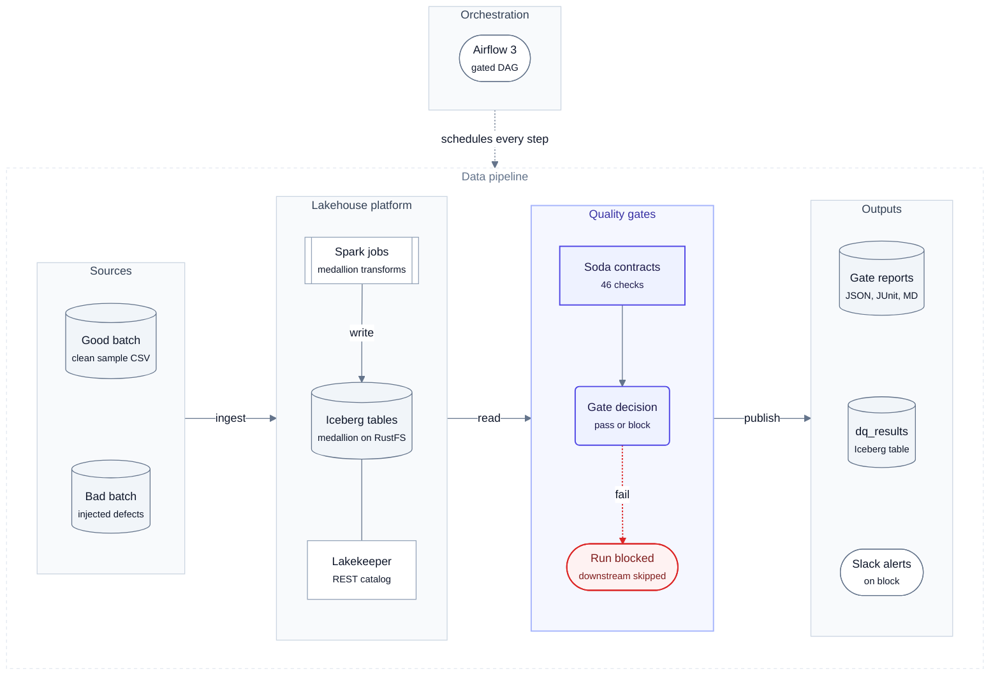
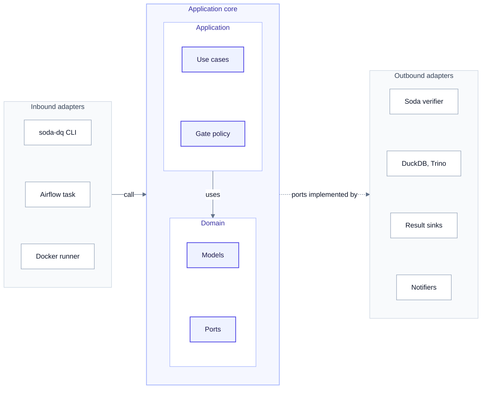
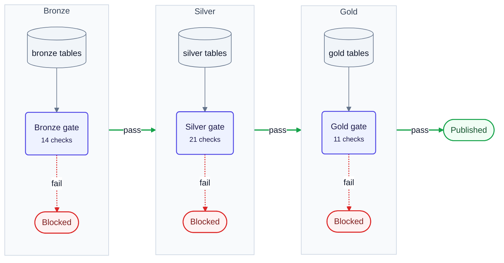
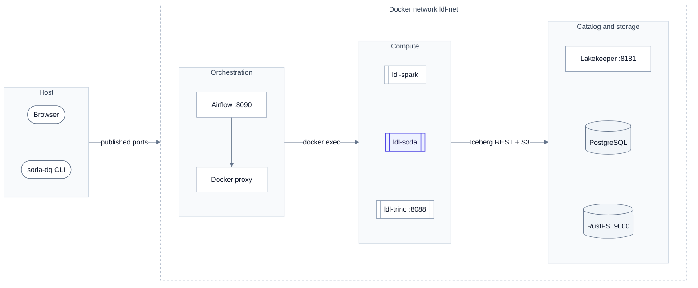

<div align="center">

# lakehouse-quality-gates

**Data contracts as quality gates for an open lakehouse: bad data never reaches gold.**

[Soda Core v4](https://docs.soda.io/) contracts run between bronze, silver and gold on Apache Iceberg,
using DuckDB or Trino, and are orchestrated by Airflow, for
[local-data-lakehouse](https://github.com/santoshshinde2012/local-data-lakehouse).

[](https://github.com/santoshshinde2012/lakehouse-quality-gates/actions/workflows/ci.yml)
[](https://github.com/santoshshinde2012/lakehouse-quality-gates/releases/tag/v0.3.0)
[](https://www.python.org/)
[](LICENSE)
[](https://github.com/astral-sh/ruff)
[](https://mypy-lang.org/)
[](docs/results/README.md)
[](https://docs.soda.io/)

[Why](#why) · [Features](#key-features) · [Architecture](#architecture) · [Quickstart](#quickstart) ·
[Usage](#usage) · [Configuration](#configuration) · [Results](#verified-results) · [Benchmarks](#benchmarks) · [Docs](#documentation) · [Roadmap](#roadmap)

</div>

---

## Why

**The problem.** In a medallion lakehouse, every layer trusts the one before it. A duplicated order, an
orphan customer id or a negative amount that lands in bronze is faithfully transformed into silver and
aggregated into gold, and the dashboards are wrong before anyone notices. Checks that run *after*
publishing only tell you about the damage.

**The solution.** Put a **gate** between the layers. Each layer has a declarative
[Soda data contract](docs/contracts.md) covering schema, completeness, validity, uniqueness, freshness,
referential integrity and reconciliation. The gate runs right after the layer is built. If the contract
fails, the Airflow task fails and the next layer is never built from bad data. Warnings are recorded but
do not block.

## Key features

- 🛡️ **5 contracts, 46 checks** over the retail medallion: schema, row count, freshness, missing,
  invalid (sets, regex, ranges, referential integrity), duplicate, `failed_rows` and a silver-to-gold
  `metric` reconciliation.
- ⚙️ **Three engines, one set of contracts.** DuckDB attaches to the Lakekeeper Iceberg REST catalog
  (default). Trino 483 is optional. `duckdb-local` builds the same medallion from CSV files with no Docker.
- 🚦 **Explicit gate policy.** A failure, an execution error or an unevaluated check blocks. A warning is
  logged. `DQ_FAIL_ON_WARN=true` makes warnings block too.
- 🧾 **Reports and alerts.** JSON, JUnit XML and Markdown for every run, an optional Iceberg table
  `ops.dq_results`, console output, and Slack alerts on problems.
- 🌀 **Airflow-native.** A gated DAG, `lakehouse_retail_medallion_dq`, sits next to the lakehouse's original
  DAG, which is left untouched. An `inject_bad_batch` switch shows a gate blocking for real.
- 🐳 **Hardened runner container.** Non-root, read-only root filesystem, `cap_drop: ALL`, digest-pinned base images.
- 🧱 **Clean architecture.** Ports and adapters with a single composition root. ruff, `mypy --strict`,
  100 tests at 99% coverage.

## Architecture

<!-- diagram:01-system-architecture -->

<!-- /diagram -->

Spark jobs build the bronze, silver and gold Iceberg tables. After each layer, **lakehouse-quality-gates**
reads the tables, runs that layer's Soda contracts and decides whether to pass or block. A pass promotes the
data; a block fails the Airflow task, so nothing downstream runs, and raises a Slack alert. Every run
writes JSON, JUnit and Markdown reports, plus an optional `dq_results` Iceberg table.

<details>
<summary><b>Code architecture (hexagonal)</b></summary>

<!-- diagram:02-code-architecture -->

<!-- /diagram -->

| Zone | Contents (real names) |
|---|---|
| Inbound adapters | `soda-dq` Typer CLI (`cli.py`), the Airflow DAG `lakehouse_retail_medallion_dq`, the Docker runner `ldl-soda`. `container.py` (`build_container`) is the single composition root that wires the adapters into the use cases |
| Application | `RunMedallionUseCase`, `VerifyLayerUseCase`, `GatePolicy` → `GateDecision`, `raise_if_blocked` |
| Domain | Models: `Layer`, `Outcome`, `GateStatus`, `ContractSpec`, `CheckResult`, `ContractResult`, `GateReport`. Ports (`Protocol`): `ContractRepository`, `ContractVerifier`, `ResultSink`, `Notifier`, `Clock`. Errors: `DataQualityError` and subclasses. Standard library only |
| Outbound adapters | `SodaContractVerifier` with `DuckDBProvider` / `TrinoProvider`, `FileContractRepository`, sinks (`JsonFileSink`, `JUnitXmlSink`, `MarkdownSink`, `IcebergSink`), notifiers (`ConsoleNotifier`, `SlackWebhookNotifier`), `SystemClock` |

Dependencies point inward: the domain imports only the standard library, and the application never imports
Soda, DuckDB or Slack. More in [docs/architecture.md](docs/architecture.md).
</details>

### Medallion flow with quality gates

<!-- diagram:03-medallion-flow -->

<!-- /diagram -->

### Deployment

<!-- diagram:04-deployment -->

<!-- /diagram -->

More views are in **[docs/architecture.md](docs/architecture.md)**: gate run sequence, Airflow DAG, and
domain model and ports. Every diagram is native Mermaid; the sources and the theme are in
[`docs/diagrams/`](docs/diagrams/) ([THEME.md](docs/diagrams/THEME.md)). Edit a `.mmd` file, then run
`make diagrams`.

## Quickstart

No Docker is needed. Requires [uv](https://docs.astral.sh/uv/) and takes about a minute:

```bash
git clone https://github.com/santoshshinde2012/lakehouse-quality-gates.git && cd lakehouse-quality-gates
uv sync --all-extras            # Python 3.12 venv: Soda Core 4.26.0, DuckDB 1.5.6, dev tools
make validate                   # Soda parses every contract
make demo                       # good batch: all gates pass; bad batch: every gate blocks
open reports/*_retail_silver.md # what was caught, and why (use xdg-open on Linux)
```

<details>
<summary><b>Against the running lakehouse (DuckDB, Trino)</b></summary>

```bash
cp .env.example .env                             # set DQ_LDL_REPO_PATH to your local-data-lakehouse checkout
export DQ_LDL_REPO_PATH=../local-data-lakehouse  # same path, for the next line
(cd "$DQ_LDL_REPO_PATH" && make up-light && make demo-light)   # tables exist in Lakekeeper
DQ_ENGINE=duckdb uv run soda-dq run                            # host DuckDB -> Iceberg REST
# Trino (lakehouse: make up-full TRINO=1):
DQ_ENGINE=trino uv run soda-dq run
```
</details>

<details>
<summary><b>Docker runner and Airflow</b></summary>

```bash
(cd "$DQ_LDL_REPO_PATH" && make up-full)
make dq-up                                  # build lakehouse-quality-gates:0.2.3, start ldl-soda on ldl-net
make airflow-dq-up AIRFLOW_API_PORT=8090    # lakehouse Airflow + the gated DAG (default port 8080)
make airflow-dq-trigger                     # good data: every task succeeds
make airflow-dq-trigger-bad                 # inject_bad_batch: dq_bronze fails, downstream is upstream_failed
make dq-down && make airflow-dq-down        # stop; volumes are kept
```
</details>

## Usage

| Command | What it does |
|---|---|
| `soda-dq verify <layer> [-e ENGINE] [-p PIPELINE] [-s K=V]` | Gate one layer (`bronze`, `silver`, `gold`). Exit **0** passed, **1** blocked, **2** configuration error |
| `soda-dq run [-e ENGINE] [-p PIPELINE]` | Gate bronze → silver → gold, stopping at the first blocked layer |
| `soda-dq validate [-p PIPELINE]` | Check the syntax of every contract with Soda, without touching data |
| `soda-dq list [-e ENGINE]` | List contracts and their rendered dataset names |
| `soda-dq seed SAMPLE_DIR --yes` | Demo only: rebuild the live retail Iceberg tables from a CSV batch, e.g. `fixtures/bad_batch` |

`ENGINE` is `duckdb`, `duckdb-local` or `trino`. `--sample-dir` points `duckdb-local` at another CSV batch.
Run `make help` to list every Makefile target.

## Configuration

All settings are environment variables with the `DQ_` prefix (or entries in `.env`), validated by
pydantic-settings in [`settings.py`](src/soda_lakehouse_dq/settings.py).

| Variable | Default | Purpose |
|---|---|---|
| `DQ_ENGINE` | `duckdb` | `duckdb` (Lakekeeper via DuckDB), `duckdb-local` (CSV, no Docker), `trino` |
| `DQ_LDL_REPO_PATH` | `../local-data-lakehouse` | Checkout of local-data-lakehouse (its `lakehouse_client` is reused) |
| `DQ_LAKEKEEPER_URL` | `http://localhost:8181` | Iceberg REST catalog |
| `DQ_LAKEKEEPER_WAREHOUSE` | `lakehouse` | Lakekeeper warehouse |
| `DQ_CATALOG_ALIAS` | `lakehouse` | DuckDB alias for the attached catalog |
| `DQ_TRINO_HOST` / `DQ_TRINO_PORT` | `localhost` / `8088` | Trino coordinator |
| `DQ_FAIL_ON_WARN` | `false` | Make warnings block |
| `DQ_ALLOW_NOT_EVALUATED` | `false` | Let unevaluated checks pass |
| `DQ_SINKS` | `["json","junit","markdown"]` | Report formats written to `DQ_REPORTS_DIR` |
| `DQ_ICEBERG_SINK` | `false` | Also append results to Iceberg `ops.dq_results` |
| `DQ_SLACK_WEBHOOK_URL` | unset | Slack incoming webhook (HTTPS only, stored as a secret) |
| `DQ_SLACK_ONLY_ON_PROBLEMS` | `true` | Skip Slack for clean passes |
| `DQ_LOG_JSON` / `DQ_LOG_LEVEL` | `false` / `INFO` | structlog output |
| `DQ_DUCKDB_HTTPFS_CLIENT` | unset | `httplib` inside containers (DNS for `*.localhost`) |
| `DQ_DUCKDB_TEMP_DIRECTORY` | unset | Writable spill directory, e.g. `/tmp/duckdb` on a read-only root filesystem |
| `DQ_CONTRACTS_DIR`, `DQ_DATASOURCES_DIR`, `DQ_REPORTS_DIR`, `DQ_SAMPLE_DIR` | project folders | Path overrides |
| `AIRFLOW_API_PORT` (Makefile) | `8080` | Airflow UI/API host port |

## Contracts

Contracts are plain Soda v4 YAML. `{{ dataset_root }}` is rendered per engine. Here is an excerpt of
[`contracts/retail/silver/orders.yml`](contracts/retail/silver/orders.yml):

```yaml
dataset: "{{ dataset_root }}/silver/orders"

checks:
  - schema:
      name: Silver orders schema is unchanged
  - failed_rows:
      name: No order timestamped in the future
      expression: order_ts > CURRENT_TIMESTAMP

columns:
  - name: customer_id
    data_type: varchar
    checks:
      - missing:
          name: Customer id present
      - invalid:
          name: Customer exists in silver.customers
          valid_reference_data:
            dataset: "{{ dataset_root }}/silver/customers"
            column: customer_id
```

[docs/contracts.md](docs/contracts.md) explains every check and why it sits in its layer.

## Project structure

```text
contracts/retail/{bronze,silver,gold}/*.yml   Soda v4 data contracts
datasources/trino.yml                         Soda data source for Trino
src/soda_lakehouse_dq/
├── domain/        models, ports (Protocols), errors (stdlib only)
├── application/   GatePolicy, VerifyLayerUseCase, RunMedallionUseCase
├── adapters/      Soda verifier, DuckDB/Trino providers, contracts, sinks, notifiers
├── container.py   composition root
├── cli.py         Typer CLI (soda-dq)
└── settings.py    pydantic-settings (DQ_*)
airflow/dags/      lakehouse_retail_medallion_dq.py, dq_operators.py
docker/            Dockerfile, docker-compose.dq.yml, docker-compose.airflow-dq.yml
fixtures/          good_batch, bad_batch (injected defects)
tests/             unit (fakes for every port) + integration (real Soda on DuckDB)
benchmarks/        perf, accuracy, Spark reference and tool-comparison harnesses (make bench*)
scripts/           gen_scale_data.py (scale + defect generator), diagrams.py (Mermaid sync)
docs/              system design, architecture, design principles, contracts, runbook, ADRs, results, research
```

> **Names.** The repository and distribution are `lakehouse-quality-gates`, the CLI is `soda-dq`, and the
> import package is `soda_lakehouse_dq` (kept to avoid churn). The Docker image is
> `lakehouse-quality-gates:<version>`.

## Design principles

The code is split into ports and adapters. The **domain** has no third-party imports, the
**application** layer orchestrates through `Protocol` ports, **adapters** wrap Soda, DuckDB, Trino, the file
system and Slack, and `container.py` is the only place that wires concrete classes together. Each SOLID
principle is mapped to real classes in **[docs/design-principles.md](docs/design-principles.md)**, and the
decisions are recorded as [ADRs](docs/adr/).

## Verified results

Verified end to end on macOS on 2026-10-13. Every log and report is in **[docs/results](docs/results/README.md)**.

| Check | Result |
|---|---|
| ruff · mypy --strict | ✅ clean |
| pytest | ✅ 100 passed, 99% coverage |
| Contracts (`soda-dq validate`) | ✅ 5/5 |
| Good / bad batch (no Docker) | ✅ 3/3 gates passed / 3/3 blocked |
| Live DuckDB → Lakekeeper Iceberg | ✅ 46/46 passed · bad batch blocked |
| Trino 483 | ✅ 46/46 passed · bad batch blocked |
| Docker `ldl-soda` (non-root, read-only) | ✅ good passed · bad blocked |
| Airflow DAG | ✅ good: 9/9 tasks succeeded · bad: `dq_bronze` failed, downstream `upstream_failed` |

## Benchmarks

Measured on an Apple M1 Pro (16 GiB, Docker VM 8 GiB) against the live Iceberg lakehouse with generated
batches of 10k to 5M orders, 1 cold + 5 warm runs per cell. Full method, variance and caveats:
**[System design §12](docs/system-design.md#12-benchmarks-and-performance-analysis)**; raw data and tables:
[docs/results/benchmarks](docs/results/benchmarks/summary.md).

| Question | Result |
|---|---|
| Gate latency (host DuckDB, warm p50 per layer) | 0.4–0.6 s up to 1M orders · 0.5–2.0 s at 5M |
| Cost next to the Spark jobs (lakehouse sample) | 4–5 % of each layer's `spark-submit` time |
| Peak memory at 5M orders | ≤ 780 MiB (container), 684 MiB (host) |
| Detection (7 defect types × 0.1/1/10 % + clean) | 66/66 verdicts correct · precision 1.0 · recall 1.0 · counts exact |
| Trino at 5M with the default 1 GiB heap | ⚠ checks run out of memory, so the gate blocks (fail closed) |
| Same six checks at 1M rows | Soda 0.44 s · Pointblank 0.47 s · datacontract-cli 1.08 s · Pandera 2.83 s · GX 11.5 s (all correct) |

Reproduce with `make bench`, `make bench-accuracy`, `make bench-spark`, `make bench-tools` and
`make bench-report` (they overwrite the live retail tables; see [benchmarks/README.md](benchmarks/README.md)).

## Documentation

| Doc | Contents |
|---|---|
| [System design](docs/system-design.md) | End-to-end design document: requirements and SLOs, architecture, failure modes, measured benchmarks, capacity, WAP roadmap |
| [Benchmarks](docs/results/benchmarks/summary.md) | Raw CSV/JSON and summary tables (latency, resources, accuracy, tool comparison) |
| [Research](docs/research/quality-gates-landscape.md) | Quality-gate tool landscape, scoring matrix and the recommendation |
| [Architecture](docs/architecture.md) | Seven diagrams: context, containers, medallion gates, sequence, DAG, deployment, classes |
| [Design principles](docs/design-principles.md) | SOLID mapped to classes, plus typing, errors, logging, config and security |
| [Use case](docs/use-case.md) | The retail scenario end to end |
| [Contracts](docs/contracts.md) | Every check, its layer and its rationale |
| [Runbook](docs/runbook.md) | Daily operation, gate triage, the verified macOS walkthrough, troubleshooting |
| [ADRs](docs/adr/) | Licence, DuckDB cursor reuse, dataset token, separate DAG, ports and adapters |
| [Results](docs/results/README.md) | Verification artefacts |
| [Changelog](CHANGELOG.md) | Release history |

## Roadmap

- [ ] **Write-Audit-Publish with Iceberg branches.** Write each layer to an audit branch, gate it, then
  fast-forward `main`, so readers never see unaudited snapshots. Designed in
  [system design §17](docs/system-design.md#17-roadmap-write-audit-publish); publish must run on Spark
  because Trino 483 cannot create or fast-forward branches.
- [ ] Gate the lakehouse's second pipeline (renewal features).
- [ ] OpenLineage events from gate runs, so quality is visible next to lineage.
- [ ] Contract drift checks in CI against the live schema.
- [ ] Dashboard over `ops.dq_results` (trend of failures per check).

## Contributing

Contributions are welcome. See [CONTRIBUTING.md](CONTRIBUTING.md). In short: `uv sync --all-extras && uv run pre-commit install`,
then make sure `make check validate demo` passes, which is exactly what CI runs.

## License

[MIT](LICENSE) © 2026 Santosh Shinde.

> Soda Core 4.x is **proprietary**: free to use, but not OSI-licensed. This project accepts that trade-off on
> purpose (see [ADR 0001](docs/adr/0001-soda-core-v4-proprietary-licence.md)). Soda Cloud is not used, and
> telemetry is switched off.

## Acknowledgements

Built on [Soda Core](https://github.com/sodadata/soda-core), [Apache Iceberg](https://iceberg.apache.org/),
[Lakekeeper](https://github.com/lakekeeper/lakekeeper), [DuckDB](https://duckdb.org/),
[Trino](https://trino.io/), [Apache Spark](https://spark.apache.org/), [Apache Airflow](https://airflow.apache.org/),
[RustFS](https://github.com/rustfs/rustfs) and [uv](https://github.com/astral-sh/uv). The README structure
takes cues from dbt, Great Expectations, Dagster and soda-core.
