# Architecture

Mermaid renders every diagram natively on GitHub. The sources (`.mmd`) and rendered SVGs live in [`diagrams/`](diagrams/).
Re-render with `npx -y @mermaid-js/mermaid-cli -i docs/diagrams/<name>.mmd -o docs/diagrams/<name>.svg -b transparent`.

**Palette** (it uses the `base` theme with explicit node colours, so it reads the same in GitHub light and dark mode):

| Colour | Meaning |
|---|---|
| 🟦 indigo | lakehouse platform and external systems |
| 🟦 sky | this project (soda-dq) and outputs |
| 🟪 violet | data stores |
| 🟩 green | quality gates and the happy path |
| 🟨 amber | sources |
| 🟪 fuchsia | orchestration |
| 🟥 red | failure paths |

## Layered reference architecture

[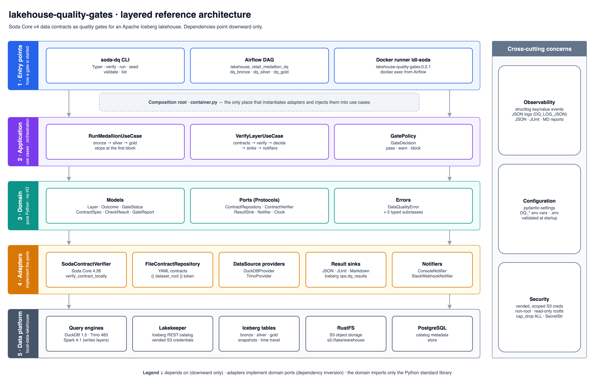](diagrams/drawio/layered-architecture.drawio)

| # | Layer | Contents (real names) | May depend on |
|---|---|---|---|
| 1 | **Entry points** | `soda-dq` Typer CLI (`cli.py`), Airflow DAG `lakehouse_retail_medallion_dq` (`airflow/dags/`), Docker runner `ldl-soda` | the application layer, through `container.py` |
| – | **Composition root** | `container.py`: `build_container`, `build_provider`, `build_sinks`, `build_notifiers` | every layer. It is the only place that instantiates adapters |
| 2 | **Application** | `RunMedallionUseCase`, `VerifyLayerUseCase`, `GatePolicy` → `GateDecision` | domain |
| 3 | **Domain** | models (`Layer`, `Outcome`, `GateStatus`, `ContractSpec`, `CheckResult`, `ContractResult`, `GateReport`), ports (`ContractRepository`, `ContractVerifier`, `ResultSink`, `Notifier`, `Clock`), errors (`DataQualityError` + subclasses) | the standard library only |
| 4 | **Adapters** | `SodaContractVerifier`, `FileContractRepository`, `DuckDBProvider` / `TrinoProvider`, sinks (`JsonFileSink`, `JUnitXmlSink`, `MarkdownSink`, `IcebergSink`), notifiers (`ConsoleNotifier`, `SlackWebhookNotifier`), `SystemClock` | domain (they implement its ports), plus third-party libraries |
| 5 | **Data platform** | local-data-lakehouse: DuckDB, Trino and Spark, the Lakekeeper REST catalog, Iceberg tables (bronze, silver, gold), RustFS (S3), PostgreSQL | none (external systems) |

**The dependency rule.** Source code only depends on layers below it, and the domain has no
third-party imports. The application layer never imports Soda, DuckDB or Slack: it receives
`ContractVerifier`, `ResultSink` and the other ports through its constructor (dependency inversion), and
`container.py` passes in the concrete adapters. Three cross-cutting concerns span every layer:
**observability** (structlog events and reports), **configuration** (pydantic-settings, `DQ_*`) and
**security** (vended S3 credentials, a non-root read-only container, `SecretStr` for the Slack URL).

### Medallion flow with quality gates

[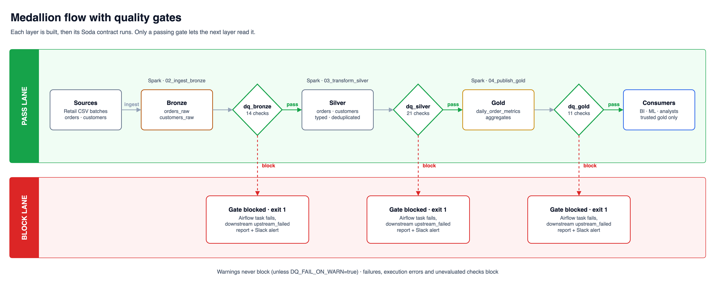](diagrams/drawio/medallion-flow.drawio)

### Deployment

[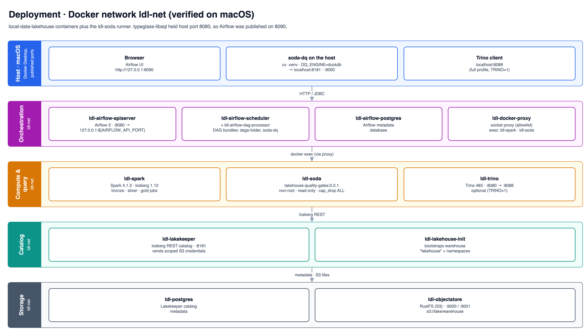](diagrams/drawio/deployment.drawio)

The three draw.io diagrams (`diagrams/drawio/*.drawio`) are generated by [`diagrams/src/build_drawio.py`](diagrams/src/build_drawio.py) and exported with `make diagrams`. The PNGs embed the diagram, so they stay editable in draw.io.

## 1. C4 level 1: System context

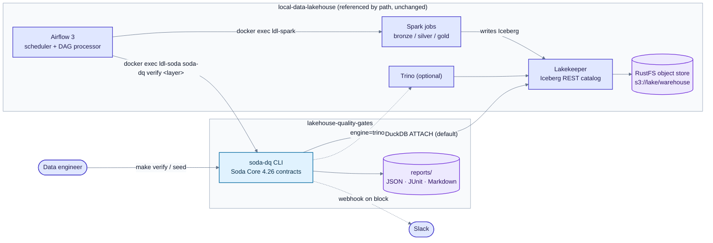

SVG: [01-system-context.svg](diagrams/01-system-context.svg)

## 2. C4 level 2/3: Containers and components (ports and adapters)

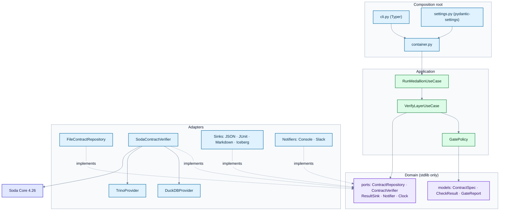

SVG: [02-components.svg](diagrams/02-components.svg)

## 3. Medallion data flow with quality gates

```mermaid
%%{init: {"theme": "base", "themeVariables": {"fontFamily": "Inter, Segoe UI, Helvetica, Arial, sans-serif", "lineColor": "#64748b", "primaryTextColor": "#0f172a", "primaryColor": "#e0e7ff", "primaryBorderColor": "#4338ca", "secondaryColor": "#dcfce7", "tertiaryColor": "#f8fafc", "edgeLabelBackground": "#f8fafc", "actorBkg": "#e0e7ff", "actorBorder": "#4338ca", "noteBkgColor": "#fef3c7", "noteBorderColor": "#b45309", "signalColor": "#334155", "signalTextColor": "#0f172a"}}}%%
flowchart LR
  SRC[("Sample CSV / bad batch")]:::store
  B["bronze.orders<br/>bronze.customers"]:::store
  GB{"Bronze gate<br/>14 checks"}:::gate
  S["silver.orders<br/>silver.customers"]:::store
  GS{"Silver gate<br/>21 checks"}:::gate
  G["gold.daily_order_metrics"]:::store
  GG{"Gold gate<br/>11 checks"}:::gate
  OK(["Published for BI"]):::gate
  X(["Task fails · Slack alert<br/>downstream not run"]):::fail
  SRC -- ingest --> B --> GB
  GB -- pass --> S --> GS
  GS -- pass --> G --> GG
  GG -- pass --> OK
  GB -- fail --> X
  GS -- fail --> X
  GG -- fail --> X
  classDef ext fill:#e0e7ff,stroke:#4338ca,stroke-width:1.5px,color:#1e1b4b
  classDef dq fill:#e0f2fe,stroke:#0369a1,stroke-width:1.5px,color:#082f49
  classDef store fill:#ede9fe,stroke:#6d28d9,stroke-width:1.5px,color:#2e1065
  classDef gate fill:#dcfce7,stroke:#15803d,stroke-width:1.5px,color:#052e16
  classDef fail fill:#fee2e2,stroke:#b91c1c,stroke-width:1.5px,color:#450a0a
```

SVG: [03-medallion-flow.svg](diagrams/03-medallion-flow.svg)

## 4. Gate run sequence

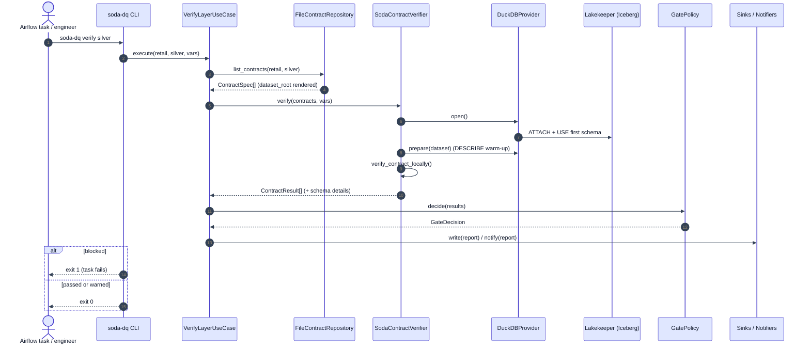

SVG: [04-gate-sequence.svg](diagrams/04-gate-sequence.svg)

## 5. Airflow DAG `lakehouse_retail_medallion_dq`

```mermaid
%%{init: {"theme": "base", "themeVariables": {"fontFamily": "Inter, Segoe UI, Helvetica, Arial, sans-serif", "lineColor": "#64748b", "primaryTextColor": "#0f172a", "primaryColor": "#e0e7ff", "primaryBorderColor": "#4338ca", "secondaryColor": "#dcfce7", "tertiaryColor": "#f8fafc", "edgeLabelBackground": "#f8fafc", "actorBkg": "#e0e7ff", "actorBorder": "#4338ca", "noteBkgColor": "#fef3c7", "noteBorderColor": "#b45309", "signalColor": "#334155", "signalTextColor": "#0f172a"}}}%%
flowchart LR
  ST["land_smoke<br/>(ldl-spark)"]:::ext
  BR["bronze"]:::ext
  IN["inject_bad_batch<br/>no-op unless conf flag"]:::dq
  DB{"dq_bronze<br/>(ldl-soda)"}:::gate
  SI["silver"]:::ext
  DS{"dq_silver"}:::gate
  GO["gold"]:::ext
  DG{"dq_gold"}:::gate
  EN["query_timetravel"]:::gate
  FX(["DAG run failed<br/>downstream: upstream_failed"]):::fail
  ST --> BR --> IN --> DB -->|exit 0| SI --> DS -->|exit 0| GO --> DG -->|exit 0| EN
  DB -->|exit 1| FX
  DS -->|exit 1| FX
  DG -->|exit 1| FX
  classDef ext fill:#e0e7ff,stroke:#4338ca,stroke-width:1.5px,color:#1e1b4b
  classDef dq fill:#e0f2fe,stroke:#0369a1,stroke-width:1.5px,color:#082f49
  classDef store fill:#ede9fe,stroke:#6d28d9,stroke-width:1.5px,color:#2e1065
  classDef gate fill:#dcfce7,stroke:#15803d,stroke-width:1.5px,color:#052e16
  classDef fail fill:#fee2e2,stroke:#b91c1c,stroke-width:1.5px,color:#450a0a
```

SVG: [05-airflow-dag.svg](diagrams/05-airflow-dag.svg)

## 6. Deployment: Docker network `ldl-net`, ports verified on macOS

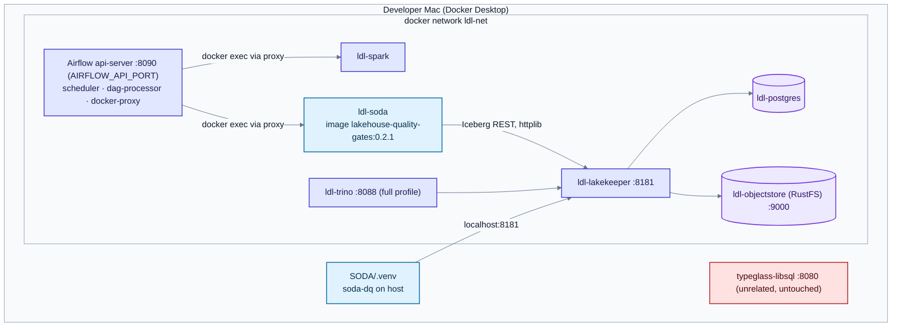

SVG: [06-deployment.svg](diagrams/06-deployment.svg)

## 7. Domain model and ports

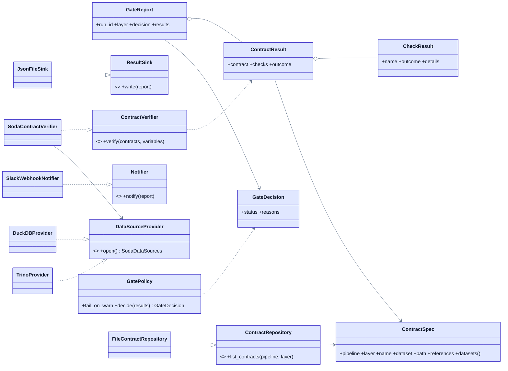

SVG: [07-domain-classes.svg](diagrams/07-domain-classes.svg)

## Layering rules

| Layer | Package | May import |
|---|---|---|
| Domain | `domain/` (models, ports, errors) | stdlib only |
| Application | `application/` | domain, structlog |
| Adapters | `adapters/` | domain, Soda, DuckDB, PyYAML, PyIceberg (lazily) |
| Composition | `container.py`, `cli.py`, `settings.py` | everything. This is the only place that instantiates concrete classes |

How SOLID applies here:
- **S**ingle responsibility. The policy decides, the use case orchestrates, sinks persist, notifiers
  notify, the verifier only translates between Soda and the domain, and the repository only renders
  contracts.
- **O**pen/closed. A new sink, notifier or engine is a new adapter plus one line in `container.py`. The
  use cases don't change.
- **L**iskov. Every fake in `tests/conftest.py` stands in for its real adapter, and `isinstance`
  checks against the `runtime_checkable` ports confirm the shapes match.
- **I**nterface segregation. Each port has one method; no adapter implements methods it doesn't use.
- **D**ependency inversion. The application depends on `Protocol`s, and Soda types never leave
  `adapters/soda_verifier.py`.

## One gate, step by step

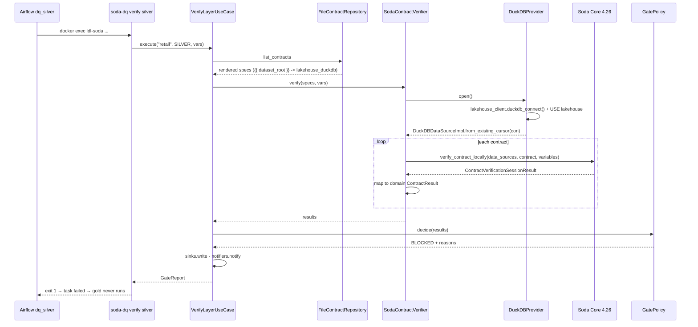

## Engines

| `DQ_ENGINE` | Data source | Dataset name | When to use |
|---|---|---|---|
| `duckdb` (default) | `lakehouse_client.duckdb_connect()` → Lakekeeper, Soda `from_existing_cursor` | `lakehouse_duckdb/<schema>/<table>` | Light or full profile. No JVM |
| `duckdb-local` | In-memory DuckDB built from CSVs by the same SQL as `sql/retail/*.sql` | same | CI, demos, writing contracts |
| `trino` | `datasources/trino.yml` (soda-trino) | `lakehouse_trino/lakehouse/<schema>/<table>` | Full profile with `TRINO=1` |

Soda's DuckDB dialect has a single namespace level (the schema), so the provider runs `USE lakehouse`. After
that, `silver.orders` resolves inside the attached Iceberg catalog, and Soda's `information_schema` lookups
(used by the schema check) match on schema name. See ADR 0002.
