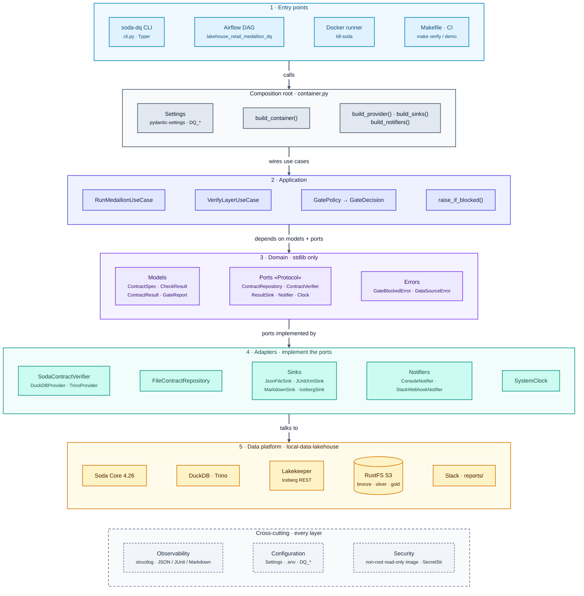
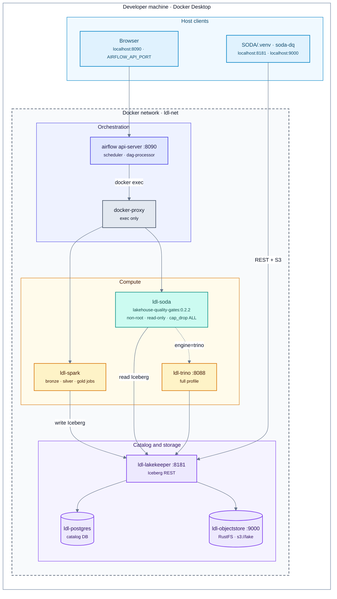
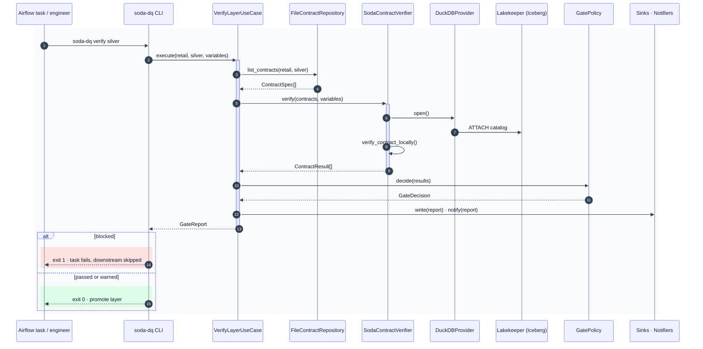
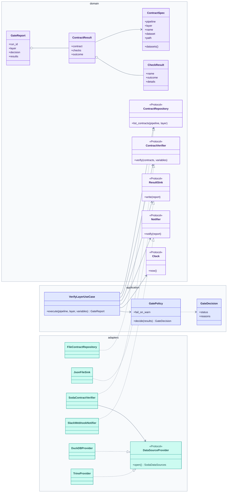
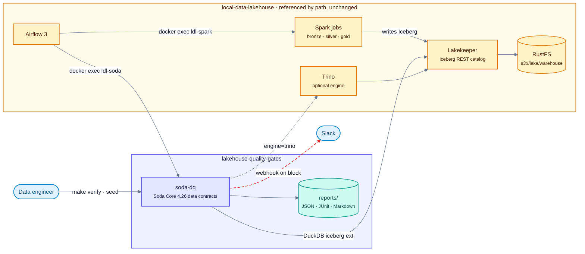

# Architecture

Every diagram here is a native Mermaid block that GitHub renders inline. The sources are in
[`diagrams/`](diagrams/) as `.mmd` files and share one theme, documented in
[diagrams/THEME.md](diagrams/THEME.md): one accent per layer (sky entry points, slate composition root,
indigo application, violet domain, teal adapters, amber data platform), green for pass and red for blocked.
Edit a source, then run `make diagrams` to sync the copies below; `make diagrams-check` catches drift.

## 1. Layered reference architecture

<!-- diagram:01-layered-architecture -->

<!-- /diagram -->

| # | Layer | Contents (real names) | May depend on |
|---|---|---|---|
| 1 | **Entry points** | `soda-dq` Typer CLI (`cli.py`), Airflow DAG `lakehouse_retail_medallion_dq` (`airflow/dags/`), Docker runner `ldl-soda` | the application layer, through `container.py` |
| – | **Composition root** | `container.py`: `build_container`, `build_provider`, `build_sinks`, `build_notifiers` | every layer. It is the only place that instantiates adapters |
| 2 | **Application** | `RunMedallionUseCase`, `VerifyLayerUseCase`, `GatePolicy` → `GateDecision` | domain |
| 3 | **Domain** | models (`Layer`, `Outcome`, `GateStatus`, `ContractSpec`, `CheckResult`, `ContractResult`, `GateReport`), ports (`ContractRepository`, `ContractVerifier`, `ResultSink`, `Notifier`, `Clock`), errors (`DataQualityError` + subclasses) | the standard library only |
| 4 | **Adapters** | `SodaContractVerifier`, `FileContractRepository`, `DuckDBProvider` / `TrinoProvider`, sinks (`JsonFileSink`, `JUnitXmlSink`, `MarkdownSink`, `IcebergSink`), notifiers (`ConsoleNotifier`, `SlackWebhookNotifier`), `SystemClock` | domain (they implement its ports), plus third-party libraries |
| 5 | **Data platform** | local-data-lakehouse: DuckDB, Trino and Spark, the Lakekeeper REST catalog, Iceberg tables (bronze, silver, gold), RustFS (S3), PostgreSQL | none (external systems) |

**The dependency rule.** Source code only depends on layers below it, and the domain has no
third-party imports. The application layer never imports Soda, DuckDB or Slack: it receives
`ContractVerifier`, `ResultSink` and the other ports through its constructor (dependency inversion), and
`container.py` passes in the concrete adapters. Three cross-cutting concerns span every layer:
**observability** (structlog events and reports), **configuration** (pydantic-settings, `DQ_*`) and
**security** (vended S3 credentials, a non-root read-only container, `SecretStr` for the Slack URL).

## 2. Medallion data flow with quality gates

```mermaid
%%{init: {'theme':'base','themeVariables':{'fontFamily':'Inter, system-ui, -apple-system, Segoe UI, Helvetica, Arial, sans-serif','fontSize':'14px','primaryColor':'#eef2ff','primaryTextColor':'#0f172a','primaryBorderColor':'#6366f1','secondaryColor':'#f1f5f9','secondaryTextColor':'#0f172a','secondaryBorderColor':'#94a3b8','tertiaryColor':'#f8fafc','tertiaryTextColor':'#0f172a','tertiaryBorderColor':'#cbd5e1','lineColor':'#64748b','textColor':'#0f172a','nodeTextColor':'#0f172a','titleColor':'#0f172a','clusterBkg':'#f8fafc','clusterBorder':'#94a3b8','edgeLabelBackground':'#ffffff','noteBkgColor':'#fef9c3','noteTextColor':'#422006','noteBorderColor':'#ca8a04','actorBkg':'#eef2ff','actorBorder':'#6366f1','actorTextColor':'#1e1b4b','actorLineColor':'#94a3b8','signalColor':'#334155','signalTextColor':'#0f172a','labelBoxBkgColor':'#eef2ff','labelBoxBorderColor':'#6366f1','labelTextColor':'#1e1b4b','loopTextColor':'#1e1b4b','activationBkgColor':'#e0e7ff','activationBorderColor':'#4f46e5','sequenceNumberColor':'#ffffff','classText':'#0f172a'}}}%%
flowchart LR
  SRC[("Raw CSV<br/><small>good or bad batch</small>")]:::platform
  subgraph BRZ["Bronze"]
    direction TB
    B["bronze.orders<br/>bronze.customers"]:::platform
    GB{{"Bronze gate<br/><small>14 checks</small>"}}:::app
  end
  subgraph SLV["Silver"]
    direction TB
    S["silver.orders<br/>silver.customers"]:::platform
    GS{{"Silver gate<br/><small>21 checks</small>"}}:::app
  end
  subgraph GLD["Gold"]
    direction TB
    G["gold.daily_order_metrics"]:::platform
    GG{{"Gold gate<br/><small>11 checks</small>"}}:::app
  end
  OK(["Published<br/><small>BI · time travel</small>"]):::pass
  X(["Blocked<br/><small>exit 1 · task fails · Slack alert<br/>downstream not run</small>"]):::fail
  SRC -->|ingest| B
  B --> GB
  GB -->|pass| S
  S --> GS
  GS -->|pass| G
  G --> GG
  GG -->|pass| OK
  GB -->|fail| X
  GS -->|fail| X
  GG -->|fail| X
  classDef entry fill:#e0f2fe,stroke:#0284c7,stroke-width:1.5px,color:#0c4a6e
  classDef root fill:#e2e8f0,stroke:#475569,stroke-width:1.5px,color:#0f172a
  classDef app fill:#e0e7ff,stroke:#4f46e5,stroke-width:1.5px,color:#1e1b4b
  classDef domain fill:#ede9fe,stroke:#7c3aed,stroke-width:1.5px,color:#2e1065
  classDef adapter fill:#ccfbf1,stroke:#0d9488,stroke-width:1.5px,color:#134e4a
  classDef platform fill:#fef3c7,stroke:#d97706,stroke-width:1.5px,color:#451a03
  classDef xcut fill:#f1f5f9,stroke:#64748b,stroke-width:1.5px,stroke-dasharray:4 3,color:#1e293b
  classDef pass fill:#dcfce7,stroke:#16a34a,stroke-width:1.5px,color:#14532d
  classDef fail fill:#fee2e2,stroke:#dc2626,stroke-width:2px,color:#7f1d1d
  style BRZ fill:#fdf4ec,stroke:#b45309,stroke-width:1.5px,color:#451a03
  style SLV fill:#f1f5f9,stroke:#64748b,stroke-width:1.5px,color:#0f172a
  style GLD fill:#fefce8,stroke:#ca8a04,stroke-width:1.5px,color:#422006
  linkStyle 2,4,6 stroke:#16a34a,stroke-width:2.5px
  linkStyle 7,8,9 stroke:#dc2626,stroke-width:2px,stroke-dasharray:6 4
```

<!-- diagram:02-medallion-flow -->

<!-- /diagram -->

## 3. Deployment: Docker network `ldl-net`

<!-- diagram:03-deployment -->

<!-- /diagram -->

Host ports were verified on macOS. Airflow's port is set by `AIRFLOW_API_PORT` (8090 in the runbook).

## 4. Gate run sequence

<!-- diagram:04-gate-sequence -->

<!-- /diagram -->

## 5. Airflow DAG `lakehouse_retail_medallion_dq`

```mermaid
%%{init: {'theme':'base','themeVariables':{'fontFamily':'Inter, system-ui, -apple-system, Segoe UI, Helvetica, Arial, sans-serif','fontSize':'14px','primaryColor':'#eef2ff','primaryTextColor':'#0f172a','primaryBorderColor':'#6366f1','secondaryColor':'#f1f5f9','secondaryTextColor':'#0f172a','secondaryBorderColor':'#94a3b8','tertiaryColor':'#f8fafc','tertiaryTextColor':'#0f172a','tertiaryBorderColor':'#cbd5e1','lineColor':'#64748b','textColor':'#0f172a','nodeTextColor':'#0f172a','titleColor':'#0f172a','clusterBkg':'#f8fafc','clusterBorder':'#94a3b8','edgeLabelBackground':'#ffffff','noteBkgColor':'#fef9c3','noteTextColor':'#422006','noteBorderColor':'#ca8a04','actorBkg':'#eef2ff','actorBorder':'#6366f1','actorTextColor':'#1e1b4b','actorLineColor':'#94a3b8','signalColor':'#334155','signalTextColor':'#0f172a','labelBoxBkgColor':'#eef2ff','labelBoxBorderColor':'#6366f1','labelTextColor':'#1e1b4b','loopTextColor':'#1e1b4b','activationBkgColor':'#e0e7ff','activationBorderColor':'#4f46e5','sequenceNumberColor':'#ffffff','classText':'#0f172a'}}}%%
flowchart LR
  ST["land_smoke<br/><small>ldl-spark</small>"]:::platform
  BR["bronze"]:::platform
  IN["inject_bad_batch<br/><small>no-op unless<br/>conf inject_bad_batch=true</small>"]:::xcut
  DB{{"dq_bronze<br/><small>ldl-soda</small>"}}:::app
  SI["silver"]:::platform
  DS{{"dq_silver"}}:::app
  GO["gold"]:::platform
  DG{{"dq_gold"}}:::app
  EN(["query_timetravel"]):::pass
  FX(["DAG run failed<br/><small>downstream: upstream_failed</small>"]):::fail
  ST --> BR
  BR --> IN
  IN --> DB
  DB -->|exit 0| SI
  SI --> DS
  DS -->|exit 0| GO
  GO --> DG
  DG -->|exit 0| EN
  DB -->|exit 1| FX
  DS -->|exit 1| FX
  DG -->|exit 1| FX
  classDef entry fill:#e0f2fe,stroke:#0284c7,stroke-width:1.5px,color:#0c4a6e
  classDef root fill:#e2e8f0,stroke:#475569,stroke-width:1.5px,color:#0f172a
  classDef app fill:#e0e7ff,stroke:#4f46e5,stroke-width:1.5px,color:#1e1b4b
  classDef domain fill:#ede9fe,stroke:#7c3aed,stroke-width:1.5px,color:#2e1065
  classDef adapter fill:#ccfbf1,stroke:#0d9488,stroke-width:1.5px,color:#134e4a
  classDef platform fill:#fef3c7,stroke:#d97706,stroke-width:1.5px,color:#451a03
  classDef xcut fill:#f1f5f9,stroke:#64748b,stroke-width:1.5px,stroke-dasharray:4 3,color:#1e293b
  classDef pass fill:#dcfce7,stroke:#16a34a,stroke-width:1.5px,color:#14532d
  classDef fail fill:#fee2e2,stroke:#dc2626,stroke-width:2px,color:#7f1d1d
  linkStyle 3,5,7 stroke:#16a34a,stroke-width:2.5px
  linkStyle 8,9,10 stroke:#dc2626,stroke-width:2px,stroke-dasharray:6 4
```

<!-- diagram:05-airflow-dag -->

<!-- /diagram -->

`inject_bad_batch` is a no-op unless the run is triggered with `{"inject_bad_batch": true}`
(`make airflow-dq-trigger-bad`); then `dq_bronze` exits 1 and every downstream task is `upstream_failed`.

## 6. Domain model and ports

<!-- diagram:06-domain-ports -->

<!-- /diagram -->

## 7. System context

<!-- diagram:07-system-context -->

<!-- /diagram -->

## Layering rules

| Layer | Package | May import |
|---|---|---|
| Domain | `domain/` (models, ports, errors) | stdlib only |
| Application | `application/` | domain, structlog |
| Adapters | `adapters/` | domain, Soda, DuckDB, PyYAML, PyIceberg (lazily) |
| Composition | `container.py`, `cli.py`, `settings.py` | everything. This is the only place that instantiates concrete classes |

How SOLID applies here:
- **S**ingle responsibility. The policy decides, the use case orchestrates, sinks persist, notifiers
  notify, the verifier only translates between Soda and the domain, and the repository only renders
  contracts.
- **O**pen/closed. A new sink, notifier or engine is a new adapter plus one line in `container.py`. The
  use cases don't change.
- **L**iskov. Every fake in `tests/conftest.py` stands in for its real adapter, and `isinstance`
  checks against the `runtime_checkable` ports confirm the shapes match.
- **I**nterface segregation. Each port has one method; no adapter implements methods it doesn't use.
- **D**ependency inversion. The application depends on `Protocol`s, and Soda types never leave
  `adapters/soda_verifier.py`.

## Engines

| `DQ_ENGINE` | Data source | Dataset name | When to use |
|---|---|---|---|
| `duckdb` (default) | `lakehouse_client.duckdb_connect()` → Lakekeeper, Soda `from_existing_cursor` | `lakehouse_duckdb/<schema>/<table>` | Light or full profile. No JVM |
| `duckdb-local` | In-memory DuckDB built from CSVs by the same SQL as `sql/retail/*.sql` | same | CI, demos, writing contracts |
| `trino` | `datasources/trino.yml` (soda-trino) | `lakehouse_trino/lakehouse/<schema>/<table>` | Full profile with `TRINO=1` |

Soda's DuckDB dialect has a single namespace level (the schema), so the provider runs `USE lakehouse`. After
that, `silver.orders` resolves inside the attached Iceberg catalog, and Soda's `information_schema` lookups
(used by the schema check) match on schema name. See ADR 0002.
