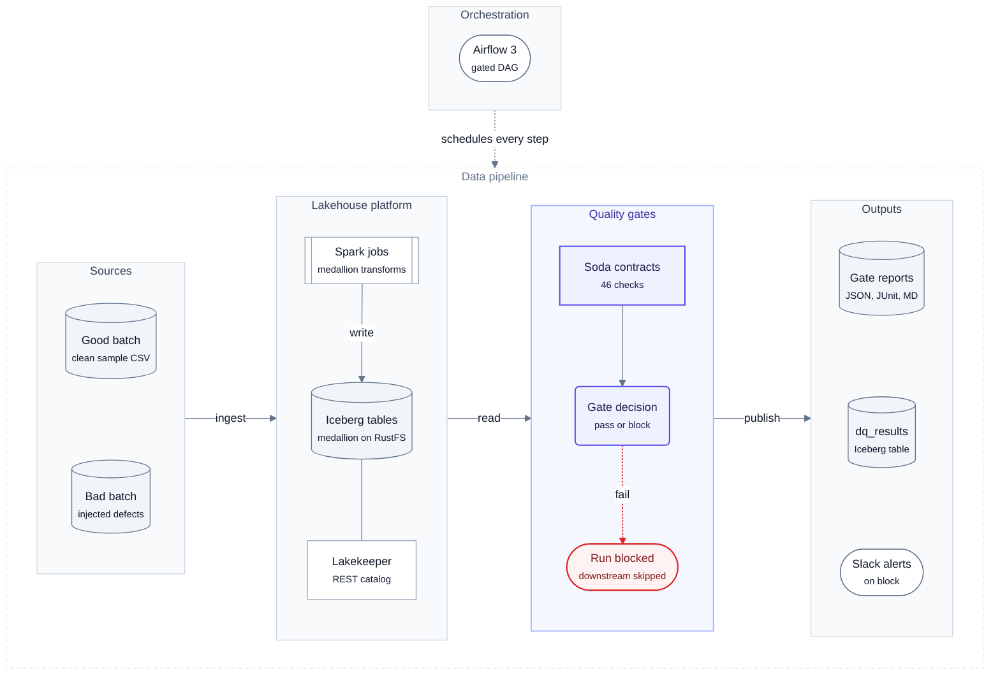
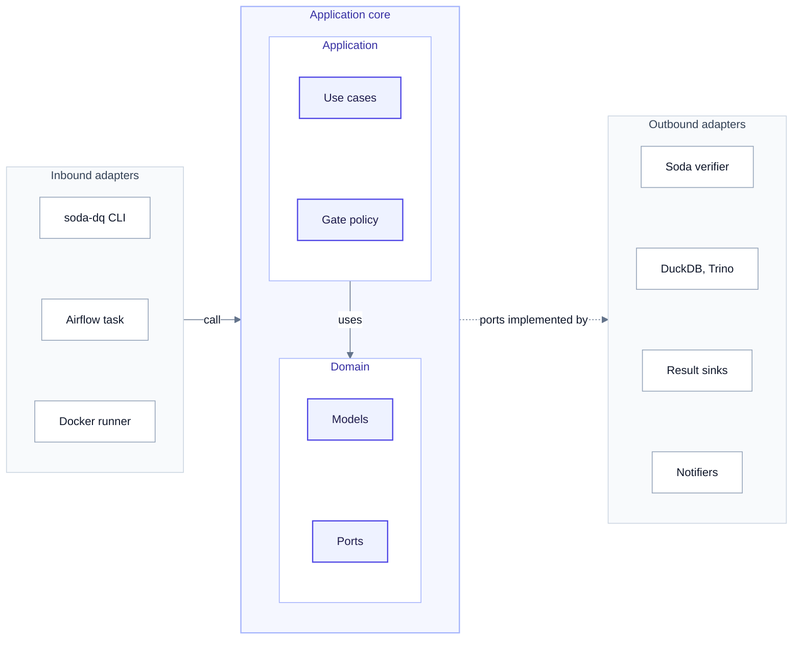
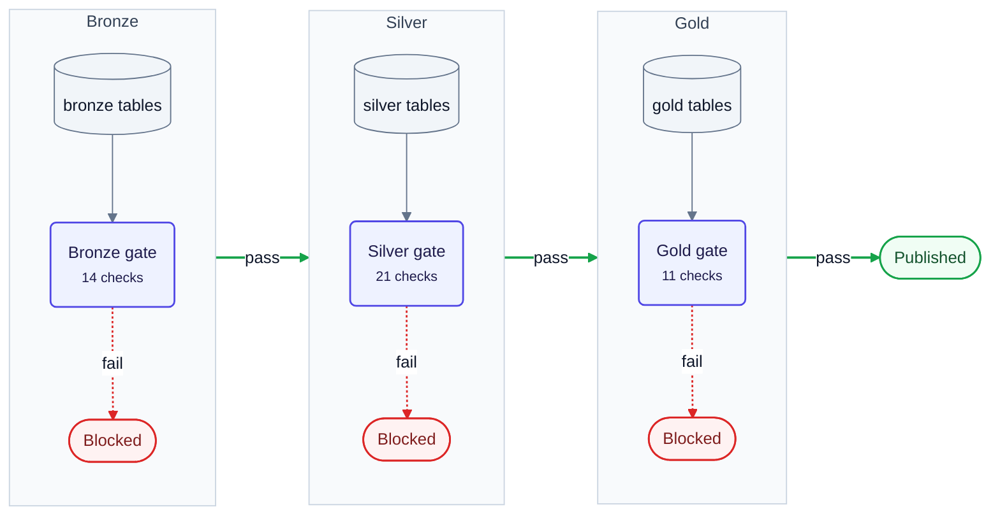
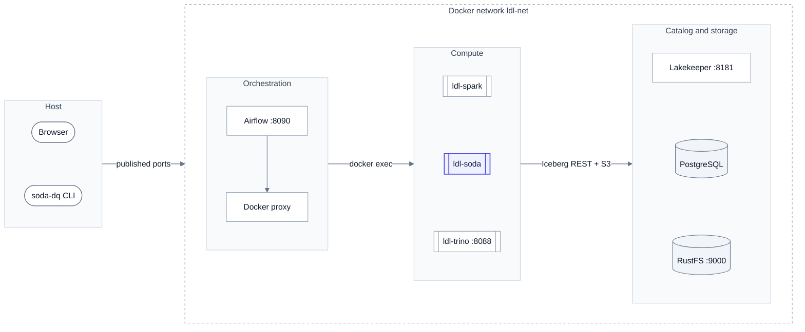
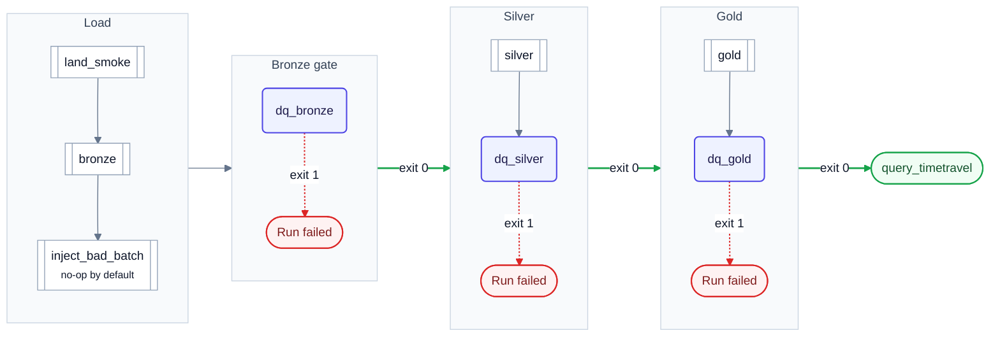
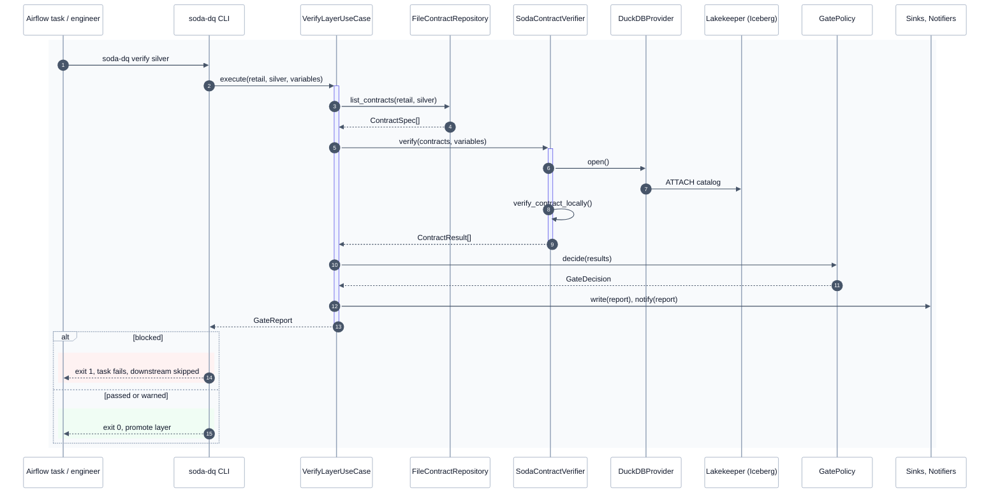
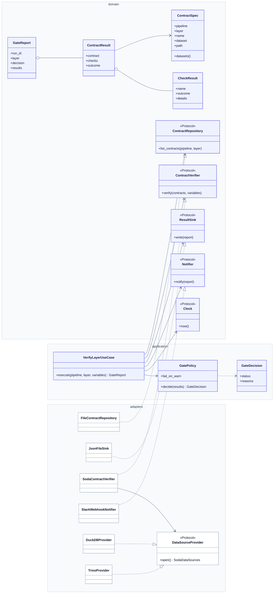

# Architecture

Every diagram here is a native Mermaid block that GitHub renders inline. The sources are `.mmd` files in
[`diagrams/`](diagrams/) and share one restrained theme, documented in [diagrams/THEME.md](diagrams/THEME.md):
light zones, indigo for this project, green for pass and red for blocked. Edit a source, then run
`make diagrams` to sync the copies below; `make diagrams-check` catches drift.

## 1. System architecture

<!-- diagram:01-system-architecture -->

<!-- /diagram -->

| Zone | What it is |
|---|---|
| Orchestration | Airflow 3 runs the gated DAG `lakehouse_retail_medallion_dq` (section 5) |
| Sources | `fixtures/good_batch` and `fixtures/bad_batch` CSVs, or the lakehouse's own sample data |
| Lakehouse platform | local-data-lakehouse: Spark jobs write Iceberg tables to RustFS (S3) through the Lakekeeper REST catalog (PostgreSQL-backed) |
| Quality gates | `soda-dq`: Soda Core 4.26 contracts (14 bronze, 21 silver and 11 gold checks), read through DuckDB or Trino, and `GatePolicy` decides pass or block |
| Outputs | JSON, JUnit and Markdown reports in `reports/`, the optional `ops.dq_results` Iceberg table, Slack alerts on block |

## 2. Code architecture (hexagonal)

<!-- diagram:02-code-architecture -->

<!-- /diagram -->

| Zone | Contents (real names) |
|---|---|
| Inbound adapters | `soda-dq` Typer CLI (`cli.py`), the Airflow DAG `lakehouse_retail_medallion_dq`, the Docker runner `ldl-soda`. `container.py` (`build_container`) is the single composition root that wires the adapters into the use cases |
| Application | `RunMedallionUseCase`, `VerifyLayerUseCase`, `GatePolicy` → `GateDecision`, `raise_if_blocked` |
| Domain | Models: `Layer`, `Outcome`, `GateStatus`, `ContractSpec`, `CheckResult`, `ContractResult`, `GateReport`. Ports (`Protocol`): `ContractRepository`, `ContractVerifier`, `ResultSink`, `Notifier`, `Clock`. Errors: `DataQualityError` and subclasses. Standard library only |
| Outbound adapters | `SodaContractVerifier` with `DuckDBProvider` / `TrinoProvider`, `FileContractRepository`, sinks (`JsonFileSink`, `JUnitXmlSink`, `MarkdownSink`, `IcebergSink`), notifiers (`ConsoleNotifier`, `SlackWebhookNotifier`), `SystemClock` |

**The dependency rule.** Dependencies point inward. The domain has no third-party imports. The application
receives `ContractVerifier`, `ResultSink` and the other ports through its constructor (dependency inversion),
and `container.py` passes in the concrete adapters. Three cross-cutting concerns span every layer:
**observability** (structlog events and reports), **configuration** (pydantic-settings, `DQ_*`) and
**security** (vended S3 credentials, a non-root read-only container, `SecretStr` for the Slack URL).

## 3. Medallion flow with quality gates

<!-- diagram:03-medallion-flow -->

<!-- /diagram -->

## 4. Deployment: Docker network `ldl-net`

<!-- diagram:04-deployment -->

<!-- /diagram -->

| Container | Host port | Role |
|---|---|---|
| Airflow api-server, scheduler, dag-processor, docker-proxy | 8090 (`AIRFLOW_API_PORT`) | Runs the DAG; `docker exec` goes through the proxy |
| `ldl-spark` | n/a | bronze, silver and gold jobs |
| `ldl-soda` | n/a | `lakehouse-quality-gates:0.2.3`: non-root, read-only root filesystem, `cap_drop: ALL` |
| `ldl-trino` | 8088 | Optional engine (full profile) |
| `ldl-lakekeeper` | 8181 | Iceberg REST catalog |
| `ldl-postgres` | n/a | Catalog database |
| `ldl-objectstore` | 9000 | RustFS, `s3://lake/warehouse` |

## 5. Airflow DAG `lakehouse_retail_medallion_dq`

<!-- diagram:06-airflow-dag -->

<!-- /diagram -->

`inject_bad_batch` is a no-op unless the run is triggered with `{"inject_bad_batch": true}`
(`make airflow-dq-trigger-bad`). Then `dq_bronze` exits 1 and every downstream task is `upstream_failed`.

## 6. Gate run sequence

<!-- diagram:05-gate-sequence -->

<!-- /diagram -->

## 7. Domain model and ports

<!-- diagram:07-domain-ports -->

<!-- /diagram -->

## Layering rules

| Layer | Package | May import |
|---|---|---|
| Domain | `domain/` (models, ports, errors) | stdlib only |
| Application | `application/` | domain, structlog |
| Adapters | `adapters/` | domain, Soda, DuckDB, PyYAML, PyIceberg (lazily) |
| Composition | `container.py`, `cli.py`, `settings.py` | everything. This is the only place that instantiates concrete classes |

How SOLID applies here:
- **S**ingle responsibility. The policy decides, the use case orchestrates, sinks persist, notifiers
  notify, the verifier only translates between Soda and the domain, and the repository only renders
  contracts.
- **O**pen/closed. A new sink, notifier or engine is a new adapter plus one line in `container.py`. The
  use cases don't change.
- **L**iskov. Every fake in `tests/conftest.py` stands in for its real adapter, and `isinstance`
  checks against the `runtime_checkable` ports confirm the shapes match.
- **I**nterface segregation. Each port has one method; no adapter implements methods it doesn't use.
- **D**ependency inversion. The application depends on `Protocol`s, and Soda types never leave
  `adapters/soda_verifier.py`.

## Engines

| `DQ_ENGINE` | Data source | Dataset name | When to use |
|---|---|---|---|
| `duckdb` (default) | `lakehouse_client.duckdb_connect()` → Lakekeeper, Soda `from_existing_cursor` | `lakehouse_duckdb/<schema>/<table>` | Light or full profile. No JVM |
| `duckdb-local` | In-memory DuckDB built from CSVs by the same SQL as `sql/retail/*.sql` | same | CI, demos, writing contracts |
| `trino` | `datasources/trino.yml` (soda-trino) | `lakehouse_trino/lakehouse/<schema>/<table>` | Full profile with `TRINO=1` |

Soda's DuckDB dialect has a single namespace level (the schema), so the provider runs `USE lakehouse`. After
that, `silver.orders` resolves inside the attached Iceberg catalog, and Soda's `information_schema` lookups
(used by the schema check) match on schema name. See ADR 0002.
