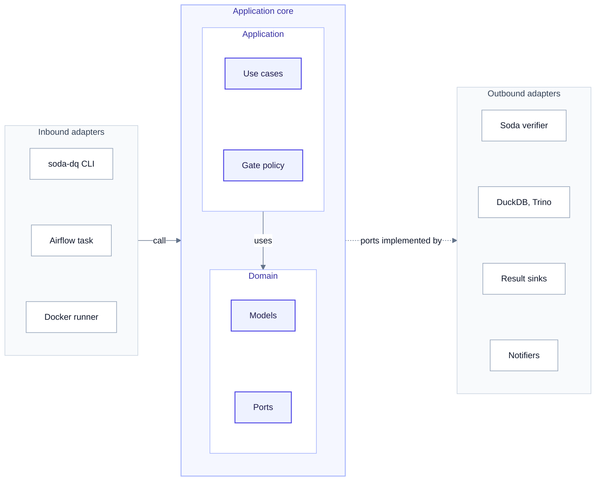

# Components

> [!NOTE]
> **At a glance.** Ports and adapters: the domain and application layers hold the rules and import no
> third-party library except structlog; adapters wrap Soda, DuckDB, Trino, files and Slack; `container.py` wires them.

## Code architecture

How the `soda-dq` code is layered as ports and adapters.

<!-- diagram:code-architecture -->

<!-- /diagram -->

**How to read it:**

- Inbound adapters (left) start a gate run: the CLI, the Airflow task, the Docker runner.
- The application core (indigo) holds the use cases, the gate policy, the domain models and the ports. It imports no third-party library except structlog.
- Outbound adapters (right) implement the ports: Soda, DuckDB and Trino, the sinks, the notifiers.
- Dependencies point inward. `container.py` (not drawn) is the only place that wires concrete classes.

Dependencies point inward: the domain imports only the standard library; the application imports only the
domain (and structlog); adapters implement domain ports; `container.py` is the only module that
instantiates concrete classes (ADR 0005).

## Modules

| Layer | Module | Responsibility |
|---|---|---|
| Entry | `cli.py` (Typer) | `verify`, `run`, `seed`, `list`, `validate`; maps outcomes to exit codes |
| Entry | `airflow/dags/lakehouse_retail_medallion_dq.py`, `dq_operators.py` | Gate tasks as `docker exec ldl-soda soda-dq verify <layer>` |
| Composition | `container.py`, `settings.py` | Build provider, verifier, repository, sinks, notifiers from `DQ_*` settings |
| Application | `application/verify_layer.py` | `VerifyLayerUseCase` (one layer), `RunMedallionUseCase` (bronze → silver → gold, stop on block) |
| Application | `application/quality_gate.py` | `GatePolicy.decide(results) → GateDecision` |
| Domain | `domain/models.py`, `ports.py`, `errors.py` | Value objects, `Protocol` ports, error hierarchy |
| Adapter | `adapters/contracts.py` | `FileContractRepository`: discover and render contracts |
| Adapter | `adapters/soda_verifier.py` | `SodaContractVerifier`: the only module that imports Soda |
| Adapter | `adapters/datasources/*` | `DuckDBProvider`, `TrinoProvider`: open sessions, warm metadata |
| Adapter | `adapters/sinks/*`, `notifiers/*` | JSON, JUnit, Markdown, Iceberg sinks; console and Slack notifiers |

## Domain model

The domain types, the ports (Python `Protocol`s) and the adapters that implement them.

```mermaid
%%{init: {'theme':'base','themeVariables':{'fontFamily':'Inter, system-ui, -apple-system, Segoe UI, Helvetica, Arial, sans-serif','fontSize':'14px','primaryColor':'#ffffff','primaryTextColor':'#0f172a','primaryBorderColor':'#94a3b8','secondaryColor':'#f8fafc','tertiaryColor':'#f8fafc','lineColor':'#64748b','textColor':'#0f172a','clusterBkg':'#f8fafc','clusterBorder':'#cbd5e1','titleColor':'#334155','edgeLabelBackground':'#ffffff','noteBkgColor':'#f8fafc','noteTextColor':'#0f172a','noteBorderColor':'#cbd5e1','actorBkg':'#ffffff','actorBorder':'#94a3b8','actorTextColor':'#0f172a','actorLineColor':'#94a3b8','signalColor':'#475569','signalTextColor':'#0f172a','labelBoxBkgColor':'#f8fafc','labelBoxBorderColor':'#94a3b8','labelTextColor':'#0f172a','loopTextColor':'#0f172a','activationBkgColor':'#eef2ff','activationBorderColor':'#4f46e5','sequenceNumberColor':'#ffffff','classText':'#0f172a','xyChart':{'backgroundColor':'#ffffff','plotColorPalette':'#4f46e5, #d97706, #0d9488','titleColor':'#0f172a','xAxisLabelColor':'#334155','yAxisLabelColor':'#334155','xAxisLineColor':'#94a3b8','yAxisLineColor':'#94a3b8'}}}}%%
%% Title: Domain model and ports
%% Purpose: The domain types, the ports (Protocols) and the adapters that implement them
%% Last updated: 2026-10-13
%% Theme: docs/diagrams/THEME.md (shared init line above). Edit here, then run: make diagrams
classDiagram
  direction TB
  namespace domain {
    class ContractSpec {
      +name: str
      +pipeline: str
      +layer: Layer
      +dataset: str
      +references: tuple
    }
    class CheckResult {
      +name: str
      +check_type: str
      +outcome: Outcome
      +column: str
      +metrics: dict
    }
    class ContractResult {
      +contract: ContractSpec
      +checks: tuple
      +errors: tuple
    }
    class GateReport {
      +run_id: str
      +layer: Layer
      +engine: str
      +status: GateStatus
      +reasons: tuple
    }
    class ContractRepository {
      <<Protocol>>
      +list_contracts(pipeline, layer)
    }
    class ContractVerifier {
      <<Protocol>>
      +verify(contracts, variables)
    }
    class ResultSink {
      <<Protocol>>
      +write(report)
    }
    class Notifier {
      <<Protocol>>
      +notify(report)
    }
  }
  namespace application {
    class VerifyLayerUseCase {
      +execute(pipeline, layer, variables) GateReport
    }
    class GatePolicy {
      +fail_on_warn: bool
      +allow_not_evaluated: bool
      +decide(results) GateDecision
    }
  }
  namespace adapters {
    class FileContractRepository
    class SodaContractVerifier
    class JsonFileSink
    class SlackWebhookNotifier
  }
  ContractResult o-- CheckResult
  ContractResult --> ContractSpec
  GateReport o-- ContractResult
  VerifyLayerUseCase --> ContractRepository
  VerifyLayerUseCase --> ContractVerifier
  VerifyLayerUseCase --> GatePolicy
  VerifyLayerUseCase --> ResultSink
  VerifyLayerUseCase --> Notifier
  FileContractRepository ..|> ContractRepository
  SodaContractVerifier ..|> ContractVerifier
  JsonFileSink ..|> ResultSink
  SlackWebhookNotifier ..|> Notifier
  style ContractSpec fill:#eef2ff,stroke:#4f46e5,color:#1e1b4b
  style CheckResult fill:#eef2ff,stroke:#4f46e5,color:#1e1b4b
  style ContractResult fill:#eef2ff,stroke:#4f46e5,color:#1e1b4b
  style GateReport fill:#eef2ff,stroke:#4f46e5,color:#1e1b4b
  style ContractRepository fill:#f5f7ff,stroke:#4f46e5,stroke-dasharray:4 3,color:#1e1b4b
  style ContractVerifier fill:#f5f7ff,stroke:#4f46e5,stroke-dasharray:4 3,color:#1e1b4b
  style ResultSink fill:#f5f7ff,stroke:#4f46e5,stroke-dasharray:4 3,color:#1e1b4b
  style Notifier fill:#f5f7ff,stroke:#4f46e5,stroke-dasharray:4 3,color:#1e1b4b
  style VerifyLayerUseCase fill:#eef2ff,stroke:#4f46e5,color:#1e1b4b
  style GatePolicy fill:#eef2ff,stroke:#4f46e5,color:#1e1b4b
  style FileContractRepository fill:#ffffff,stroke:#94a3b8,color:#0f172a
  style SodaContractVerifier fill:#ffffff,stroke:#94a3b8,color:#0f172a
  style JsonFileSink fill:#ffffff,stroke:#94a3b8,color:#0f172a
  style SlackWebhookNotifier fill:#ffffff,stroke:#94a3b8,color:#0f172a
```

<!-- diagram:domain-model -->

<!-- /diagram -->

**How to read it:**

- Solid indigo boxes are domain and application types; dashed indigo boxes are ports.
- White boxes are adapters; one example per port is shown (see the components table for all).
- A dotted arrow with a hollow head means *implements*; a diamond means *contains*.
- Field lists are abridged; the source is `src/soda_lakehouse_dq/domain/models.py`.

| Type | Kind | Notes |
|---|---|---|
| `Layer` | `StrEnum` | `bronze`, `silver`, `gold` |
| `Outcome` | `StrEnum` | `passed`, `warned`, `failed`, `not_evaluated`, `excluded` (mapped from Soda's outcomes) |
| `GateStatus` | `StrEnum` | `passed`, `passed_with_warnings`, `blocked` |
| `ContractSpec` | frozen dataclass | Rendered contract path, dataset, referenced datasets |
| `CheckResult` | frozen dataclass | Name, type, outcome, column, metrics (`missing_count`, `invalid_count`, ...), details |
| `ContractResult` | frozen dataclass | Contract + checks + execution errors |
| `GateReport` | frozen dataclass | Run id, layer, engine, status, results, reasons, timestamp |

## Engines

`DataSourceProvider.open()` yields `SodaDataSources`: the Soda data-source implementations plus a
`prepare(dataset)` hook. `SodaContractVerifier` never knows which engine it talks to.

| Engine | Provider | How it connects | Dataset prefix |
|---|---|---|---|
| `duckdb` | `DuckDBProvider` | `lakehouse_client.duckdb_connect()` from the lakehouse repo: DuckDB `iceberg` extension, `ATTACH` to the Lakekeeper REST catalog with vended S3 credentials; Soda wraps the cursor (`from_existing_cursor`, ADR 0002) | `lakehouse_duckdb/<schema>/<table>` |
| `duckdb-local` | `DuckDBProvider` + `LocalMedallionBuilder` | In-memory DuckDB built from CSVs with the same SQL as the Spark jobs (CI, demos) | same |
| `trino` | `TrinoProvider` | `datasources/trino.yml` (soda-trino), Trino 483 Iceberg connector on the same catalog | `lakehouse_trino/lakehouse/<schema>/<table>` |
| container | `DuckDBProvider` in `ldl-soda` | Same as `duckdb`, inside `ldl-net`, `httplib` client, spill to tmpfs | same as `duckdb` |

## Contract templating

Soda v4 does not substitute variables in the `dataset:` key, so contracts carry a `{{ dataset_root }}`
token that `FileContractRepository` renders per engine before Soda reads the file (ADR 0003). Unknown
tokens raise `ContractRenderError` (exit 2). Everything else is plain Soda syntax, including
`${var.NAME}` variables with defaults, overridable with `--set`.

## Sinks and notifiers

| Port | Adapter | Output |
|---|---|---|
| `ResultSink` | `JsonFileSink` | `reports/<run>_<pipeline>_<layer>.json` (full report) |
| `ResultSink` | `JUnitXmlSink` | JUnit XML: one test case per check (CI-native) |
| `ResultSink` | `MarkdownSink` | Human summary; CI appends it to the job summary |
| `ResultSink` | `IcebergSink` | Appends one row per check to `ops.dq_results` through PyIceberg (`DQ_ICEBERG_SINK=true`) |
| `Notifier` | `ConsoleNotifier` | Always on |
| `Notifier` | `SlackWebhookNotifier` | HTTPS webhook only; by default only on warnings or blocks |

A notifier that raises is logged and ignored: alerting must never hide the gate result.

## Error handling

| Error | Raised by | Exit code | Gate effect |
|---|---|---|---|
| `ContractNotFoundError` | repository | 2 | no gate run |
| `ContractRenderError` | repository | 2 | no gate run |
| `DataSourceError` | providers | 2 | no gate run (Airflow task fails) |
| Soda execution error inside a contract | verifier → `ContractResult.errors` | 1 | block |
| `GateBlockedError` | `raise_if_blocked` (library use) | 1 | block |
| `NotificationError` | notifiers | logged | none |

---

[← Overview](overview.md) · [Architecture index](README.md) · [Data flow →](data-flow.md)
