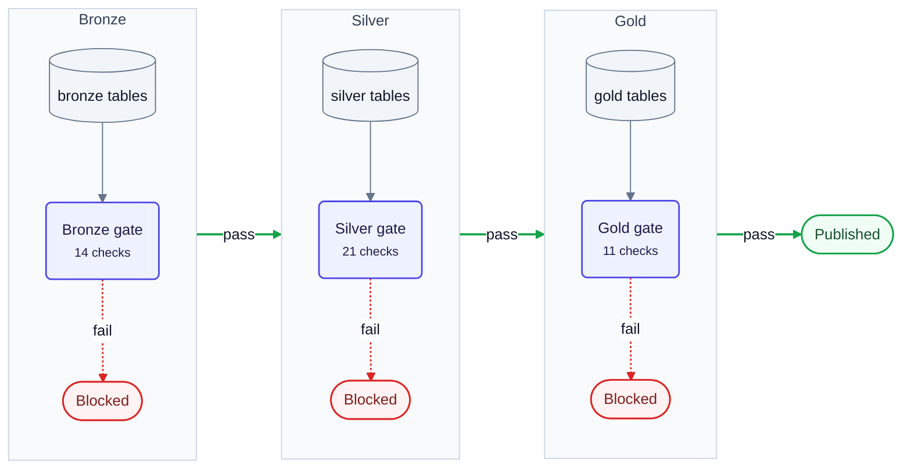
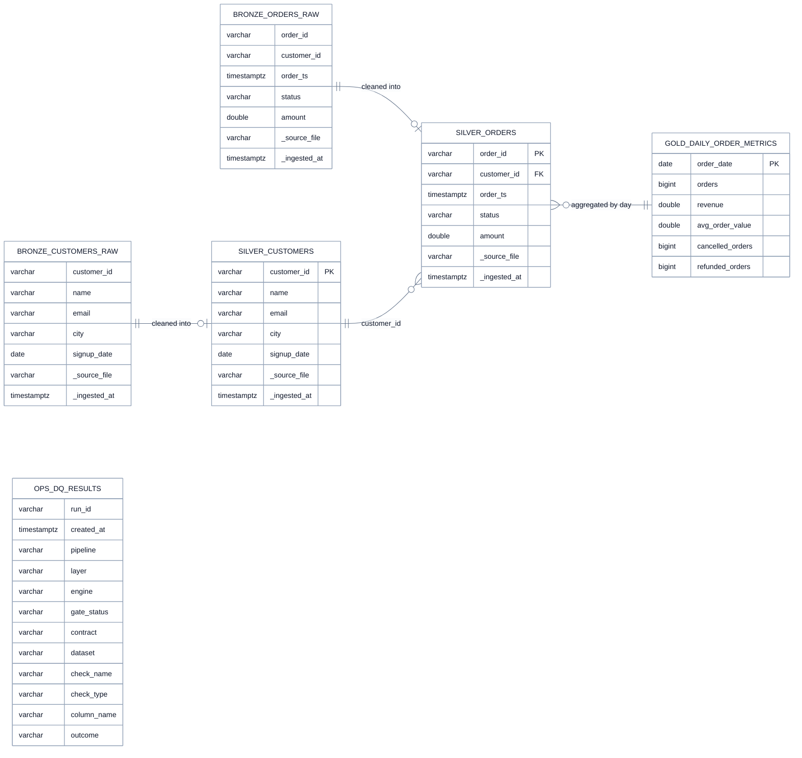
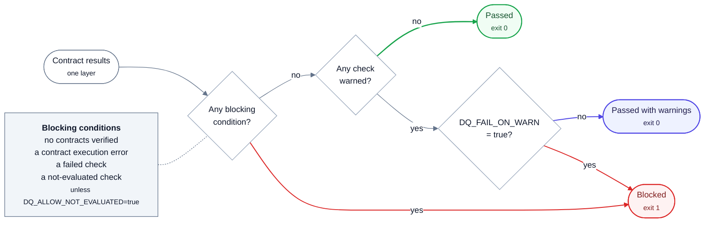
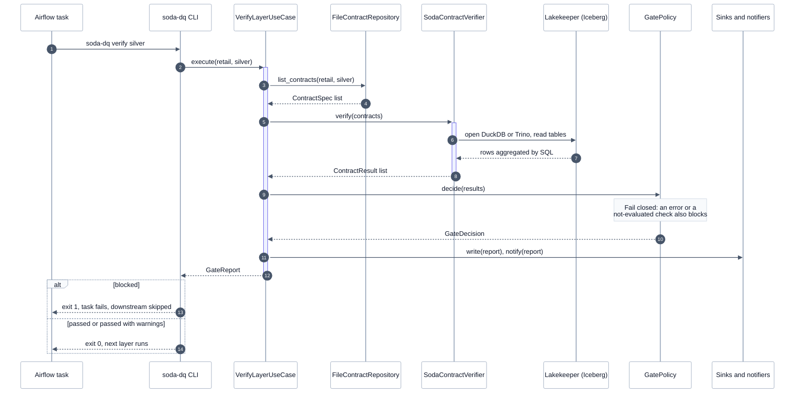
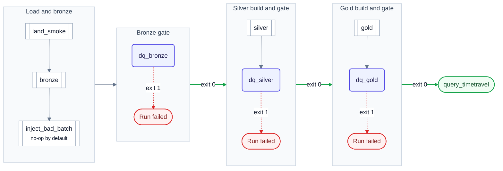

# Data flow

> [!NOTE]
> **At a glance.** Spark builds a layer, then its gate runs: the contracts are rendered, Soda verifies them through
> DuckDB or Trino, and `GatePolicy` decides. Exit 1 stops the Airflow run; exit 0 lets the next layer build.

## Medallion flow with quality gates

One gate after each layer; only a passing gate lets the next layer run.

<!-- diagram:medallion-gates -->

<!-- /diagram -->

**How to read it:**

- Green arrows are **pass**: the next layer is built.
- Red dotted arrows are **fail**: the run is **blocked** at that layer.
- The gates run 14 (bronze), 21 (silver) and 11 (gold) checks: 46 in total.
- A **warn** does not block unless `DQ_FAIL_ON_WARN=true`.

## Data model

The retail Iceberg tables the gates check, and the `ops.dq_results` table the Iceberg sink writes.

<!-- diagram:data-model -->

<!-- /diagram -->

**How to read it:**

- Bronze keeps raw values; silver is cleaned, typed and deduplicated; both carry the lineage columns `_source_file` and `_ingested_at`. Gold is one row per day.
- Each bronze row becomes at most one silver row (`|o`). A crow's foot means *many*: one customer has many orders, and many orders aggregate into one day. `silver.orders.customer_id` must exist in `silver.customers` (a `valid_reference_data` check).
- Gold reconciles with silver: `SUM(orders)` must equal the silver row count.
- `OPS_DQ_RESULTS` (`ops.dq_results`) is written only with `DQ_ICEBERG_SINK=true`, one row per check.
- Columns and types are the ones the contracts' schema checks enforce.

## What each gate checks

One contract per dataset under `contracts/retail/<layer>/`: 14 checks in the bronze gate, 21 in silver and 11 in
gold. Bronze keeps raw values, so value problems **warn** there and are **enforced** in silver; structural problems
(schema drift, an empty batch, missing keys, duplicates within a file) fail at bronze. Every check, with its type
and level, is listed in the [contracts guide](../guides/contracts.md#checks-per-contract).

## Gate policy decision flow

How `GatePolicy` turns the check outcomes of one layer into *passed*, *passed with warnings* or *blocked*.

<!-- diagram:gate-policy -->

<!-- /diagram -->

**How to read it:**

- Read left to right. Any of the blocking conditions in the grey box **blocks** (exit code 1).
- The gate **fails closed**: no contracts, an execution error or a not-evaluated check all block by default.
- Warnings pass unless `DQ_FAIL_ON_WARN=true`. The only other override is `DQ_ALLOW_NOT_EVALUATED=true` (plus `allow_empty`, in code only).
- The policy evaluates every rule and reports **all** reasons, not just the first one.

| Situation | Default | Override |
|---|---|---|
| A check **failed** | block | none |
| A contract raised an **execution error** (SQL error, missing table) | block | none (fail closed) |
| A check is **not evaluated** (e.g. a metric could not be computed) | block | `DQ_ALLOW_NOT_EVALUATED=true` |
| A check **warned** | passed with warnings | `DQ_FAIL_ON_WARN=true` blocks |
| The layer has **no contracts** | block | `allow_empty` in code only |

Reasons are collected in a stable order (errors, failures, not evaluated, warnings) and printed, written to
every report and sent to notifiers.

## Gate run sequence

What happens, step by step, when one layer is gated (here: silver).

<!-- diagram:gate-run-sequence -->

<!-- /diagram -->

**How to read it:**

- Numbers give the order of calls. Solid arrows are calls; dashed arrows are returns.
- Only `SodaContractVerifier` imports Soda, and only the data-source provider knows the engine (DuckDB or Trino).
- The note marks the key decision: the gate fails closed.
- The `alt` box shows the two exits: 1 (blocked) and 0 (passed, with or without warnings).

Soda issues one metadata query (schema) and one batched aggregate query per dataset, plus extra queries for
reference, failed-rows and SQL-metric checks. Measured per layer: bronze 4, silver 5, gold 3 queries, identical on
DuckDB and Trino and confirmed by Trino's own query log ([methodology](../benchmarks/methodology.md)).

## Airflow DAG `lakehouse_retail_medallion_dq`

The tasks of the gated DAG and how a failed gate stops the run.

<!-- diagram:airflow-dag -->

<!-- /diagram -->

**How to read it:**

- White double-edged boxes are Spark tasks; indigo boxes are gate tasks (`docker exec ldl-soda soda-dq verify <layer>`).
- Exit 0 lets the next group run; exit 1 fails the task and every downstream task becomes `upstream_failed`.
- Gate tasks have `retries=0`: data problems do not fix themselves.
- `inject_bad_batch` does nothing unless the run is triggered with `{"inject_bad_batch": true}`.

| Concern | Design |
|---|---|
| Gate task | `BashOperator`: `docker exec ldl-soda soda-dq verify <layer>`, through the lakehouse's Docker socket proxy (exec only) |
| Retries | `retries=0` on gates: data problems do not fix themselves. Spark tasks keep the lakehouse defaults |
| Failure propagation | Exit 1 fails the task; downstream tasks become `upstream_failed` (verified live, see [results](../results/README.md)) |
| Idempotency | Gates are read-only and safe to re-run. Spark layers are `CREATE OR REPLACE`, so a re-run rebuilds the layer from the one below |
| Re-run after a fix | Clear the failed `dq_<layer>` task (or the Spark task before it) in the Airflow UI |
| Backfills | The DAG is unscheduled (manual trigger, `catchup=False`), like the original. Backfills are re-runs of the whole medallion; per-partition backfills need WAP + partition-scoped contracts ([write-audit-publish](write-audit-publish.md)) |
| Demo fault injection | `inject_bad_batch` is a no-op unless the run conf has `inject_bad_batch: true`; the Jinja renders to the literal words `yes`/`no`, so no conf value reaches the shell |
| Concurrency | One DAG run at a time is assumed: layers are rebuilt in place |

---

[← Components](components.md) · [Architecture index](README.md) · [Deployment →](deployment.md)
