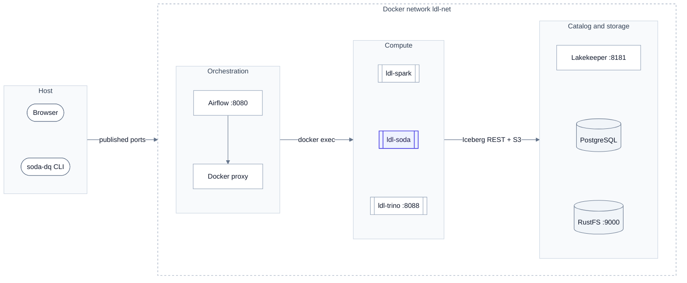

# Deployment

> [!NOTE]
> **At a glance.** One hardened container, `ldl-soda`, joins the lakehouse's Docker network `ldl-net`. Airflow
> starts gates in it with `docker exec`; the gate reads Iceberg through Lakekeeper with vended credentials.

## Topology

The containers, their host ports and how they connect.

<!-- diagram:deployment -->

<!-- /diagram -->

**How to read it:**

- The dashed boundary is the Docker network `ldl-net`; `:NNNN` are host ports (defaults).
- `ldl-soda` (indigo) is this project; every other container belongs to `local-data-lakehouse`.
- Airflow reaches containers only through the Docker socket proxy, which allows `exec` and little else.
- `ldl-trino` runs only in the lakehouse's full profile with `TRINO=1`.

## Containers

| Component | Image / version | Host port | Notes |
|---|---|---|---|
| Airflow api-server, scheduler, dag-processor | Apache Airflow 3 | 8080 by default (`AIRFLOW_API_PORT`) | Mounts our DAG through our own compose overlay |
| docker-proxy | socket proxy | none | Allowlist widened to `exec` for `ldl-soda` |
| `ldl-spark` | Spark 4.1.3, Iceberg 1.12 | none | Runs the jobs |
| `ldl-soda` | `lakehouse-quality-gates:<version>` | none | Non-root `dq`, read-only root FS, `cap_drop: ALL`, `no-new-privileges`, tmpfs `/tmp` |
| `ldl-trino` | Trino 483 | 8088 | Full profile only |
| `ldl-lakekeeper` | Lakekeeper | 8181 | Iceberg REST catalog, vends S3 credentials |
| `ldl-postgres` | PostgreSQL | none | Catalog database |
| `ldl-objectstore` | RustFS | 9000 | `s3://lake/warehouse` |

## Ways to run a gate

| Where | Engine | Command | Needs |
|---|---|---|---|
| Laptop, no Docker | `duckdb-local` | `make demo` | uv |
| Host against the lakehouse | `duckdb` or `trino` | `DQ_ENGINE=duckdb uv run soda-dq run` | lakehouse light or full profile |
| Runner container | `duckdb` | `make dq-up`, then `docker exec ldl-soda soda-dq run` | lakehouse full profile |
| Airflow | `duckdb` in `ldl-soda` | `make airflow-dq-up && make airflow-dq-trigger` | the above plus the Airflow overlay |

Step-by-step commands: [quickstart](../guides/quickstart.md) and [runbook](../guides/runbook.md).

---

[← Data flow](data-flow.md) · [Architecture index](README.md) · [Security →](security.md)
