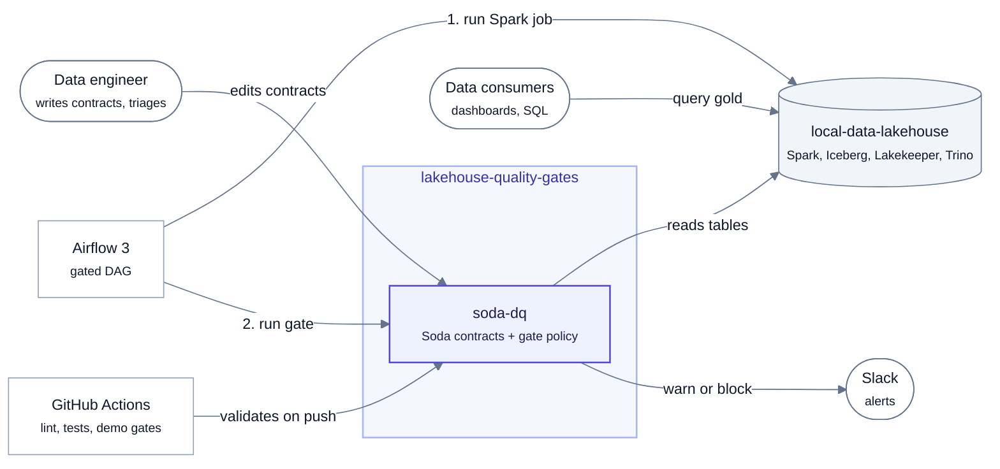
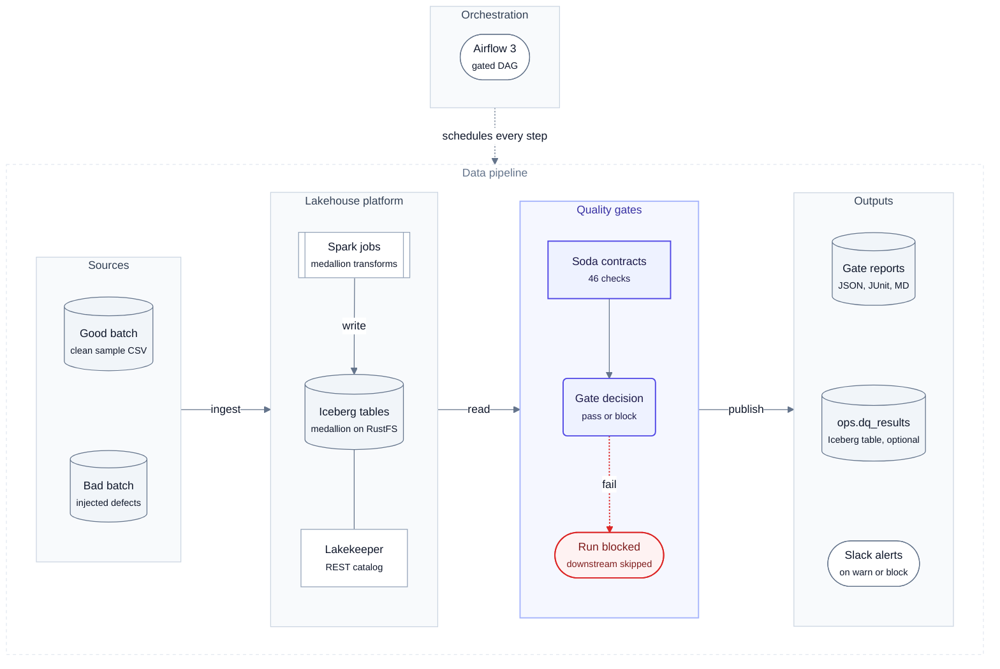

# Architecture overview

> [!NOTE]
> **At a glance.** `soda-dq` runs Soda Core v4 contracts against the Iceberg tables right after each layer is built
> and decides **pass** or **block**. Airflow runs it as a task between the Spark jobs. It reads the lakehouse; it
> changes none of the lakehouse's files.

## Context

### System context

lakehouse-quality-gates and the people and systems around it.

<!-- diagram:system-context -->

<!-- /diagram -->

**How to read it:**

- The indigo box is this project; everything else is external.
- Arrows point from the caller to the system it uses; the label says what for.
- Airflow does two things per layer, in order: **1.** run the Spark job, **2.** run the gate.
- Consumers only ever read gold; the gate is what decides whether new gold gets built.

## System architecture

Where the quality gates sit between the lakehouse layers, and what every gate run produces.

<!-- diagram:system-architecture -->

<!-- /diagram -->

**How to read it:**

- Read left to right, following the data: **Sources → Lakehouse platform → Quality gates → Outputs**.
- Indigo is this project (`soda-dq`); grey zones belong to `local-data-lakehouse` or are outputs.
- The red dotted path is a **block**: the gate fails, the Airflow task fails, nothing downstream runs.
- Airflow (top) schedules every step: the Spark job of a layer, then that layer's gate.

| Zone | Responsibility |
|---|---|
| Orchestration | Airflow 3 runs `lakehouse_retail_medallion_dq`: a Spark task per layer, then a gate task |
| Sources | CSV batches (`fixtures/good_batch`, `fixtures/bad_batch`, or generated at scale by `scripts/gen_scale_data.py`) |
| Lakehouse platform | `local-data-lakehouse`: Spark 4.1 writes Iceberg 1.12 tables to RustFS (S3) through the Lakekeeper REST catalog |
| Quality gates | `soda-dq`: renders contracts, verifies them through an engine, applies the gate policy |
| Outputs | Reports per gate, optional `ops.dq_results` Iceberg table, Slack alerts, Airflow task state |

## Goals and non-goals

The goals (G1 to G7), how each is measured, and what is out of scope are in
[system design § 2](../system-design.md#2-problem-statement-goals-and-non-goals).

---

[← Docs hub](../README.md) · [Architecture index](README.md) · [Components →](components.md)
