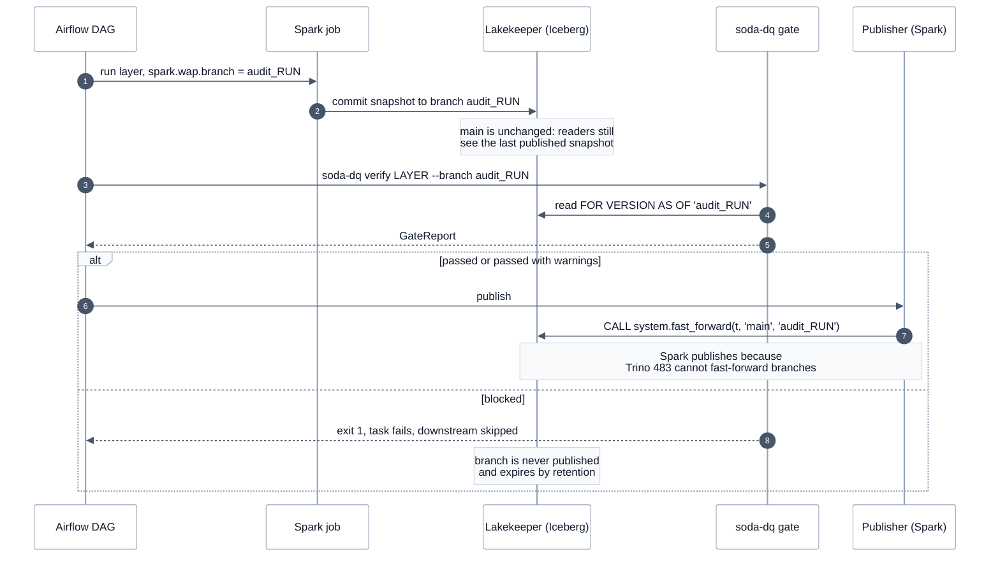

# Write-audit-publish (proposed)

> [!IMPORTANT]
> **Not implemented yet.** Today a gate stops *promotion*, but Spark has already overwritten the layer it checks
> (`CREATE OR REPLACE`), so readers can see a bad layer until it is rolled back. Write-audit-publish closes that gap.

**Goal:** readers of `main` never see a batch that has not passed its gate.

## Sequence

How Iceberg branches would keep a layer hidden from readers until its gate passes.

<!-- diagram:wap-sequence -->

<!-- /diagram -->

**How to read it:**

- This is a **proposal**; nothing on this page is implemented yet.
- Numbers give the order of steps; notes mark the key decisions.
- Readers of `main` never see the `audit_RUN` branch: a blocked batch is simply never published.
- Publishing runs on Spark because Trino 483 cannot create or fast-forward branches.

## Design

1. **Table properties** (once per table, Spark): `ALTER TABLE t SET TBLPROPERTIES ('write.wap.enabled'='true')`.
2. **Write** (Spark job): `spark.conf.set("spark.wap.branch", f"audit_{run_id}")`, then the existing
   writes. On Spark 4.1 + Iceberg 1.12 a session WAP branch can create the branch (Iceberg PR #15917).
   Alternative: `INSERT INTO t.branch_audit_<run_id>`. `spark.wap.id` and `spark.wap.branch` are mutually
   exclusive (Iceberg issue #11528).
3. **Audit** (`soda-dq`): a new `--branch audit_<run_id>` option. `FileContractRepository` renders the
   dataset to a branch-aware form: DuckDB and Trino read `FOR VERSION AS OF 'audit_<run_id>'` (Trino 483
   supports reading branches); `soda-sparkdf` can read `t.branch_audit_<run_id>` in Spark instead. Reference
   datasets in the same run read the same branch.
4. **Publish** (new `Publisher` port, `SparkFastForwardPublisher` adapter, Airflow task after each gate):
   `CALL lakehouse.system.fast_forward('silver.orders', 'main', 'audit_<run_id>')`, one call per table.
5. **Rollback:** if a gate blocks, do nothing: `main` is untouched and the branch expires through
   retention (`ALTER TABLE t CREATE BRANCH ... RETAIN 7 DAYS`, Lakekeeper keeps referenced snapshots).
   If a published batch is later found bad, `CALL system.rollback_to_snapshot` or `set_current_snapshot`.
6. **Multi-table:** each table is fast-forwarded separately; there is no atomic multi-table publish on this
   catalog. Publish order follows dependencies (customers before orders), and gold is published last.

**Effort:** 3 to 5 days (Spark write changes 1 d, publisher port and DAG task 1 d, branch-aware dataset
rendering 0.5 to 1 d, live tests and docs 1 to 2 d). Requires changes in `local-data-lakehouse`'s Spark
jobs, so it needs agreement from that repo's owners.

---

[← Observability](observability.md) · [Architecture index](README.md) · [Design principles →](design-principles.md)
