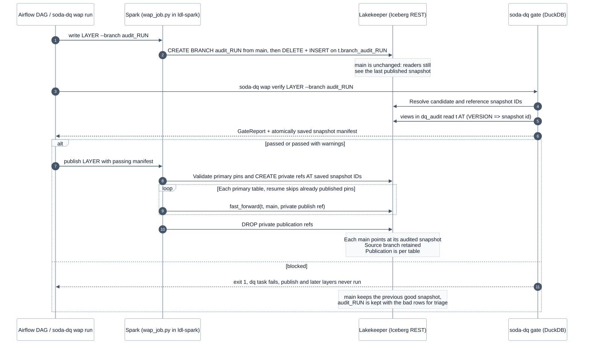

# Write-audit-publish

> [!NOTE]
> **Implemented in v1.0.0** ([ADR 0006](../adr/0006-write-audit-publish.md)). Each layer is written to an Iceberg
> audit branch, gated there, and published to `main` only when the gate passes. A bad batch never reaches `main`.

**Goal:** readers of `main` never see a batch that has not passed its gate (this resolves limitation L1).

## Sequence

How one layer moves from an audit branch to `main`. The run repeats it for bronze, silver and gold, and stops at the
first blocked gate.

<!-- diagram:wap-sequence -->

<!-- /diagram -->

**How to read it:**

- Writing changes the audit branch while `main` keeps the previously published snapshot.
- Verification reads immutable candidate and reference snapshots using the same contracts and policy.
- A passing gate saves its pins before publication; private refs freeze the exact primary table snapshots.
- Each primary table advances separately. Retrying publication skips tables already at their saved pins.
- A blocked gate prevents publication and downstream work; the source branch stays for triage by default.

## How to run it

| What | Command | Expected result |
|---|---|---|
| Start the lakehouse with the WAP overlay | `make wap-up` | `ldl-spark` has `/opt/soda-wap` and `/opt/soda-wap-fixtures` mounted |
| Good batch, whole medallion | `make wap-demo-good` | 3 layers `passed`, each table `main <old> -> <new>` |
| Bad batch | `make wap-demo-bad` | bronze `blocked`, `main stays <id>`, branch kept with the bad rows |
| One layer | `uv run soda-dq wap run --layer bronze --batch good` | that layer published |
| Inspect refs and row counts | `uv run soda-dq wap status bronze [--branch audit_...]` | JSON with `main_snapshot`, `main_rows` and every ref |
| Delete a kept branch | `uv run soda-dq wap drop bronze --branch audit_...` | the branch is gone and `main` is untouched |
| Airflow | `make airflow-dq-up`, then `make airflow-wap-trigger` / `make airflow-wap-trigger-bad` | good: all tasks succeed; bad: `dq_bronze` fails, `publish_bronze` and the rest are `upstream_failed` |
| Everything, with a summary | `make e2e-wap` | every step `PASS` |

`--evidence FILE` on a successful or blocked `soda-dq wap run` writes per-layer snapshot IDs and row
counts as JSON. An operational error can prevent this aggregate file from being written; use the saved
per-layer audit manifests and task logs to inspect and resume a partial publication.

## Components

| Part | Where | Role |
|---|---|---|
| `wap/wap_job.py` | this repo, mounted at `/opt/soda-wap` in `ldl-spark` | `write`, `publish`, `drop` and `status` actions. Reuses the lakehouse SQL files read-only |
| `docker/docker-compose.wap.yml` | compose overlay applied after the lakehouse's own file | mounts the job, `fixtures/` and `reports/` into `ldl-spark` |
| `AuditWriter`, `BranchPublisher` ports | `domain/ports.py` | build a layer on a branch, fast-forward or drop it |
| `SparkSubmitWap` adapter | `adapters/wap/spark_wap.py` | `docker exec ldl-spark spark-submit ...`, parses the `WAP_JSON` line |
| `SnapshotReader` port, `PyIcebergSnapshotReader` | `adapters/wap/pyiceberg_refs.py` | branch to snapshot id from the REST catalog, metadata only |
| `BranchGate` port, `PinnedSnapshotGate` | `adapters/wap/pinned_gate.py` | the normal gate on a DuckDB source with pinned snapshots |
| `DuckDBProvider(pins=...)` | `adapters/datasources/duckdb_provider.py` | `dq_audit` views over `AT (VERSION => id)` |
| `VerifyBranchUseCase`, `RunWapMedallionUseCase` | `application/wap.py` | write, audit, publish; stop at the first block |
| `lakehouse_retail_medallion_wap` | `airflow/dags/` | `wap_write_<layer> >> dq_<layer> >> publish_<layer>` per layer |

## Design notes

1. **Branch writes without changing table properties.** The job writes to `t.branch_audit_<run>` explicitly, so
   `write.wap.enabled` and `spark.wap.branch` are not needed. A table that does not exist yet is created empty
   on `main` (no rows reach `main`) so that the branch has a snapshot to start from.
2. **Same SQL as the lakehouse.** Silver and gold run the `SELECT` of each `CREATE OR REPLACE TABLE` in the
   lakehouse's `sql/retail/*.sql`. Bronze runs `bronze_ddl.sql` and loads the CSVs with one append per file,
   tagged `ldl.batch`, so the lakehouse's time-travel job still finds day 1.
3. **Why DuckDB for the audit.** Soda builds SQL from the dataset name, so a `FOR VERSION AS OF` clause cannot be
   added to its queries. Views in an attached `dq_audit` catalog redirect the same names to the branch snapshot.
   Custom SQL must use `schema.table` to resolve those views. An explicit catalog path or external reader
   bypasses them; SQL declarations and query paths require review together. See
   [SQL read dependencies](../guides/contracts.md#declare-sql-read-dependencies).
4. **Why Spark publishes.** OSS Trino 483 cannot create or fast-forward branches (L7).
5. **Rollback.** A blocked batch needs none: `main` was never moved. If a published batch turns out bad later, use
   `CALL lakehouse.system.rollback_to_snapshot('<table>', <main_before>)` with the id from the evidence JSON.
6. **Multi-table.** Each table is fast-forwarded separately; there is no atomic multi-table publish on this
   catalog. The gate saves a snapshot manifest before publication. Retries skip tables already at their
   audited snapshot. Resume a failed publication with
   `soda-dq wap publish <layer> --audit reports/wap/<branch>/<layer>.audit.json`; an Airflow publish task can be
   cleared and rerun using the same saved manifest. Replays also work after private-ref cleanup failures.
   Source audit branches remain after passing gates and, by default, blocked gates. Delete a branch after inspection with
   `soda-dq wap drop <layer> --branch <branch>`; publication never deletes a concurrent writer's source data.
7. **Concurrency.** Publication creates private branches at the exact audited snapshot IDs and fast-forwards
   `main` to those frozen refs. Moving the source branch after verification cannot publish unaudited data.
   Missing primary table branches fail the audit. Reference tables without the audit branch use a pinned `main` snapshot; they are recorded in evidence and never promoted by that layer.
   Fast-forward still needs `main` to be an ancestor of the audited snapshot, so the DAG allows one active run.
   Audit manifests are written atomically under `reports/wap/<branch>/`; Airflow shares that folder with Spark.
   Audit branch names cannot be `main` or start with `publish_`, which is reserved for private publication refs.

## Evidence

[WAP run, 2026-10-14](../results/runs/2026-10-14-wap/README.md): snapshot ids of `main` before and after a good and
a bad batch, from the CLI and from Airflow. [Overhead](../benchmarks/results.md#write-audit-publish-overhead) at
100k and 1M orders: 3.5 to 4.5 s extra Spark time per layer (branch write about equal to a direct write, plus a 3.3 to 4.0 s fast-forward), median audit elapsed 0.39–0.65 s across the six size/layer groups. This measures the earlier 46-check publisher; current frozen refs, durable manifests, and 53-check gates have not been rebenchmarked.

---

[← Observability](observability.md) · [Architecture index](README.md) · [Design principles →](design-principles.md)
