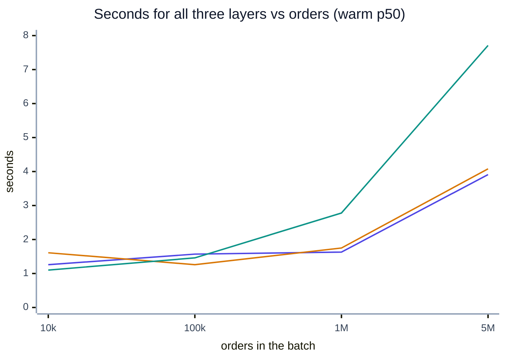

# Benchmark results

> [!NOTE]
> **At a glance.** Gates stay under a second per layer up to 1M orders on DuckDB, detection is exact for every
> injected defect, and Soda is the fastest and leanest of five tools on the same checks. Trino needs more than
> its default 1 GiB heap past 1M orders.

Method: [methodology](methodology.md). Raw data: [`results/benchmarks/`](../results/benchmarks/summary.md).

## Latency

Warm p50 / p95 per gate, seconds (cold in brackets):

| orders | layer | host DuckDB | Trino | container |
|---|---|---|---|---|
| 10k | bronze | 0.44 / 0.72 (0.51) | 0.90 / 1.94 (1.53) | 0.58 / 0.65 (0.77) |
| 10k | silver | 0.45 / 0.55 (0.54) | 1.11 / 1.38 (1.27) | 0.59 / 0.73 (0.52) |
| 10k | gold | 0.37 / 0.39 (0.37) | 0.53 / 0.74 (0.63) | 0.44 / 0.58 (0.41) |
| 100k | bronze | 0.51 / 0.56 (0.70) | 0.78 / 1.31 (2.15) | 0.44 / 0.48 (1.35) |
| 100k | silver | 0.57 / 0.69 (0.58) | 0.76 / 0.86 (0.94) | 0.44 / 0.49 (0.48) |
| 100k | gold | 0.49 / 0.54 (0.63) | 0.49 / 0.63 (0.46) | 0.38 / 0.40 (0.40) |
| 1M | bronze | 0.62 / 0.67 (0.84) | 2.57 / 7.69 (2.75) | 0.66 / 0.97 (1.81) |
| 1M | silver | 0.62 / 0.79 (0.65) | 2.12 / 2.24 (6.41) | 0.64 / 0.73 (0.63) |
| 1M | gold | 0.39 / 0.43 (0.38) | 0.55 / 0.61 (0.87) | 0.45 / 0.46 (0.50) |
| 5M | bronze | 1.40 / 1.59 (1.81) | ⚠ 1.31 / 1.65 (2.48) blocked | 1.86 / 3.56 (3.54) |
| 5M | silver | 1.99 / 2.32 (1.33) | ⚠ 2.61 / 2.98 (2.61) blocked | 1.02 / 2.16 (1.53) |
| 5M | gold | 0.51 / 0.68 (0.50) | 0.50 / 0.63 (0.68) | 1.20 / 1.69 (1.13) |

Reading the table:

- **Gate time is nearly flat to 1M.** Up to 1M orders the fixed costs (opening the Iceberg catalog, loading
  metadata, Soda's planning) dominate; the scan of 22 MiB of Parquet is cheap. Going 1M → 5M (5× the data)
  roughly doubles to triples the bronze and silver gates on DuckDB. Gold reads a 90-row table and stays flat.
- **Process start-up adds 0.25 to 0.3 s on the host and about 0.7 s in the container** (`process p50` minus
  `gate p50` in the summary), which is what an Airflow task sees on top of the table above.
- **Variance is real.** The 1M Trino bronze p95 of 7.69 s is one run (σ 2.33 s) out of five whose others
  were 2.6 to 3.8 s; the container at 5M has σ up to 0.9 s. Cold runs are not consistently slower, because
  every run is a fresh process and the data was just written (OS and object-store caches are warm).
- **Trino at 5M (⚠):** the bronze and silver order checks fail with `EXCEEDED_LOCAL_MEMORY_LIMIT` on the
  lakehouse's 1 GiB Trino heap (the duplicate and reference checks hash 5M keys). Soda reports those checks as
  *not evaluated* and the gate **blocks** (fail closed). The timings are therefore of a failing gate. Fix:
  give Trino more memory (`-Xmx` and `query.max-memory-per-node`) or keep DuckDB for large batches.

### All three gates vs build time

Seconds for all three layers as the batch grows from 10k to 5M orders.

<!-- diagram:benchmark-scaling -->

<!-- /diagram -->

**How to read it:**

- **Indigo:** host DuckDB gates (bronze + silver + gold, warm p50 summed).
- **Amber:** the same gates in the `ldl-soda` container.
- **Teal:** the time to build the three layers (DuckDB writer running the Spark SQL).
- Trino is left out because its bronze and silver gates fail at 5M on the default 1 GiB heap. Source: [benchmark summary](../results/benchmarks/summary.md).

| orders | gates, host DuckDB | gates, container | gates, Trino | build (DuckDB writer) |
|---|---|---|---|---|
| 10k | 1.26 | 1.61 | 2.54 | 1.10 |
| 100k | 1.57 | 1.26 | 2.03 | 1.46 |
| 1M | 1.63 | 1.75 | 5.23 | 2.78 |
| 5M | 3.91 | 4.08 | (blocked) | 7.71 |

## Resources

Median of warm runs. RSS and CPU are for the gate *client* process. For `trino` the work happens in the
Trino server, whose CPU, physical input and peak memory come from Trino's query API, summed over the gate's
queries.

| orders | layer | DuckDB RSS MiB / CPU s | container RSS MiB / CPU s | Trino client RSS MiB | Trino server CPU s / scan MiB / peak MiB |
|---|---|---|---|---|---|
| 100k | bronze | 149 / 0.88 | 175 / 1.26 | 91 | 0.26 / 2 / 5 |
| 100k | silver | 142 / 0.89 | 166 / 1.21 | 92 | 0.17 / 4 / 3 |
| 1M | bronze | 294 / 1.19 | 312 / 2.28 | 91 | 2.51 / 24 / 145 |
| 1M | silver | 284 / 1.06 | 278 / 1.90 | 91 | 2.06 / 33 / 11 |
| 1M | gold | 121 / 0.75 | 145 / 1.24 | 91 | 0.04 / 0 / 1 |
| 5M | bronze | 684 / 2.95 | 780 / 7.16 | 91 | 0.90 / 117 / 179 (failed) |
| 5M | silver | 497 / 2.46 | 604 / 4.43 | 91 | 4.53 / 162 / 180 (failed) |
| 5M | gold | 119 / 0.86 | 214 / 3.19 | 91 | 0.04 / 0 / 1 |

Iceberg data sizes (Trino `$files`): bronze orders 0.2 / 2.1 / 22 / 112 MiB and silver orders
0.2 / 2.0 / 22 / 116 MiB at 10k / 100k / 1M / 5M. The Trino scan bytes show that a gate reads about 1.1 to 1.4 times
the orders table's data size (the aggregate pass plus the duplicate or reference pass); DuckDB's iceberg
extension does not expose scan bytes, and its scans are the same SQL. Host DuckDB uses more CPU than wall
time (multi-threaded scans); the container is slower per CPU-second because Docker Desktop's VM file and
network path sits between it and the RustFS object store.

## Detection accuracy

100k orders, host DuckDB, each defect injected alone by the generator (with ground truth in
`ground_truth.json`) at 0.1 %, 1 % and 10 % of rows (of customers for `malformed_email`), all three gates
run on every batch. A *TP* is an expected failing or warning check that fired.

| defect | expected effect | 0.1 % | 1 % | 10 % | reported count vs injected |
|---|---|---|---|---|---|
| none (control) | all pass | ✅ | — | — | — |
| missing_customer | block bronze + silver | ✅ | ✅ | ✅ | exact (100 / 1,000 / 10,000) |
| duplicate_in_file | block bronze | ✅ | ✅ | ✅ | exact |
| negative_amount | warn bronze, block silver | ✅ | ✅ | ✅ | exact |
| orphan_customer | block silver | ✅ | ✅ | ✅ | exact |
| future_timestamp | block silver + gold | ✅ | ✅ | ✅ | exact in silver; gold reports 1 (one future *day* of metrics) |
| malformed_email | block silver | ✅ | ✅ | ✅ | exact (10 / 100 / 1,000 customers) |
| unknown_status | warn bronze only | ✅ | ✅ | ✅ | exact |

**66 / 66 gate verdicts correct (22 batches × 3 layers), check-level precision 1.000 and recall 1.000
(30 TP, 0 FP, 0 FN), no false block on the clean control.** Two honest caveats: the defects are the ones the
contracts were written for, so this shows the gates do what the contracts say, not that the contracts cover
every possible defect; and the generator injects one defect type per batch, so interaction effects were not
tested. Where a check name exists in two contracts (for example *Customer id present* in silver orders and
silver customers) the raw CSV lists both counts, such as `0;100`.

## Overhead against the pipeline

On the lakehouse's own sample, running the real Spark jobs (`spark-submit --master local[*]` inside
`ldl-spark`, three repeats):

| layer | Spark job s (median) | gate s | gate process s | gate process / Spark |
|---|---|---|---|---|
| bronze | 26.3 | 0.79 | 1.17 | **4 %** |
| silver | 23.3 | 0.76 | 1.10 | **5 %** |
| gold | 20.3 | 0.69 | 1.00 | **5 %** |

Much of Spark's time at this size is JVM and session start-up, so at sample size the ratio flatters the gate. At
scale the layers were built with DuckDB running the same SQL (Spark at 5M on this laptop was not measured),
which is a much faster writer; even against it the bronze and silver gates cost **37 to 60 %** of the build
at 1M and 5M. The gold gate takes 2.4 times its 90-row build at 1M and 93 % of it at 5M; both stay under 0.6 s.

## Tool comparison

Same data (orders + customers Parquet, k = rows / 1,000 defective rows per check), same six checks
(id not null, customer not null, id unique, status in set, amount ≥ 0, customer exists), each tool on its
native local engine, fresh process per run, 3 repeats, median shown. Versions in
`tools_versions.json`.

| tool | engine | 100k process s | 100k RSS MiB | 1M process s | 1M RSS MiB | verdicts correct |
|---|---|---|---|---|---|---|
| **Soda Core v4** | DuckDB | **0.46** | **108** | **0.44** | **204** | 6/6 × 3 |
| Pointblank | Polars | 0.42 | 154 | 0.47 | 389 | 6/6 × 3 |
| datacontract-cli | DuckDB (Soda inside) | 1.12 | 194 | 1.08 | 286 | 6/6 × 3 |
| Pandera | pandas | 0.61 | 189 | 2.83 | 1,552 | 6/6 × 3 |
| GX Core | pandas | 3.38 | 294 | 11.54 | 723 | 6/6 × 3 |

All five reach the right verdicts. Counts differ by semantics, not by error: Pointblank and Pandera count
*both* rows of a duplicate pair (2k), Pointblank also reports 2k for the reference check, and GX reported 2k
for the customer-not-null check where k rows were injected. The verdicts are right; we did not root-cause
those two count differences. The first run of each tool in a fresh venv was 2.6 to 21 s
(byte-code compilation); medians exclude it by construction. The pandas-based tools grow with rows in
memory; the SQL-pushdown tools stay flat, which matches the lakehouse case where data lives in Iceberg.

---

[← Methodology](methodology.md) · [Benchmarks index](README.md) · [Analysis →](analysis.md)
