# Benchmark results

Measured on one laptop against the live lakehouse: gate latency, memory and SQL queries at 10k to 5M orders on three
engines, the end-to-end pipeline stage by stage, overhead against Spark, the Airflow DAG per task, detection accuracy
and a comparison with four other tools. How each number is taken: [methodology](methodology.md). What the numbers mean:
[analysis](analysis.md). Reproduce: `make bench-all BENCH_OUT=docs/results/benchmarks/<date>-v<version>` (about two
hours; see [running and testing](../guides/running-and-testing.md#benchmarks-and-the-accuracy-suite)).

Everything between the markers below is generated by `scripts/bench_charts.py` from the newest raw-data folder;
`make docs-check` fails if it is stale. Charts are Mermaid, so GitHub renders them inline. Mermaid charts have no
legend, so each line chart names its series in colour order.

## Charts and tables

<!-- bench-charts:begin -->
Generated by `make bench-charts` from [`specs.json`](../results/benchmarks/2026-10-14-v0.4.1/specs.json): Apple M1 Pro, macOS-26.6.2-arm64-arm-64bit, Docker 29.8.1 cpus=10 mem=8214851584, Trino 483 (-Xmx4G), commit `e39dc18`, soda-core 4.26.0, soda-duckdb 4.26.0, soda-trino 4.26.0, duckdb 1.5.6, lakehouse-quality-gates 0.4.1. Do not edit by hand.

### Gate latency vs batch size

**All three gates on host DuckDB take 3.09 s at 5M orders (warm p50); Trino takes 9.6x as long.**

Lines, in order indigo, amber, teal: host DuckDB, Trino, container (ldl-soda). Sum of the bronze, silver and gold warm p50.

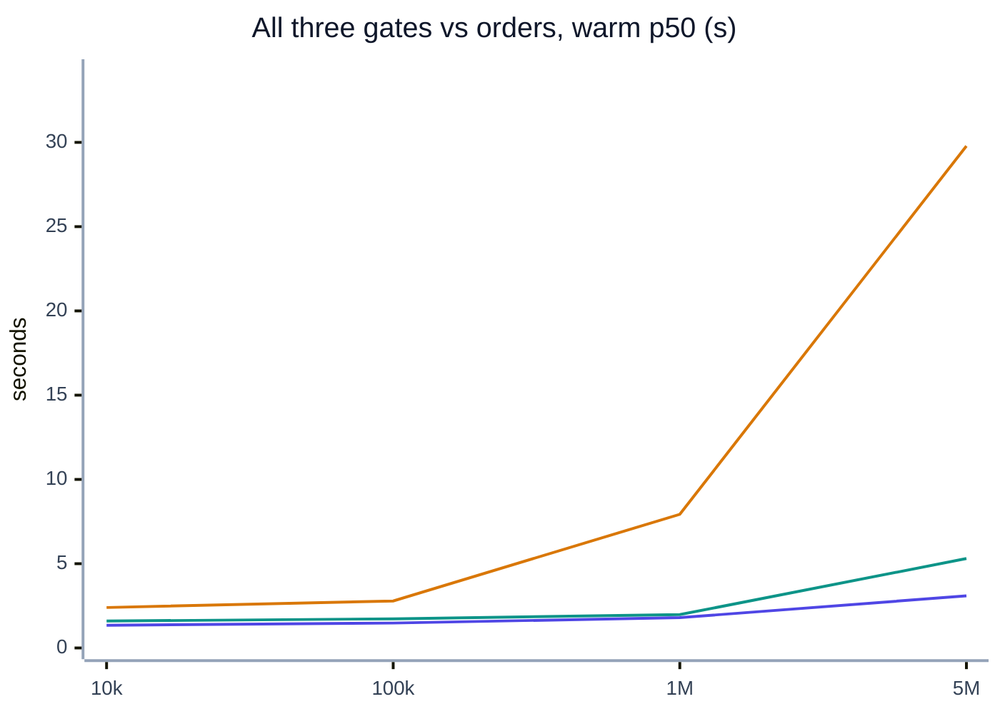

| orders | layer | host DuckDB p50 / p95 (cold) | Trino p50 / p95 (cold) | container (ldl-soda) p50 / p95 (cold) |
|---|---|---|---|---|
| 10k | bronze | 0.47 / 0.50 (0.71) | 0.73 / 0.99 (1.31) | 0.53 / 0.65 (1.12) |
| 10k | silver | 0.45 / 0.53 (0.83) | 0.76 / 0.97 (1.42) | 0.57 / 0.89 (0.49) |
| 10k | gold | 0.42 / 0.44 (0.39) | 0.91 / 1.59 (0.56) | 0.50 / 0.53 (0.56) |
| 100k | bronze | 0.49 / 0.52 (0.61) | 1.12 / 1.44 (1.67) | 0.72 / 1.04 (1.11) |
| 100k | silver | 0.54 / 0.84 (0.69) | 1.14 / 2.23 (1.92) | 0.59 / 0.63 (0.73) |
| 100k | gold | 0.44 / 0.59 (0.46) | 0.53 / 0.70 (0.72) | 0.42 / 0.48 (0.42) |
| 1M | bronze | 0.67 / 0.76 (1.41) | 3.75 / 7.61 (3.75) | 0.76 / 0.97 (1.30) |
| 1M | silver | 0.68 / 0.95 (0.66) | 3.49 / 4.33 (5.27) | 0.72 / 1.25 (0.73) |
| 1M | gold | 0.45 / 0.72 (0.39) | 0.69 / 0.85 (0.54) | 0.49 / 0.60 (0.46) |
| 5M | bronze | 1.36 / 1.49 (1.65) | 14.72 / 30.14 (36.71) | 2.93 / 3.47 (14.97) |
| 5M | silver | 1.33 / 1.53 (1.39) | 14.48 / 16.63 (14.17) | 1.78 / 2.16 (2.68) |
| 5M | gold | 0.40 / 0.43 (0.64) | 0.59 / 1.06 (1.08) | 0.59 / 0.68 (0.61) |

Raw data: [`perf_raw.csv`](../results/benchmarks/2026-10-14-v0.4.1/perf_raw.csv)

### Per-layer latency at 5M orders

**At 5M orders the slowest single gate is Trino bronze at 14.72 s (warm p50).**

Bars: engine (DuckDB host, Trino, container) and layer (br = bronze, si = silver, go = gold).

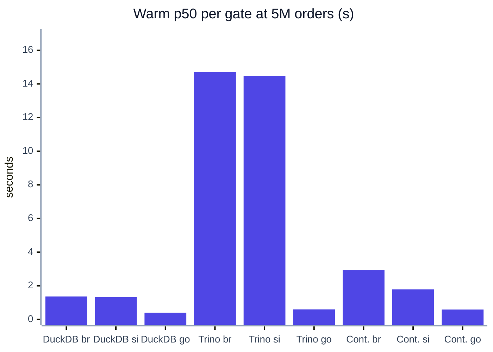

| engine | bronze | silver | gold |
|---|---|---|---|
| host DuckDB | 1.36 | 1.33 | 0.40 |
| Trino | 14.72 | 14.48 | 0.59 |
| container (ldl-soda) | 2.93 | 1.78 | 0.59 |

Raw data: [`perf_raw.csv`](../results/benchmarks/2026-10-14-v0.4.1/perf_raw.csv)

### Memory vs batch size

**Client memory peaks at 690 MiB (container) and 685 MiB (host DuckDB) at 5M; Trino's client stays near 91 MiB because the server does the work.**

Lines, in order indigo, amber, teal: host DuckDB, Trino, container (ldl-soda). Largest per-layer median peak RSS.

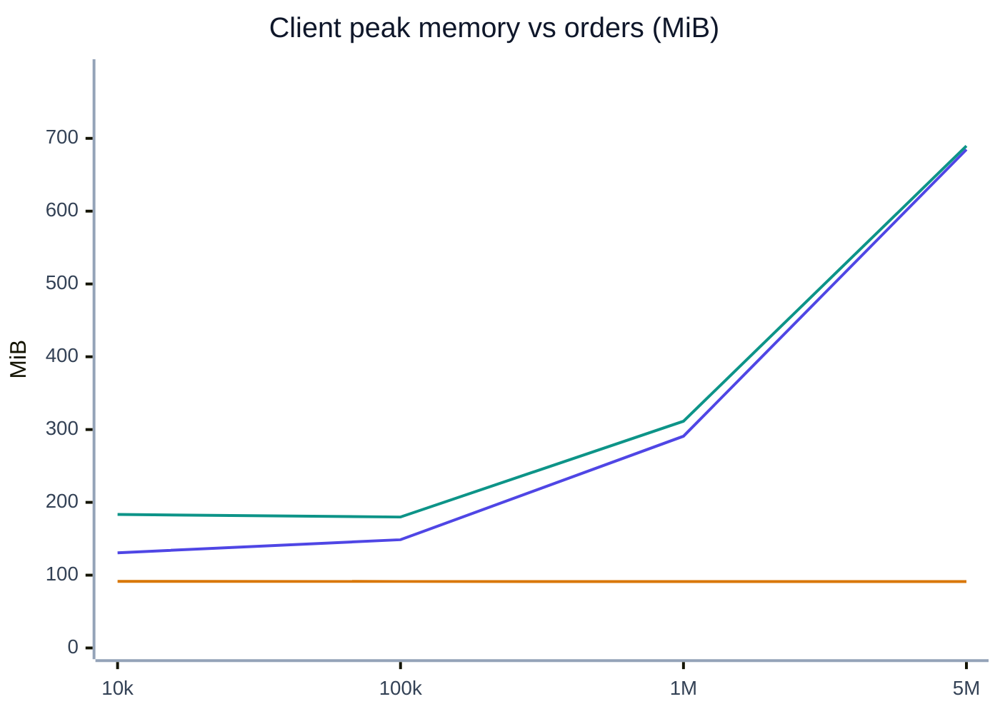

| orders | host DuckDB MiB | Trino MiB | container (ldl-soda) MiB | SQL queries br / si / go |
|---|---|---|---|---|
| 10k | 131 | 92 | 183 | 4 / 5 / 3 |
| 100k | 149 | 91 | 180 | 4 / 5 / 3 |
| 1M | 291 | 91 | 311 | 4 / 5 / 3 |
| 5M | 685 | 91 | 690 | 4 / 5 / 3 |

Raw data: [`perf_raw.csv`](../results/benchmarks/2026-10-14-v0.4.1/perf_raw.csv)

### End-to-end pipeline, stage by stage

**At 5M orders the three gates are 24 % of the 12.9 s seed-to-gold run.**

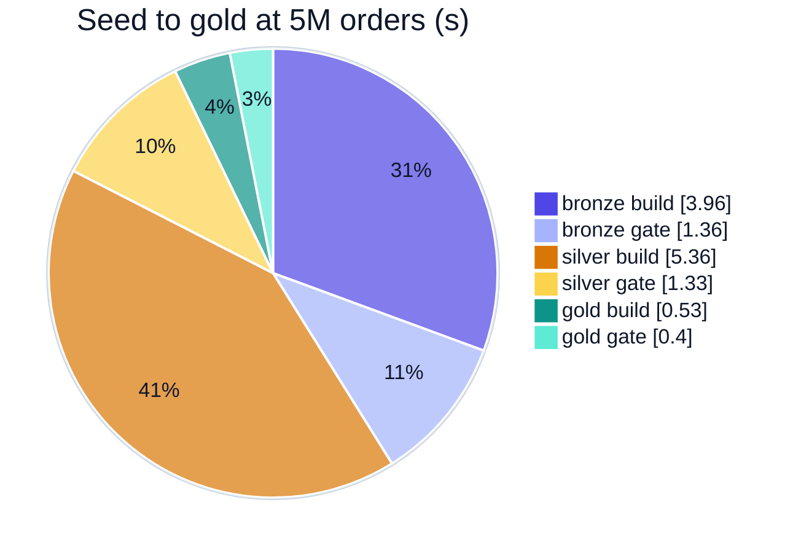

| orders | bronze build | bronze gate | silver build | silver gate | gold build | gold gate | total s |
|---|---|---|---|---|---|---|---|
| 10k | 0.96 | 0.47 | 0.21 | 0.45 | 0.07 | 0.42 | 2.59 |
| 100k | 0.94 | 0.49 | 0.35 | 0.54 | 0.12 | 0.44 | 2.89 |
| 1M | 1.79 | 0.67 | 1.38 | 0.68 | 0.20 | 0.45 | 5.17 |
| 5M | 3.96 | 1.36 | 5.36 | 1.33 | 0.53 | 0.40 | 12.94 |

Raw data: [`pipeline_raw.csv`](../results/benchmarks/2026-10-14-v0.4.1/pipeline_raw.csv) · [`perf_raw.csv`](../results/benchmarks/2026-10-14-v0.4.1/perf_raw.csv)

### Gate overhead against the Spark pipeline

**A gate adds 2.3–4.9 % to its Spark job (median of the repeats).**

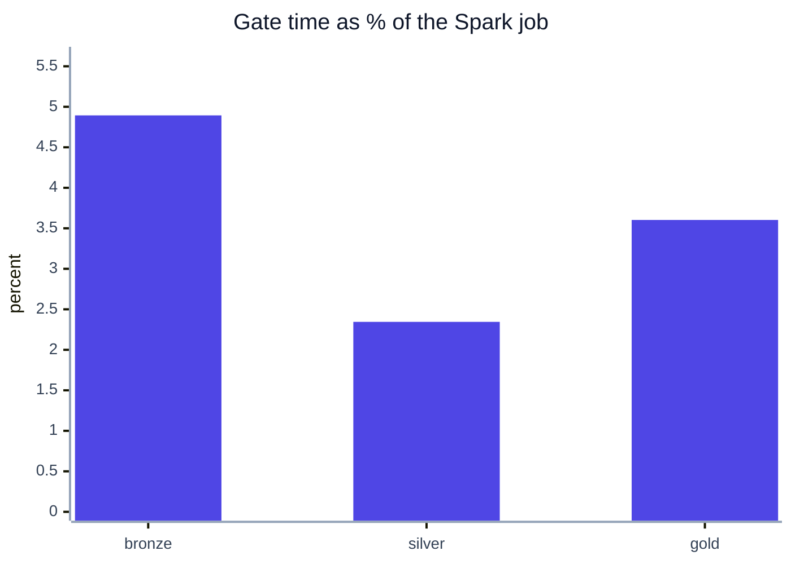

| layer | Spark job s | gate s | overhead |
|---|---|---|---|
| bronze | 23.7 | 1.11 | 4.9 % |
| silver | 25.7 | 0.67 | 2.3 % |
| gold | 23.4 | 0.70 | 3.6 % |

Raw data: [`spark_reference.csv`](../results/benchmarks/2026-10-14-v0.4.1/spark_reference.csv)

### Airflow DAG run, per task

**A good DAG run takes 124 s, of which the three gate tasks are 6 s; a bad run stops at dq_bronze after 57 s.**

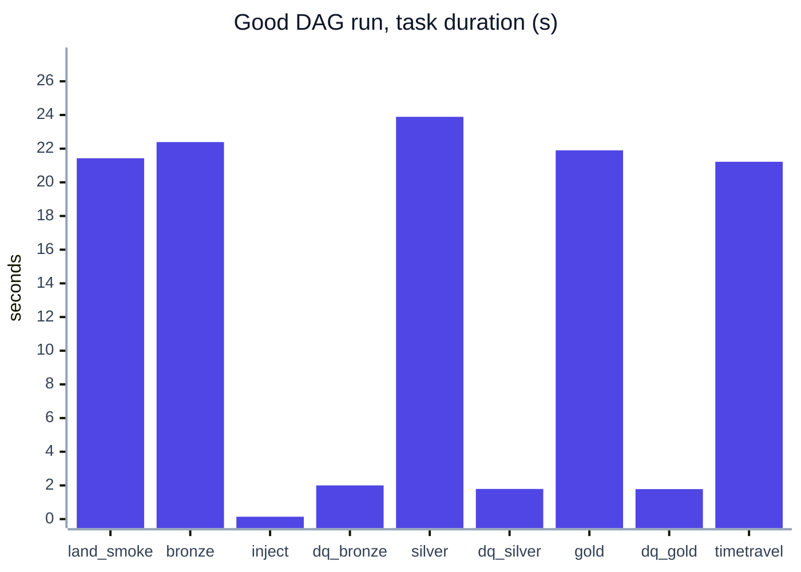

| task | good s | good state | bad s | bad state |
|---|---|---|---|---|
| land_smoke | 21.4 | success | 20.7 | success |
| bronze | 22.4 | success | 23.7 | success |
| inject_bad_batch | 0.1 | success | 2.3 | success |
| dq_bronze | 2.0 | success | 2.0 | failed |
| silver | 23.9 | success | – | upstream_failed |
| dq_silver | 1.8 | success | – | upstream_failed |
| gold | 21.9 | success | – | upstream_failed |
| dq_gold | 1.8 | success | – | upstream_failed |
| query_timetravel | 21.2 | success | – | upstream_failed |

Raw data: [`airflow_tasks.csv`](../results/benchmarks/2026-10-14-v0.4.1/airflow_tasks.csv) · [`airflow_runs.csv`](../results/benchmarks/2026-10-14-v0.4.1/airflow_runs.csv)

### Detection accuracy

**66 of 66 gate verdicts were right; precision at least 1.00 and recall at least 1.00 for every defect type.**

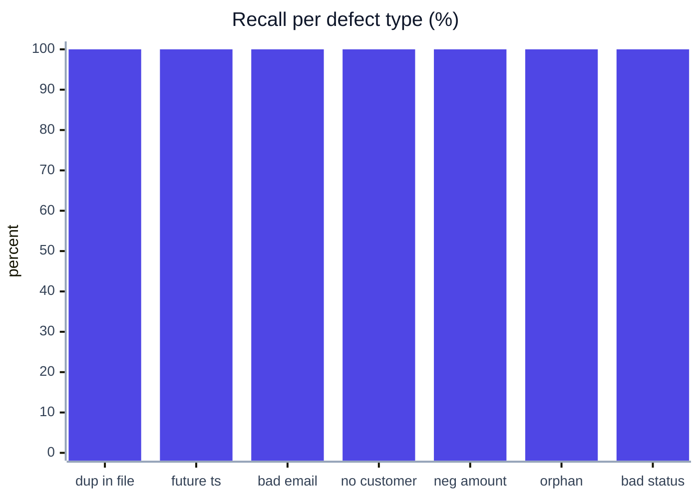

| defect | precision | recall | verdicts at 0.1% | verdicts at 1% | verdicts at 10% |
|---|---|---|---|---|---|
| duplicate_in_file | 1.00 | 1.00 | 3/3 | 3/3 | 3/3 |
| future_timestamp | 1.00 | 1.00 | 3/3 | 3/3 | 3/3 |
| malformed_email | 1.00 | 1.00 | 3/3 | 3/3 | 3/3 |
| missing_customer | 1.00 | 1.00 | 3/3 | 3/3 | 3/3 |
| negative_amount | 1.00 | 1.00 | 3/3 | 3/3 | 3/3 |
| orphan_customer | 1.00 | 1.00 | 3/3 | 3/3 | 3/3 |
| unknown_status | 1.00 | 1.00 | 3/3 | 3/3 | 3/3 |

Raw data: [`accuracy.csv`](../results/benchmarks/2026-10-14-v0.4.1/accuracy.csv)

### Tool comparison

**At 1M rows soda is fastest (0.39 s) and gx slowest (11.40 s) on the same six checks.**

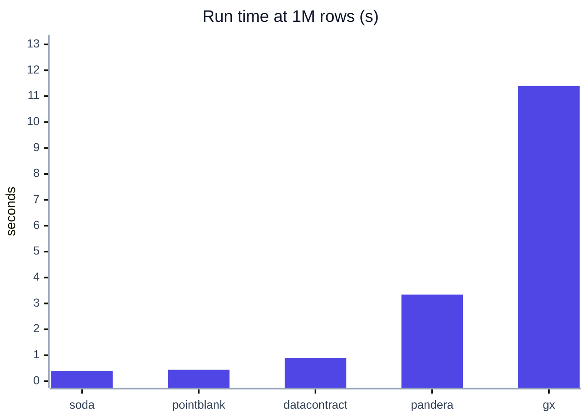

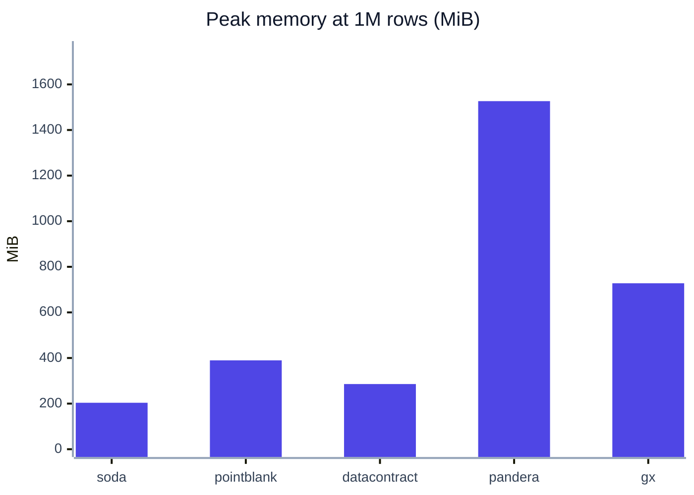

| tool | run s 100k | run s 1M | MiB 100k | MiB 1M | all checks right |
|---|---|---|---|---|---|
| soda | 0.35 | 0.39 | 109 | 204 | yes |
| pointblank | 0.33 | 0.44 | 154 | 390 | yes |
| datacontract | 1.07 | 0.89 | 193 | 286 | yes |
| pandera | 0.53 | 3.34 | 189 | 1527 | yes |
| gx | 3.01 | 11.40 | 277 | 728 | yes |

Raw data: [`tools.csv`](../results/benchmarks/2026-10-14-v0.4.1/tools.csv) · [`tools_versions.json`](../results/benchmarks/2026-10-14-v0.4.1/tools_versions.json)

### Write-audit-publish overhead

**At 1M orders write-audit-publish adds 3.9–4.5 s of Spark work per layer (branch write plus fast-forward against a direct write); end to end, with a second spark-submit and the gate, a layer takes 18–19 s longer.**

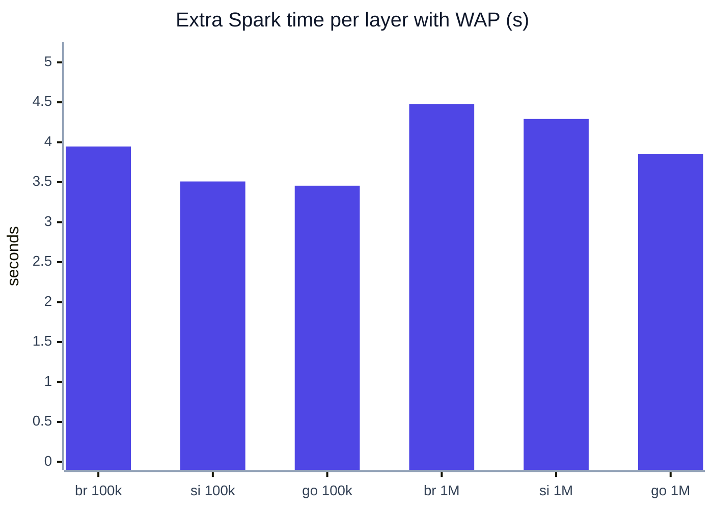

| orders | layer | rows on main | direct s | branch write s | gate s | fast-forward s | extra s | extra | wall direct s | wall WAP s |
|---|---|---|---|---|---|---|---|---|---|---|
| 100k | bronze | 110,000 | 6.91 | 7.17 | 0.48 | 3.69 | 3.95 | 57 % | 20.4 | 37.9 |
| 100k | silver | 110,000 | 6.99 | 6.77 | 0.47 | 3.73 | 3.51 | 50 % | 20.5 | 37.6 |
| 100k | gold | 90 | 4.59 | 4.72 | 0.39 | 3.33 | 3.46 | 75 % | 18.1 | 35.3 |
| 1M | bronze | 1,100,000 | 8.61 | 9.05 | 0.64 | 4.04 | 4.48 | 52 % | 22.1 | 40.8 |
| 1M | silver | 1,100,000 | 8.66 | 8.99 | 0.65 | 3.96 | 4.29 | 50 % | 22.1 | 41.0 |
| 1M | gold | 90 | 4.83 | 5.16 | 0.55 | 3.52 | 3.85 | 80 % | 18.5 | 36.2 |

Raw data: [`wap_overhead.csv`](../results/benchmarks/2026-10-14-wap/wap_overhead.csv)

<!-- bench-charts:end -->

## Headline chart

The README shows this chart; it is the latency chart above, kept as a shared region.

<!-- region:headline-chart -->
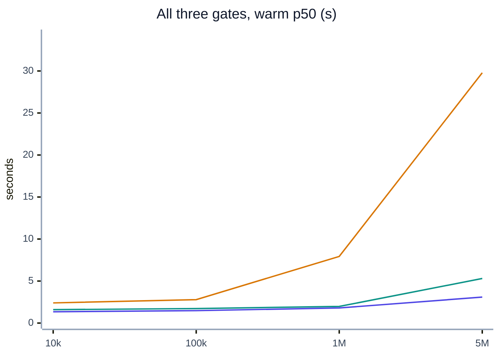
<!-- /region -->
