# End-to-end setup and run

One ordered path from a clean machine to every running service, the quality gates, write-audit-publish (WAP),
Airflow, the benchmarks and the charts, then teardown. Each step names the `make` target it runs; the
[quickstart](quickstart.md) explains the individual steps in more detail. The stack, the gates, WAP and the
Airflow WAP run were run this way on a Linux x86_64 VM (Debian 13, 4 vCPU, 8 GiB RAM), where the screenshots below
were taken; the same targets are covered on macOS by the runs in [docs/results](../results/README.md).

## 1. Prerequisites

| Need | macOS | Linux |
|---|---|---|
| Docker | Docker Desktop, 8 GB memory for the full stack | Docker Engine with Compose v2 |
| Disk | about 15 GB free for images | the same; Docker's data root must have the room (see [troubleshooting](troubleshooting.md)) |
| Memory | 8 GB for Spark, Trino and Airflow together | 8 GB (Trino's default 1 GiB heap; skip 5M-order benchmarks) |
| Tools | `uv` (installs Python 3.12), Git, Make | the same, plus `acl` for `setfacl` |

```bash
docker version && docker compose version && uv --version && git --version && make --version | head -1
```

On Linux also: `sudo apt install acl`, `echo "127.0.0.1 objectstore.localhost" | sudo tee -a /etc/hosts`, and
after cloning, `chmod a+rwx ../local-data-lakehouse/data/export` (Spark writes it as uid 185).

## 2. Clone both repositories side by side

```bash
git clone https://github.com/santoshshinde2012/lakehouse-quality-gates.git
git clone https://github.com/santoshshinde2012/local-data-lakehouse.git
cd lakehouse-quality-gates
make env && make venv          # .env from .env.example (DQ_LDL_REPO_PATH=../local-data-lakehouse), .venv from uv.lock
make validate && make demo-good && make demo-bad   # no Docker: 53 checks pass, then the bad batch is blocked
```

## 3. Start the lakehouse and the runner

```bash
make wap-up      # lakehouse full profile + Trino + the WAP overlay (Lakekeeper, RustFS, Spark, Trino, Postgres)
make dq-up       # runner container ldl-soda on ldl-net; runs make reports-dir first
```

`make wap-up` builds the Spark image on the first run. Without WAP, `make up-full TRINO=1` in the lakehouse repo
starts the same services.

## 4. Run the gates and write-audit-publish

```bash
make verify LAYER=silver ENGINE=trino    # one layer on one engine
make run                                 # bronze, silver, gold on the default engine
make wap-demo-good                       # good batch: audit branch, gates, fast-forward of main per layer
make wap-demo-bad                        # bad batch: bronze blocked, main untouched, audit branch kept
```

Reports land in `reports/` as Markdown, JSON and JUnit; WAP evidence in `reports/wap/`.

## 5. Airflow

```bash
make airflow-dq-up                 # Airflow 3 overlay with the gated DAGs (AIRFLOW_API_PORT=8090 if 8080 is taken)
make airflow-wap-trigger           # lakehouse_retail_medallion_wap, expect success
make airflow-wap-trigger-bad       # dq_bronze fails and publish_bronze never runs (non-zero exit on purpose)
```

Log in as `admin`; the password is `_AIRFLOW_WWW_USER_PASSWORD` in `../local-data-lakehouse/.env`, generated by
`pipelines/airflow_env.sh`.

## 6. Service UIs

| Service | URL | Login |
|---|---|---|
| Airflow | `http://localhost:8080` | `admin`, password from the lakehouse `.env` |
| Trino | `http://localhost:8088/ui/` | any user name, no password |
| Lakekeeper | `http://localhost:8181/ui/` | none (authentication is off in the local stack) |
| RustFS console | `http://localhost:9001` | `S3_ACCESS_KEY` / `S3_SECRET_KEY` from the lakehouse `.env` (local-only sample values) |
| Spark | `http://localhost:4040` | only while a Spark job runs |

The screenshots were taken with headless Chromium on the Linux VM after `make wap-demo-good`, `make wap-demo-bad`
and a successful `make airflow-wap-trigger`. The earlier failed Airflow run is the Linux `reports/` permission
problem that `make reports-dir` now fixes.

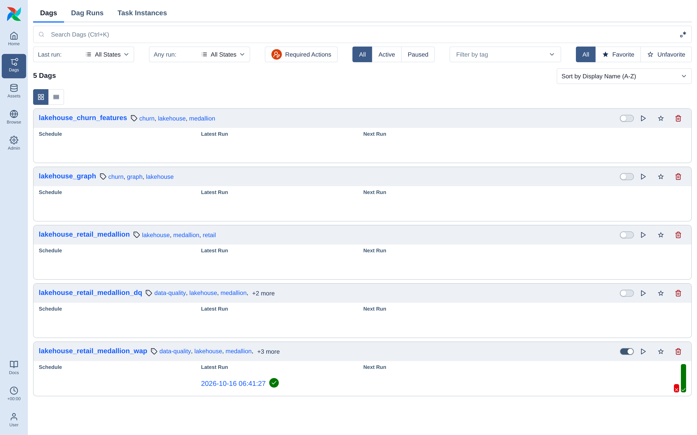

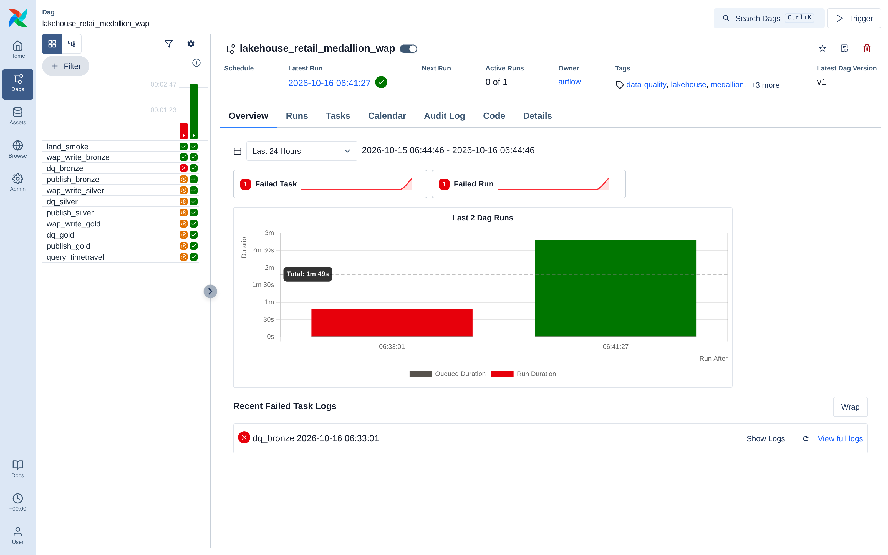

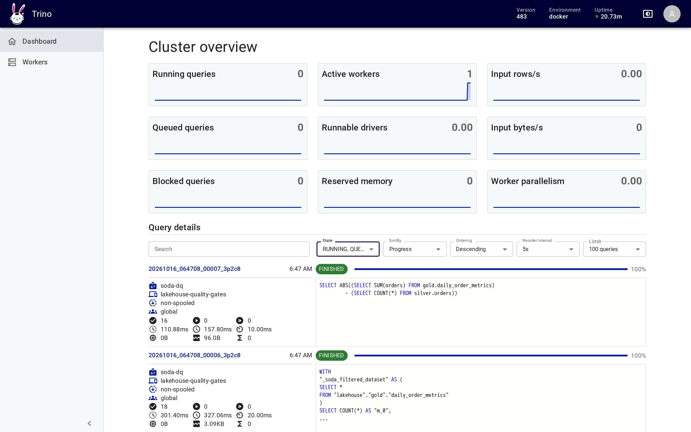

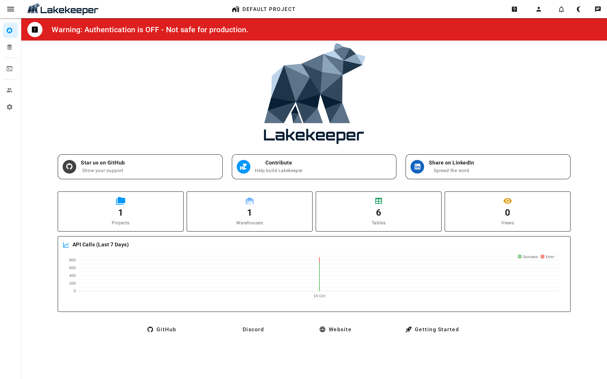

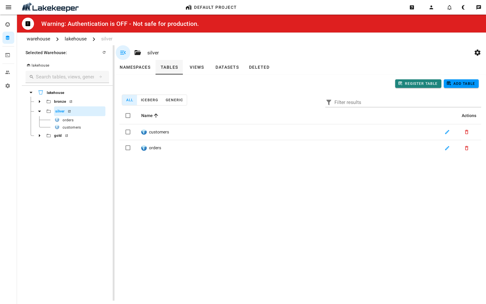

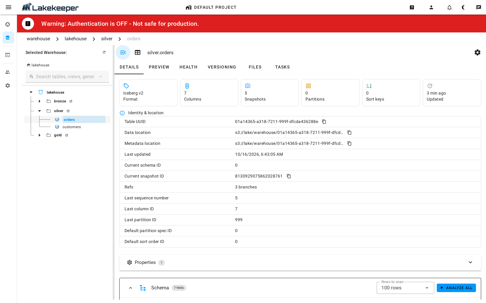

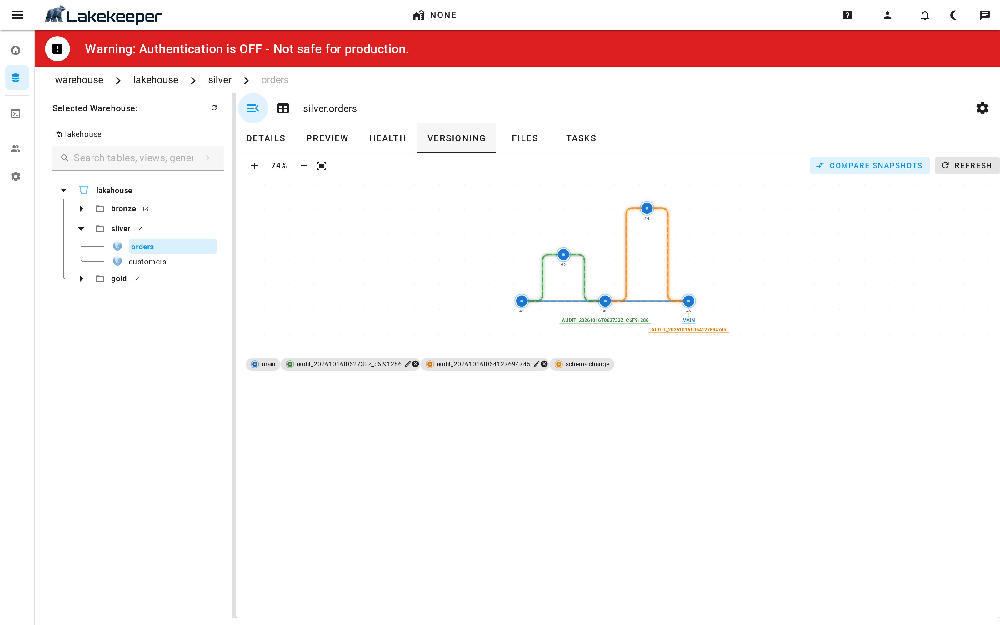

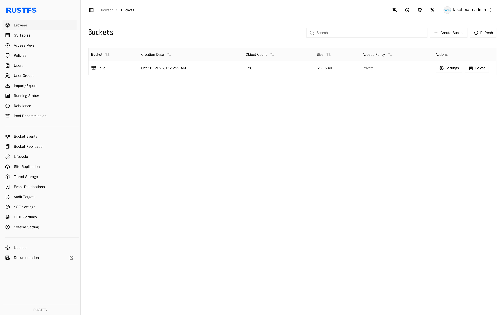

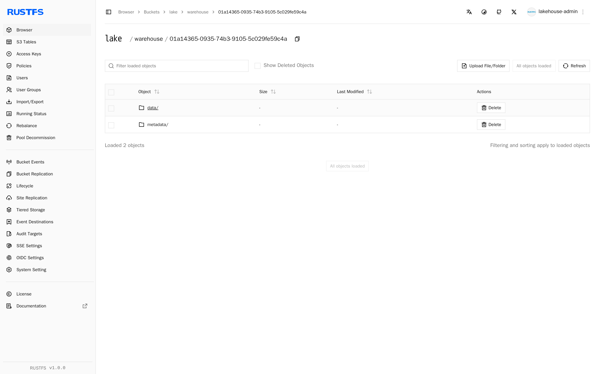

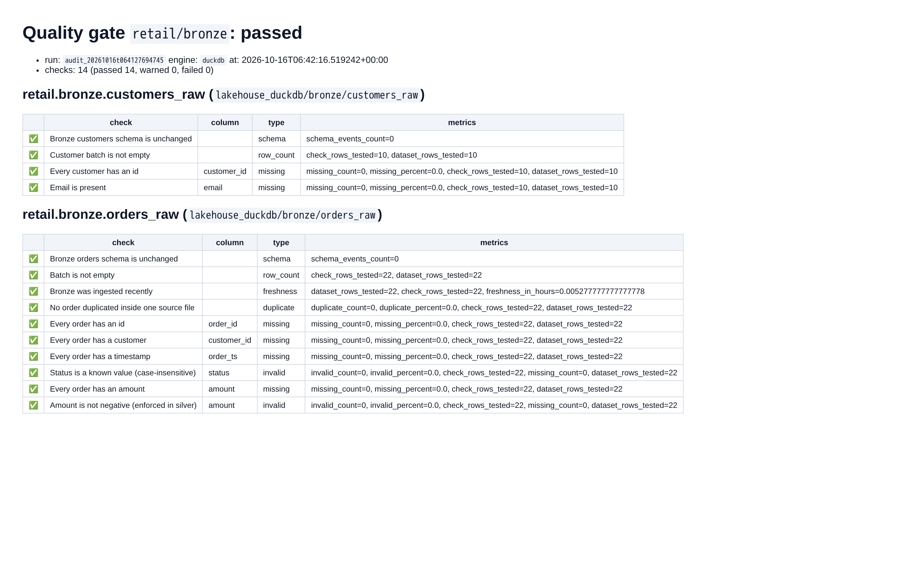

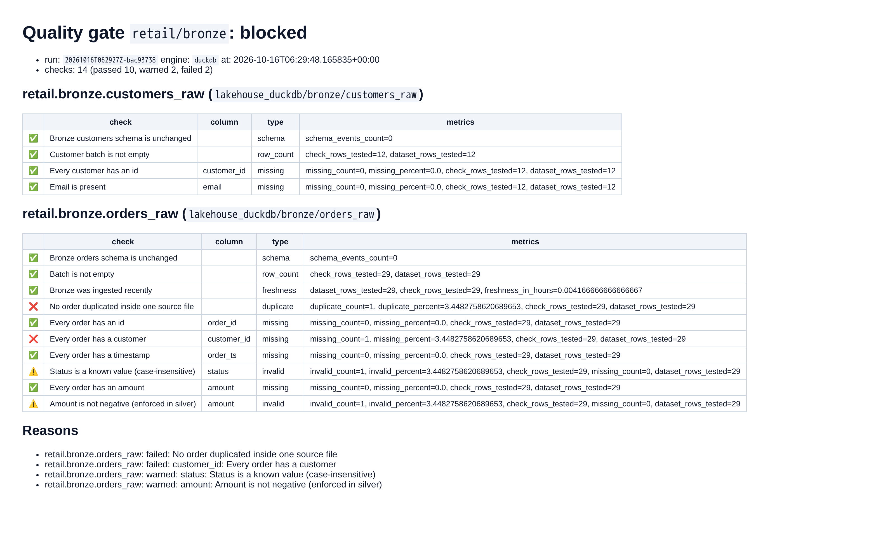

The two report images are the Markdown gate reports from `reports/`, rendered to HTML for the screenshot.

## 7. Benchmarks and charts

```bash
make bench-tools TOOL_SIZES='100000 1000000' REPEATS=5 BENCH_OUT=/tmp/lqg-bench   # no Docker needed
make bench SIZES='10000 100000 1000000' WARM=5 BENCH_OUT=/tmp/lqg-bench          # overwrites the live tables
make bench-report BENCH_OUT=/tmp/lqg-bench
uv run soda-dq seed fixtures/good_batch --yes   # restore the sample tables after make bench
```

Charts are rebuilt from the committed results by the scripts in [docs/figures](../figures/README.md). Every
benchmark target is listed in [running and testing](running-and-testing.md#benchmarks-and-the-accuracy-suite).

## 8. Teardown

```bash
make airflow-dq-down     # Airflow overlay only
make dq-down             # runner container
cd ../local-data-lakehouse && make down    # everything, volumes kept (make purge also deletes the data)
```

Problems on the way: [troubleshooting](troubleshooting.md).
