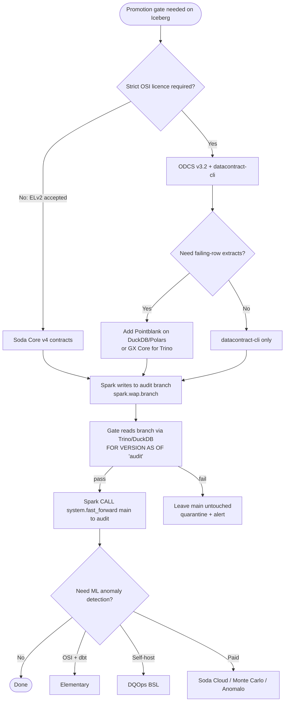

# Data Quality Gates Landscape for `local-data-lakehouse` (v2, 13 Oct 2026 IST)

**Stack evaluated against:** Iceberg 1.12 on the Lakekeeper REST catalog with RustFS S3, Spark 4.1.3, Trino 483, DuckDB 1.5.6, PyIceberg 0.12, Polars, Airflow 3.3.2 and Python 3.12. The repo prefers OSI-licensed dependencies.
**Current solution:** `lakehouse-quality-gates`, which uses Soda Core v4 contracts as bronze → silver → gold promotion gates.

**Method:**

1. Pulled licences, versions and activity live from the PyPI JSON API, the GitHub REST API and LICENSE files.
2. Read the official docs and release notes for each tool (URLs are given with each claim).
3. Ran a hands-on benchmark on the box: 5 tools, the same silver.orders check set, DuckDB/Polars, one good batch and one bad batch (§4).

Where something couldn't be verified it is marked *unverified*. Numbers that weren't measured or published are not given.

---

## 1. Executive summary

**The recommendation is unchanged: keep Soda Core v4 and add Iceberg write-audit-publish (WAP).** The deeper pass did change three facts behind it.

1. **Soda Core v4's licence is Elastic License 2.0**, read from the `LICENSE` file in `sodadata/soda-core` (PyPI only says "Proprietary"). ELv2 is source-available, not OSI. It forbids offering Soda as a managed service, which doesn't apply to an internal lakehouse. Trino support for contracts landed in Feb 2026 (soda-core PR #2585, merged 2026-02-27), and Spark support comes through `soda-sparkdf`. In the benchmark Soda had the fewest config lines among the declarative tools, the fastest run, and 100% correct verdicts.
2. **Trino 483 cannot run WAP's publish step.** It can *read* branches (`FOR VERSION AS OF 'branch'`, Trino 483 Iceberg connector docs). The connector PR that would have added `CREATE BRANCH`, `ALTER BRANCH … FAST FORWARD` and `INSERT INTO t@branch` (trinodb/trino #28464) was **closed without merging**, so these commands aren't in OSS Trino 483. Starburst Enterprise 476-e does ship them. **So WAP has to run on Spark:** set the table property `write.wap.enabled=true`, set `spark.wap.branch` (or write to `t.branch_audit`), then run `CALL system.fast_forward(table, 'main', 'audit')`. Trino and DuckDB only *audit* the branch.
3. **DQOps is not OSI-licensed.** The server is under **Business Source License 1.1**; only the Python client on PyPI is Apache-2.0. Earlier I had wrongly classed it as Apache.

**The best fully OSI path is still ODCS v3.2 + datacontract-cli 1.2.5 (MIT).** It is now verified to test Trino, DuckDB, Iceberg REST catalogs and Spark DataFrames. It reports only counts, though, so pair it with **Pointblank (MIT)** for failed-row extracts. **GX Core (Apache-2.0)** is the heavier but more feature-rich alternative.

**Score change:** datacontract-cli + ODCS stays #1 at 82. Soda v4 is #2 at 76 (up from 74), because the benchmark confirmed its correctness and low setup effort. The ELv2 licence still costs it 12 points.

---

## 2. Verified capability matrix (open source / source-available)

| Tool | Licence (verified) | Latest (date) | Trino | DuckDB | Spark | Iceberg | Contracts | Warn/fail tiers | Failed rows | Airflow gating |
|---|---|---|---|---|---|---|---|---|---|---|
| **Soda Core v4** | **ELv2** (LICENSE) | 4.27.0 (2026-10-13) | ✅ `soda-trino` (PR #2585, tested on a Trino Iceberg/S3 catalog) | ✅ `soda-duckdb` | ✅ `soda-sparkdf` (existing session) | via engines | ✅ YAML | ✅ `threshold.level: warn` | counts + *diagnostics warehouse* | Python `verify_contract_locally` → `is_ok` |
| **datacontract-cli** | MIT (ODCS Apache-2.0) | 1.2.5 (2026-10-12) | ✅ `[trino]` (basic/JWT/OAuth2) | ✅ `[duckdb]` | ✅ DataFrame (programmatic) | ✅ `iceberg` server (REST catalog) | ✅ **ODCS v3.2 open standard** (Bitol / LF AI & Data) | `mustBe`/`mustBeLessThan` etc.; no warn tier exercised | ❌ counts only (verified) | CLI exit code 0/1 |
| **GX Core 1.x** | Apache-2.0 | 1.24.0 (2026-10-07) | ✅ SQL **table assets only** | ✅ via SQLAlchemy `duckdb://` | ✅ DataFrame | via engines | Expectation suites | `mostly`, severity | ✅ values + row indices | `GXValidateBatchOperator` / `GXValidateDataFrameOperator` |
| **Pointblank** | MIT | 1.0.1 (2026-10-07) | ❌ not in documented backends | ✅ Ibis | ✅ PySpark via Narwhals | via DuckDB/Spark | YAML workflows | ✅ warning/error/critical | ✅ full row extracts | Python `all_passed()` |
| **Pandera** | MIT | 0.34.1 (2026-10-06) | via Ibis | via Ibis/Polars | ✅ pyspark | via engines | schema classes | ❌ (raise / lazy) | ✅ `failure_cases` frame | Python exception |
| **dbt + Elementary** | Apache-2.0 | dbt-core 1.12.5 / elementary 0.26.1 | ✅ dbt-trino | ✅ dbt-duckdb | ✅ dbt-spark | via adapters | model contracts | `warn_if`/`error_if` | `store_failures` | Cosmos |
| **SQLMesh audits** | Apache-2.0 | 0.236.3 (2026-10-06) | ✅ (not as state DB) | ✅ | ✅ (not as state DB) | via engines | audits | blocking / `blocking: false` | partial | Airflow via Tobiko Cloud facade |
| **PyDeequ** | Apache-2.0 | 1.7.0 (2026-09-14) | ❌ | 2.0.0b1 beta only | ✅ Spark 3.5 & **4.1** (Deequ 2.0.18), not 4.0 | via Spark | constraint suggestion | Error/Warning | row-level results | Spark task |
| **DQOps** | **BSL 1.1** (server) | 1.13.1 (2026-01-05) | ✅ | ✅ | ✅ | via DuckDB provider | YAML | warning/error/fatal | ✅ | REST client |
| **Airflow common-sql** | Apache-2.0 | 2.3.0 (2026-10-13) | ✅ TrinoHook (DbApiHook) | via hook | via hook | via Trino | ❌ | `tolerance` % on column checks | ❌ | native task failure |
| Cuallee | Apache-2.0 | 0.15.4 (2025-10-07) | ❌ | ✅ | ✅ | – | ❌ | coverage % | partial | Python |
| whylogs | Apache-2.0 | 1.6.4 (2024-12-03), **stale** | – | – | ✅ | – | ❌ | – | ❌ | – |
| Apache Griffin | Apache-2.0 | **archived** | – | – | – | – | – | – | – | – |
| data-diff OSS | MIT | 0.11.2 (2024-05), **archived** | – | – | – | – | – | – | – | – |
| Dagster asset checks | Apache-2.0 | 1.13.26 | any | any | any | any | asset checks | WARN/ERROR | custom | **replaces Airflow** |

Stars and last-push dates are in `quality-gates-matrix.csv`.

**Evidence:**
- Soda: [release notes](https://docs.soda.io/release-notes/soda-core), [Trino PR #2585](https://github.com/sodadata/soda-core/pull/2585), [Spark DF](https://docs.soda.io/reference/data-source-reference-for-soda-core/spark-dataframe), [LICENSE](https://github.com/sodadata/soda-core/blob/main/LICENSE)
- datacontract-cli: [testing](https://docs.datacontract.com/testing), [installation extras](https://docs.datacontract.com/installation), [ODCS](https://docs.datacontract.com/open-data-contract-standard)
- GX: [SQL data](https://docs.greatexpectations.io/docs/core/connect_to_data/sql_data/), [Airflow provider](https://great-expectations.github.io/airflow-provider-great-expectations/latest/getting-started/)
- Pointblank: [Validate](https://posit-dev.github.io/pointblank/reference/Validate.html), [YAML](https://posit-dev.github.io/pointblank/user-guide/yaml/yaml-reference.html)
- SQLMesh: [audits](https://sqlmesh.readthedocs.io/en/stable/concepts/audits/), [connections](https://sqlmesh.readthedocs.io/en/stable/guides/connections/)
- Elementary: [anomaly tests](https://docs.elementary-data.com/data-tests/add-elementary-tests), [PR #2135](https://github.com/elementary-data/elementary/pull/2135)
- PyDeequ: [PyPI 1.7.0](https://pypi.org/project/pydeequ/1.7.0/)
- DQOps: [Trino](https://dqops.com/docs/data-sources/trino/), [Iceberg](https://dqops.com/docs/data-sources/iceberg/), [LICENSE](https://github.com/dqops/dqo/blob/develop/LICENSE)
- Airflow: [common-sql operators](https://airflow.apache.org/docs/apache-airflow-providers-common-sql/stable/operators.html)

---

## 3. Iceberg Write-Audit-Publish on this stack (verified)

| Capability | Spark 4.1 + Iceberg 1.12 | Trino 483 (OSS) | DuckDB 1.5.6 / PyIceberg 0.12 | Lakekeeper |
|---|---|---|---|---|
| Create branch | `ALTER TABLE t CREATE BRANCH audit RETAIN 7 DAYS` | ❌ (PR #28464 closed unmerged; Starburst 476-e has it) | PyIceberg `manage_snapshots().create_branch()` | stores refs via the standard REST commit |
| Write to branch | `SET spark.wap.branch=audit` (needs `write.wap.enabled=true`) or `INSERT INTO t.branch_audit`. On 4.1+ a session WAP branch can create the branch, and an explicit branch wins (Iceberg PR #15917) | ❌ | – | – |
| Read / audit branch | `SELECT … FROM t.branch_audit` / `VERSION AS OF 'audit'` | ✅ `FOR VERSION AS OF 'audit'` | via snapshot ref | – |
| Publish | `CALL cat.system.fast_forward('t','main','audit')`; legacy `spark.wap.id` + `publish_changes` / `cherrypick_snapshot` (append/dynamic overwrite only) | ❌ | – | atomic commit |
| Multi-table atomic | ❌ (each table separately) | ❌ | ❌ | ❌ (Nessie offers catalog-level branches) |

Notes:
- `spark.wap.id` and `spark.wap.branch` are mutually exclusive ("Cannot set both WAP ID and branch", Iceberg issue #11528).
- Lakekeeper exposes branches and tags through the standard Iceberg REST API. Its snapshot expiry retains snapshots that refs point to, and `main` never expires ([Lakekeeper table maintenance](https://docs.lakekeeper.io/docs/latest/table-maintenance/)).

**Implication for the repo:**
1. The Spark job writes to `audit`.
2. Soda (or another checker) runs on the Trino or DuckDB connection against `FOR VERSION AS OF 'audit'`. Alternatively, it runs in Spark through `soda-sparkdf` reading `t.branch_audit`.
3. An Airflow task runs `fast_forward` in Spark.
4. If the gate fails, the branch is left unpublished and expires. Readers on `main` never see the bad batch.

This fixes the overwrite-before-gate gap documented in ADR 0004.

**Sources:**
- [Iceberg branching](https://iceberg.apache.org/docs/latest/branching/)
- [Spark procedures](https://iceberg.apache.org/docs/latest/spark-procedures/)
- [Trino 483 Iceberg connector](https://trino.io/docs/current/connector/iceberg.html)
- [Trino 483 release notes](https://trino.io/docs/current/release/release-483.html)
- [Trino 477 release notes (branch SPI)](https://trino.io/docs/current/release/release-477)
- [trinodb/trino#28464](https://github.com/trinodb/trino/pull/28464) (state: closed, `merged_at: null`, per the GitHub API)
- [Starburst branching blog](https://www.starburst.io/blog/iceberg-branching-data-management/)

---

## 4. Hands-on benchmark (on the box, 13 Oct 2026)

**Fixtures:** I couldn't clone the private repo from the box (HTTPS auth refused). The GitHub connector only gave access to the contracts; the repo's own sample CSVs weren't in the tree it returned. So I built minimal fixtures that mirror `contracts/retail/silver/orders.yml`. The bad batch has exactly 5 defects: a duplicate `O1`, a null `customer_id`, an orphan customer `C9`, status `PAID??` and amount `-3`.

**Checks (identical for every tool):** `order_id` not null, `customer_id` not null, `order_id` unique, `status` in set, `amount ≥ 0`, `customer_id` references customers.

| Tool (version) | Engine | Config/code lines | Good batch | Bad batch: failed checks | Correct? | Failed-row output | Wall time incl. import (s) |
|---|---|---|---|---|---|---|---|
| Soda Core 4.27.0 + soda-duckdb | DuckDB (existing connection) | 24 YAML + 13 py | ✅ 7/7 pass | 5 (dup, missing, ref, status, amount) | ✅ | counts and % per check, no rows | **0.65** |
| datacontract-cli 1.2.5 | DuckDB (local CSV server) | 42 YAML (ODCS) | ✅ 10/10 | 5 + human-readable errors, exit 1 | ✅ | counts only | 1.86 / 2.02 |
| GX Core 1.24.0 | pandas from DuckDB | 18 py | ✅ | 5 | ✅ | unexpected values + row indices | 2.93 |
| Pointblank 1.0.1 | Polars | 18 py | ✅ | 5 steps | ✅ | **full failing rows per step** | **0.64** |
| Pandera 0.34.1 | Polars | 15 py | ✅ | 6 failure cases (both dup rows) | ✅ | `failure_cases` frame (value, column, check, index) | 0.94 |

**What I learned about each tool:**
- **Soda:** most compact declarative contract. Referential checks are native (`valid_reference_data`). The Python result is easy to gate on (`is_ok`). It returns no failing rows without the diagnostics warehouse or Cloud.
- **datacontract-cli:** native checks cover required/unique/validValues. Referential and min checks needed SQL quality rules. It is the only option with a vendor-neutral standard, with schema lint and export (dbt, DDL, …). Its CLI is very usable in CI.
- **GX:** most verbose to set up (context → datasource → asset → batch). Noisy progress bars. Rich results. No native referential expectation, so I emulated it with `ExpectColumnValuesToBeInSet`.
- **Pointblank:** best failed-row extracts and a built-in threshold model. No Trino backend, so it is a DuckDB/Polars/Spark-only gate.
- **Pandera:** schema-as-code that fits the Polars jobs. No severity tiers.

These runtimes are on tiny data and mostly measure import and setup cost. They are **not** throughput benchmarks.

**Artifacts (`/workspace/research/benchmark/`):**
- `data/`: fixtures
- `configs/`: Soda contract and ODCS contracts
- `scripts/run_*.py`
- `run_all.sh`: reproduces everything
- `results/*.txt`: raw outputs
- `results/summary.csv`
- `results/versions.txt`: pinned environment

---

## 5. Commercial observability (docs and pricing checked)

| Vendor | Trino / Iceberg | Airflow | Public pricing | Source |
|---|---|---|---|---|
| Soda Cloud | same engines as Core v4 | via Core | free tier + paid (no list price found) | soda.io |
| Monte Carlo | Starburst (Trino-based) integration in **public preview**, SEP 451+. Freshness/volume need manual SQL monitors, and query logs aren't supported. No OSS-Trino connector documented | Airflow lineage via query tagging | quote-based. AWS Marketplace entry contract reported at **$50k / 12 months** (third-party report) | [MC Starburst](https://docs.getmontecarlo.com/docs/starburst), [MC Airflow](https://docs.getmontecarlo.com/docs/airflow-in-lineage), [pricing](https://montecarlo.ai/request-for-pricing/) |
| Bigeye | *unverified* | yes | AWS Marketplace listing: $45k/yr for 100 tables, $75k for 300 | [AWS Marketplace](https://aws.amazon.com/marketplace/pp/prodview-w4yis4dzpm4u2) |
| Sifflet | *unverified* | yes | ~$48k/yr (third-party report) | [dataobservability.ai](https://dataobservability.ai/blog/enterprise-data-observability-cost) |
| Anomalo | lakehouse claimed, Trino *unverified* | yes | "$1/unit/yr", unit undefined | same |
| Metaplane (Datadog) | *unverified* | partial | free tier + usage plans, no $ | [pricing](https://www.metaplane.dev/pricing) |
| Validio / Lightup | *unverified* | partial | quote only | [Validio](https://www.validio.ai/pricing), [Lightup](https://www.lightup.ai/pricing/) |
| Telmai | claims open formats/Iceberg, *unverified* | – | not found | – |
| AWS Glue DQ | Glue/Spark + Iceberg on AWS only | via Glue | per-DPU | AWS WAP blog |

**Bottom line:** none of these runs fully local, and the only documented Trino-family connector (Monte Carlo) is a Starburst preview. For this laptop lakehouse they make sense only as optional observability for a cloud deployment.

---

## 6. Scoring (evidence-weighted)

**Weights:**

| Criterion | Weight |
|---|---|
| OSI licence | 20 |
| Engine coverage (Iceberg/Trino/DuckDB/Spark) | 20 |
| Contracts-as-code | 15 |
| Airflow gating | 10 |
| Failed rows | 10 |
| Anomaly detection | 5 |
| Maturity | 10 |
| Effort to adopt in this repo | 10 |

**Licence scoring:** OSI scores 20; source-available (ELv2/BSL) scores 8, because internal use is allowed; proprietary SaaS scores 0.

| Tool | Lic 20 | Engines 20 | Contracts 15 | Airflow 10 | Rows 10 | Anomaly 5 | Maturity 10 | Effort 10 | **Total** |
|---|---|---|---|---|---|---|---|---|---|
| datacontract-cli + ODCS | 20 | 19 | 15 | 7 | 2 | 0 | 9 | 10* | **82** |
| Soda Core v4 | 8 | 19 | 14 | 8 | 5 | 2 | 10 | 10 | **76** (already adopted) |
| GX Core 1.x | 20 | 15 | 9 | 9 | 9 | 0 | 10 | 2 | **74** |
| Pointblank | 20 | 10 | 10 | 6 | 10 | 0 | 8 | 8 | **72** |
| dbt + Elementary | 20 | 15 | 10 | 6 | 7 | 4 | 9 | 0 (requires rewriting Spark jobs as dbt models) | **71** |
| Pandera | 20 | 11 | 8 | 5 | 9 | 0 | 9 | 2 | **64** |
| Airflow common-sql | 20 | 12 | 2 | 10 | 0 | 0 | 10 | 6 | **60** |
| PyDeequ | 20 | 8 | 6 | 5 | 8 | 3 | 7 | 3 | **60** |
| SQLMesh audits | 20 | 18 | 6 | 3 | 3 | 0 | 9 | 0 (replaces transform layer) | **59** |
| DQOps | 8 | 18 | 8 | 4 | 8 | 5 | 5 | 2 | **58** |
| Monte Carlo | 0 | 8 | 8 | 8 | 7 | 5 | 10 | 2 | **48** |

\* datacontract-cli gets full marks for effort because a scripted conversion from the existing Soda contracts is mechanical (§7B). These are judgement scores built from the evidence above, not vendor benchmarks.

---

## 7. Recommended architectures (refined estimates)

### A. Soda Core v4 + Spark-side Iceberg WAP (**recommended now**)

**Changes:**
- Spark jobs set `write.wap.enabled=true` and `spark.wap.branch=audit_{{run_id}}`.
- Gate tasks read `FOR VERSION AS OF 'audit_…'` (Trino/DuckDB) or use `soda-sparkdf`.
- A new `PublishBranch` adapter, behind a `Publisher` port, calls `fast_forward`.
- A failed gate leaves `main` untouched, and branch retention cleans up afterwards.

**Pros:** no contract rewrite; it closes ADR 0004; Soda has native referential, reconciliation and group-by checks.

**Cons:** the ELv2 licence; failing rows need the diagnostics warehouse; anomaly detection is in Soda Cloud only; there's no Trino-side publish until OSS Trino merges branch DDL.

**Effort:** **3–5 days**, as estimated:
- Spark write changes and table properties: 1 d
- Publisher port/adapter and DAG task: 1 d
- Branch-aware dataset resolution in contracts: 0.5–1 d
- Tests, including a live Spark branch run, plus docs/ADR: 1–2 d

### B. Fully OSI: ODCS v3.2 + datacontract-cli + Pointblank + Spark WAP

**Changes:**
- Convert the 5 Soda contracts to ODCS. Required/unique/validValues map to native rules; reference/min/freshness checks become SQL quality rules.
- Add a `DataContractCliRunner` adapter behind the existing `ContractRunner` port, so policy, reporters and the DAG stay unchanged.
- Add Pointblank steps on DuckDB/Polars to extract failing rows into a quarantine Iceberg table.

**Pros:** every dependency is OSI; it uses an open LF standard; contracts can be exported to dbt, DDL or docs.

**Cons:** two tools to run; no native warn tier exercised in my run; no anomaly detection; Pointblank can't read Trino.

**Effort:** **1.5–2.5 weeks**: contract conversion and parity tests 3–4 d, adapter 2 d, failed-row quarantine 2 d, WAP 3 d (shared with A), docs 1 d.

### C. Hard gates (A or B) + an observability add-on

Options:
- Soda Cloud (same contracts, lowest effort).
- Monte Carlo, Bigeye or Anomalo for cloud deployments.
- **Elementary** as the OSI anomaly layer, but only if dbt is adopted.
- **DQOps** (BSL) self-hosted for volume/freshness anomalies. It needs at least 30 days of history.

**Effort:** 1 week for integration, plus procurement time. None of these is local-first.

---

## 8. Decision flow

---

## 9. Sources

**APIs** (fetched 2026-10-13):
- PyPI JSON API: `https://pypi.org/pypi/<pkg>/json`
- GitHub REST API: `https://api.github.com/repos/<owner>/<repo>`, including `/license`, plus `/pulls/28464` (trinodb) and `/pulls/2585` (sodadata)

**Soda:**
- https://docs.soda.io/release-notes/soda-core
- https://github.com/sodadata/soda-core/pull/2585
- https://docs.soda.io/reference/data-source-reference-for-soda-core/spark-dataframe
- https://github.com/sodadata/soda-core/blob/main/LICENSE

**datacontract-cli / ODCS:**
- https://docs.datacontract.com/testing
- https://docs.datacontract.com/installation
- https://docs.datacontract.com/open-data-contract-standard

**GX Core:**
- https://docs.greatexpectations.io/docs/core/connect_to_data/sql_data/
- https://great-expectations.github.io/airflow-provider-great-expectations/latest/getting-started/

**Pointblank:**
- https://posit-dev.github.io/pointblank/reference/Validate.html
- https://posit-dev.github.io/pointblank/user-guide/yaml/yaml-reference.html
- https://posit-dev.github.io/pointblank/user-guide/getting-started/installation.html

**SQLMesh:**
- https://sqlmesh.readthedocs.io/en/stable/concepts/audits/
- https://sqlmesh.readthedocs.io/en/stable/guides/connections/

**Elementary:**
- https://docs.elementary-data.com/data-tests/add-elementary-tests
- https://github.com/elementary-data/elementary/pull/2135

**PyDeequ:**
- https://pypi.org/project/pydeequ/1.7.0/
- https://github.com/awslabs/python-deequ/issues/270

**DQOps:**
- https://dqops.com/docs/data-sources/trino/
- https://dqops.com/docs/data-sources/iceberg/
- https://dqops.com/docs/dqo-concepts/

**Airflow:**
- https://airflow.apache.org/docs/apache-airflow-providers-common-sql/stable/operators.html
- https://www.astronomer.io/docs/learn/airflow-sql-data-quality/

**Iceberg:**
- https://iceberg.apache.org/docs/latest/branching/
- https://iceberg.apache.org/docs/latest/spark-procedures/
- https://github.com/apache/iceberg/issues/11528
- https://github.com/apache/iceberg/pull/15917

**Trino:**
- https://trino.io/docs/current/connector/iceberg.html
- https://trino.io/docs/current/release/release-483.html
- https://trino.io/docs/current/release/release-477
- https://github.com/trinodb/trino/pull/28464
- https://www.starburst.io/blog/iceberg-branching-data-management/

**Lakekeeper:**
- https://docs.lakekeeper.io/docs/latest/table-maintenance/
- https://docs.lakekeeper.io/docs/latest/engines/
- https://github.com/PostHog/duckgres/blob/main/docs/runbooks/lakekeeper-iceberg-catalog.md

**AWS:**
- https://aws.amazon.com/blogs/big-data/build-write-audit-publish-pattern-with-apache-iceberg-branching-and-aws-glue-data-quality/

**Commercial:**
- https://docs.getmontecarlo.com/docs/starburst
- https://docs.getmontecarlo.com/docs/airflow-in-lineage
- https://montecarlo.ai/request-for-pricing/
- https://aws.amazon.com/marketplace/pp/prodview-w4yis4dzpm4u2
- https://dataobservability.ai/blog/enterprise-data-observability-cost (third-party)
- https://www.metaplane.dev/pricing
- https://www.validio.ai/pricing
- https://www.lightup.ai/pricing/
