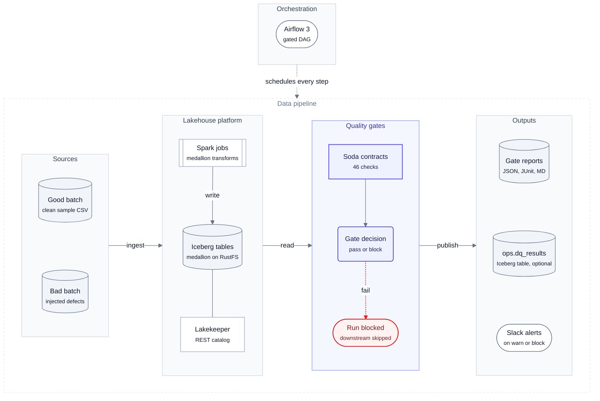
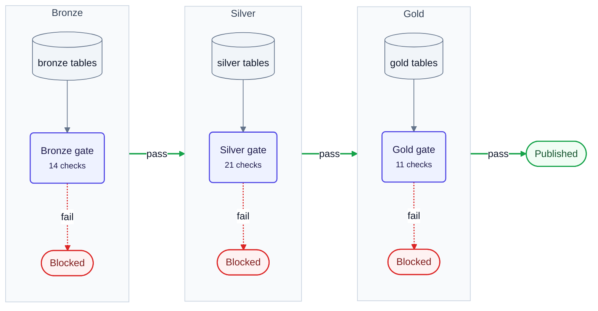

# lakehouse-quality-gates: System Design

| | |
|---|---|
| **Version** | 2.0 |
| **Status** | Accepted. Performance figures are measured; write-audit-publish ([section 13](#13-write-audit-publish)) is implemented (v1.0.0) |
| **Author** | Santosh Shinde |
| **Date** | 2026-10-14 |
| **Repository** | [santoshshinde2012/lakehouse-quality-gates](https://github.com/santoshshinde2012/lakehouse-quality-gates) |
| **Reviewers** | Data platform owners of `local-data-lakehouse` |

> [!TIP]
> This document is the end-to-end narrative: the problem, the requirements, the decisions and the risks. Each
> section links to the focused page that holds the full detail (components, data flow, deployment, benchmarks,
> runbook), so nothing is written twice. Terms are defined in the [glossary](overview/glossary.md); the
> [documentation hub](README.md) lists every page.

## Contents

1. [Executive summary](#1-executive-summary)
2. [Problem statement, goals and non-goals](#2-problem-statement-goals-and-non-goals)
3. [Requirements](#3-requirements)
4. [Background and tool selection](#4-background-and-tool-selection)
5. [Architecture](#5-architecture)
6. [Design and data flow](#6-design-and-data-flow)
7. [Operations: orchestration, deployment, security, observability](#7-operations-orchestration-deployment-security-observability)
8. [Performance](#8-performance)
9. [Reliability and failure modes](#9-reliability-and-failure-modes)
10. [Scalability and capacity](#10-scalability-and-capacity)
11. [Trade-offs and alternatives considered](#11-trade-offs-and-alternatives-considered)
12. [Known limitations and risks](#12-known-limitations-and-risks)
13. [Write-audit-publish](#13-write-audit-publish)
14. [Testing strategy](#14-testing-strategy)
15. [References](#15-references)

## 1. Executive summary

> [!IMPORTANT]
> **Decision.** Keep Soda Core v4 as the gate engine, and publish every layer through Iceberg write-audit-publish:
> a layer is written to an audit branch, gated there, and fast-forwarded to `main` only when its gate passes
> ([section 13](#13-write-audit-publish)). This resolves [L1](#12-known-limitations-and-risks).

`local-data-lakehouse` builds a retail medallion (bronze, silver and gold Apache Iceberg tables) with Spark,
orchestrated by Airflow 3. Before this project nothing stopped a bad batch from flowing from bronze into the
tables people query. **lakehouse-quality-gates** adds a *quality gate* after every layer: a set of
[Soda Core v4](https://docs.soda.io/) data contracts that run against the freshly written tables, and a
policy that turns their results into **pass** (promote the next layer) or **block** (fail the Airflow task,
so nothing downstream runs, and alert).

The design is a small hexagonal Python service (`soda-dq`) with one composition root, three engines behind
one port (DuckDB on the Iceberg catalog, Trino, and in-memory DuckDB from CSV files), run on the host or in a hardened container, four result sinks and two
notifiers. It sits next to the lakehouse and changes none of its files.

**What the measurements say** (Apple M1 Pro, Docker Desktop with 8 GiB; details in [Benchmarks](benchmarks/README.md)):

| Question | Answer (measured) |
|---|---|
| How long does a gate take? | Host DuckDB, warm p50 per layer: **0.42–0.68 s up to 1M orders, 0.40 to 1.36 s at 5M**; all three gates 3.09 s at 5M. Worst warm p95 on DuckDB: 3.47 s (container, bronze, 5M) |
| What does it cost next to the pipeline? | **2.3–4.9 %** of the Spark job time per layer (median, lakehouse sample). In the Airflow DAG the three gate tasks are about 6 s of a 124 s run. Seed to gold at 5M with DuckDB builds: gates are 24 % of 12.9 s |
| How much memory? | Peak client RSS **690 MiB at 5M orders** (container), 685 MiB host; about 310 MiB at 1M |
| Does it catch bad data? | **66 of 66 gate verdicts correct** over 7 defect types × 3 rates (0.1 %, 1 %, 10 %) plus a clean control; check-level precision and recall **1.0**; reported failing-row counts equal the injected counts |
| Where does it break? | **Trino with the lakehouse's default 1 GiB heap fails at 5M orders** (`EXCEEDED_LOCAL_MEMORY_LIMIT`; the gate fails *closed*). With `make trino-heap` (4 GiB) it passes, taking 29.79 s for the three gates |
| How does Soda compare? | Same six checks at 1M rows: Soda 0.44 s / 204 MiB, Pointblank 0.47 s / 389 MiB, datacontract-cli 1.08 s / 286 MiB, Pandera 2.83 s / 1.5 GiB, GX Core 11.5 s / 723 MiB. All five got every verdict right |

**Decision.** Keep Soda Core v4 (Elastic License 2.0, internal use is allowed) as the gate engine, with Iceberg
**write-audit-publish** on Spark ([section 13](#13-write-audit-publish)). This closes the one real correctness gap of
the gate-after-write DAG, where a gate stopped *promotion* but could not hide a bad layer that Spark had already
written with `CREATE OR REPLACE`. The fully OSI-licensed fallback is ODCS v3.2 + datacontract-cli + Pointblank ([section 4](#4-background-and-tool-selection)).

## 2. Problem statement, goals and non-goals

> [!NOTE]
> **At a glance.** Bad batches flowed from bronze to gold unchecked. Goal: block the right layer for every injected defect, never block clean data, and change nothing in the lakehouse.

### Problem

Spark jobs in the lakehouse overwrite each layer from the one below. A malformed file (a missing key, a
negative amount, an orphan customer, an order dated 2099) is silently carried into silver, aggregated into
gold, and served to BI. Nobody finds out until a number looks wrong, and by then several layers and
snapshots carry the problem.

### Goals

| # | Goal | Measure |
|---|---|---|
| G1 | Block promotion of a layer that violates its contract | 100% of injected blocking defects block the right gate ([accuracy](benchmarks/results.md#detection-accuracy)) |
| G2 | Never block clean data | 0 false blocks on clean batches at every scale |
| G3 | Cheap enough to run after every layer | Gate p95 well inside the latency budget in [section 3.2](#32-non-functional-slos) |
| G4 | Contracts as reviewable code | Plain Soda contract YAML per dataset, in git, validated in CI |
| G5 | Same contracts on every engine | One contract file runs on DuckDB and Trino unchanged |
| G6 | Zero changes to `local-data-lakehouse` | Referenced by path; its git tree stays clean |
| G7 | Explainable outcomes | Every block names the contract, column, check and metric |

### Non-goals

- Anomaly detection, profiling or ML-based monitoring (Soda Cloud and commercial observability territory; see [section 4](#4-background-and-tool-selection)).
- Quarantining or repairing bad rows. The gate decides; humans or upstream jobs fix.
- Multi-table atomic publishing. Iceberg has no cross-table transactions on this catalog.
- Replacing the lakehouse's original DAG. The gated DAG is a sibling ([ADR 0004](adr/0004-separate-gated-dag.md)).
- A hosted service. This runs on a laptop or a single VM next to the lakehouse.

## 3. Requirements

> [!NOTE]
> **At a glance.** Nine functional requirements and eight SLOs. Latency, correctness and memory SLOs are met on DuckDB; overhead is met against Spark; Trino misses the 5M-order latency SLO on its default heap.

### 3.1 Functional

| ID | Requirement |
|---|---|
| F1 | Verify all contracts of one layer (`soda-dq verify <layer>`) or the whole medallion in order, stopping at the first blocked layer (`soda-dq run`) |
| F2 | Decide **passed**, **passed with warnings** or **blocked** from check outcomes with a configurable policy ([gate policy](architecture/data-flow.md#gate-policy-decision-flow)) |
| F3 | Exit codes are the API: `0` pass (warnings allowed), `1` blocked, `2` configuration or usage error |
| F4 | Run the same contracts on DuckDB, Trino or in-memory DuckDB (chosen by `DQ_ENGINE`), from the host or the `ldl-soda` container |
| F5 | Write a JSON, JUnit XML and Markdown report per gate; optionally append rows to the `ops.dq_results` Iceberg table |
| F6 | Notify on problems (console always, Slack incoming webhook when configured) |
| F7 | Airflow DAG with a gate after every layer and a demo switch that injects a bad batch |
| F8 | Contract variables overridable per run (`--set MAX_ORDER_AMOUNT=50000`) |
| F9 | Validate contract syntax without data (`soda-dq validate`), runnable in CI |

### 3.2 Non-functional (SLOs)

| ID | Area | Target (SLO) | Measured ([benchmarks](benchmarks/results.md)) |
|---|---|---|---|
| N1 | Gate latency | p95 ≤ 10 s per layer up to 1M orders, ≤ 30 s at 5M, on the reference laptop | **Met** for host DuckDB and the container at every size (worst warm p95 3.47 s at 5M). Trino with the 4 GiB heap meets it up to 1M (worst p95 7.61 s) and at 5M except the bronze tail (p95 30.14 s); on the default 1 GiB heap it **fails** at 5M ([latency](benchmarks/results.md#gate-latency-vs-batch-size)) |
| N2 | Overhead | A gate costs less than its layer's build at ≥ 1M rows | **Met against Spark** (2.3–4.9 %). Against the DuckDB writer at 5M the bronze and silver gates cost less than their builds; the gold gate (0.40 s) is close to its 0.53 s build; see [pipeline](benchmarks/results.md#end-to-end-pipeline-stage-by-stage) |
| N3 | Correctness | Recall 1.0 on blocking defect categories; 0 false blocks on clean data | **Met**: 30/30 expected failing or warning checks raised, 0 unexpected, 0 false blocks on clean data |
| N4 | Memory | Gate client peak RSS ≤ 2 GiB at 5M orders (fits the 8 GiB Docker VM next to Spark and Trino) | **Met**: 685 MiB host, 690 MiB container at 5M |
| N5 | Availability | A gate that cannot run **blocks** (fail closed); no silent pass | By design: execution errors and NOT_EVALUATED block |
| N6 | Security | No long-lived storage keys; non-root, read-only container; secrets never logged | [Security](architecture/security.md) |
| N7 | Portability | One contract set for every engine; Python 3.12; macOS and Linux | CI on Ubuntu, live runs on macOS |
| N8 | Maintainability | `ruff`, `mypy --strict`, ≥ 95% line coverage | 110 tests at 99% coverage |

## 4. Background and tool selection

> [!NOTE]
> **At a glance.** Soda Core v4 stays (score 76, ELv2). The OSI fallback is ODCS + datacontract-cli + Pointblank (score 82).

A separate landscape study ([quality-gates landscape](research/quality-gates-landscape.md),
13 Oct 2026) verified licences, versions and engine support from PyPI, GitHub and vendor docs, and ran the
same six checks in five tools. The summary:

| Tool | Licence (verified) | Trino | DuckDB | Spark | Contracts | Warn tier | Failed rows | Score /100 |
|---|---|---|---|---|---|---|---|---|
| datacontract-cli + ODCS v3.2 | MIT / Apache-2.0 | ✅ | ✅ | ✅ (DataFrame) | ODCS open standard | not exercised | counts only | **82** |
| **Soda Core v4** (chosen) | **Elastic License 2.0** | ✅ `soda-trino` | ✅ `soda-duckdb` | ✅ `soda-sparkdf` | YAML contracts | ✅ | counts (rows via diagnostics warehouse) | **76** |
| GX Core 1.x | Apache-2.0 | ✅ table assets | ✅ | ✅ | expectation suites | `mostly` | ✅ | 74 |
| Pointblank | MIT | ❌ | ✅ | ✅ | YAML | ✅ | ✅ full rows | 72 |
| dbt + Elementary | Apache-2.0 | ✅ | ✅ | ✅ | model contracts | ✅ | `store_failures` | 71 |
| Pandera | MIT | via Ibis | ✅ | ✅ | schema classes | ❌ | ✅ | 64 |

Weights: OSI licence 20, engine coverage 20, contracts-as-code 15, Airflow gating 10, failed rows 10,
anomaly detection 5, maturity 10, adoption effort 10. Licence scoring: OSI 20, source-available 8.

**Why Soda stays.** It was already adopted, it had the most compact declarative contracts and correct
verdicts in the study, it has native referential (`valid_reference_data`), freshness, schema, duplicate and
SQL metric checks with warn/fail tiers, and its Python API returns structured results that map cleanly to
our domain. The licence (ELv2, source-available) forbids offering Soda as a managed service, which this
project does not do; [ADR 0001](adr/0001-soda-core-v4-proprietary-licence.md) records the acceptance. The ELv2 licence is the main thing that costs Soda
points, and the reason the OSI fallback exists.

**OSI fallback.** ODCS v3.2 contracts tested by datacontract-cli, with Pointblank for failed-row extracts,
behind the same `ContractVerifier` port. Estimated 1.5 to 2.5 weeks; nothing outside one adapter changes.

**Commercial observability** (Monte Carlo, Bigeye, Sifflet, Anomalo, Soda Cloud) was reviewed and rejected
for this laptop lakehouse: none runs locally, and the only documented Trino-family connector is a Starburst
preview.

The [tool comparison](benchmarks/results.md#tool-comparison) re-runs five of these tools at 100k and 1M rows on the reference laptop.

## 5. Architecture

> [!NOTE]
> **At a glance.** A gate runs after each Spark layer and Airflow schedules both. Inside `soda-dq`, ports and
> adapters keep Soda, the engines and the sinks behind interfaces.

### System architecture

The whole system on one page: data sources, the lakehouse, the three gates and what each gate run produces.

<!-- diagram:system-architecture -->

<!-- /diagram -->

**How to read it:**

- Left to right is the data path: a batch lands in bronze, Spark builds silver and gold, and a gate checks each layer before the next one is built.
- A blocked gate fails its Airflow task, so nothing downstream runs.
- Every gate writes reports and can append to the `ops.dq_results` history table and alert on Slack.

The service is a small hexagonal Python package:

- **Entry points:** the `soda-dq` CLI (Typer) and the gated Airflow DAG, which runs `docker exec ldl-soda soda-dq verify <layer>`.
- **Composition root:** `container.py` builds everything from `DQ_*` settings; nothing else wires dependencies.
- **Application:** `VerifyLayerUseCase` (one layer), `RunMedallionUseCase` (bronze → silver → gold, stop at the first block) and `GatePolicy`.
- **Domain:** value objects, `Protocol` ports and the error hierarchy. It imports nothing from the adapters.
- **Adapters:** the contract repository, `SodaContractVerifier` (the only module that imports Soda), the DuckDB and Trino providers, four sinks (JSON, JUnit XML, Markdown, Iceberg) and two notifiers (console, Slack).

Detail: [architecture overview](architecture/overview.md) (system context), [components](architecture/components.md)
(code architecture, modules, domain model, ports and adapters, engines) and [design principles](architecture/design-principles.md).

## 6. Design and data flow

> [!NOTE]
> **At a glance.** Repository → verifier → policy → sinks. Each gate issues a fixed 3 to 5 SQL queries
> regardless of data size, and the policy fails closed.

### Medallion flow with quality gates

Which contracts guard each layer and what happens when a gate blocks.

<!-- diagram:medallion-gates -->

<!-- /diagram -->

**How to read it:**

- Each gate runs every contract of one layer; the next Spark job starts only if the gate passes.
- Bronze keeps raw values, so value problems **warn** there and are **enforced** in silver; structural problems fail at bronze.
- 46 checks in total: 14 in bronze, 21 in silver and 11 in gold.

The rules that decide a gate:

- **Contracts** are plain Soda YAML, one file per dataset under `contracts/retail/<layer>/`, with one
  `{{ dataset_root }}` token that the repository renders per engine ([contracts guide](guides/contracts.md)).
- **Policy:** a failed check, an execution error, a not-evaluated check or a gate with no contracts **blocks**
  (exit 1). Warnings pass unless `DQ_FAIL_ON_WARN=true`. A gate that cannot run proves nothing, so it fails closed;
  `DQ_ALLOW_NOT_EVALUATED=true` exists only as a deliberate override.
- **Engines:** `duckdb` (DuckDB on the Iceberg catalog, the default), `trino`, or `duckdb-local` (in-memory, from
  CSV files), chosen by `DQ_ENGINE`; the same contracts run unchanged on all three, from the host or the
  `ldl-soda` container.

Detail: [data flow](architecture/data-flow.md) (data model, checks per gate, gate policy decision flow, gate run
sequence, Airflow DAG) and the [configuration reference](guides/configuration.md).

## 7. Operations: orchestration, deployment, security, observability

> [!NOTE]
> **At a glance.** A sibling Airflow DAG runs a gate task after each Spark task, in one hardened container on the
> lakehouse network. No storage keys, read-only access, reports for every run.

| Area | Summary | Detail |
|---|---|---|
| Orchestration | Sibling DAG `lakehouse_retail_medallion_dq`; a gate task after each Spark task; exit 1 fails the task and downstream tasks become `upstream_failed`; gates never retry | [Airflow DAG](architecture/data-flow.md#airflow-dag-lakehouse_retail_medallion_dq) |
| Deployment | One `ldl-soda` container on the lakehouse network; everything else belongs to the lakehouse | [Deployment](architecture/deployment.md) |
| Security | No storage keys (Lakekeeper vends short-lived credentials); read-only gate; non-root, read-only container; Slack webhook is a secret and never logged | [Security](architecture/security.md) |
| Observability | JSON, JUnit XML and Markdown reports per gate; structured logs; optional `ops.dq_results` history; Slack on warn or block | [Observability](architecture/observability.md) |
| Day-to-day | Triage a block, roll back a visible bad layer, override a threshold for one run | [Runbook](guides/runbook.md), [troubleshooting](guides/troubleshooting.md) |

## 8. Performance

> [!NOTE]
> **At a glance.** Measured, not estimated: the headline numbers are in the [executive summary](#1-executive-summary)
> and the requirement verdicts in [section 3.2](#32-non-functional-slos).

| Question | Where to read |
|---|---|
| How was it measured? | [Methodology](benchmarks/methodology.md) |
| Latency, memory, accuracy, overhead, tool comparison | [Results](benchmarks/results.md) |
| What it means for the design, capacity planning | [Analysis](benchmarks/analysis.md) |
| Raw CSV and JSON | [`docs/results/benchmarks/`](results/benchmarks/summary.md) |

The design conclusions: host DuckDB or the container are the right default engines up to at least 5M orders per
batch; the gate is a small fraction of a Spark pipeline; detection is exact for the defects the contracts encode,
so contract *coverage*, not accuracy, is the risk (failure mode 5 in [section 9](#9-reliability-and-failure-modes)).

## 9. Reliability and failure modes

> [!NOTE]
> **At a glance.** The gate fails closed. The top risks are a missing check (bad data passes) and the window before the gate runs.

| # | Failure mode | Effect | Detection | Severity (1-5) | Likelihood (1-5) | Mitigation |
|---|---|---|---|---|---|---|
| 1 | Lakekeeper or object store down | Gate cannot read | `DataSourceError`, exit 2, task fails | 4 | 2 | Fail closed; Airflow retry on the *Spark* task, not the gate |
| 2 | Contract references a dropped column | Schema check fails | block with schema details | 3 | 3 | Contract change in the same PR as the producer change |
| 3 | Soda raises inside a check | `ContractResult.errors` | block | 3 | 2 | Fail closed; error text in reasons |
| 4 | Metric cannot be computed | NOT_EVALUATED | block (default) | 3 | 2 | `DQ_ALLOW_NOT_EVALUATED` only as a deliberate override |
| 5 | Gate passes but data is bad (missing check) | Bad data promoted | Downstream checks (gold reconciliation), consumers | 5 | 2 | Contract review, [accuracy suite](benchmarks/results.md#detection-accuracy), WAP |
| 6 | Bad layer visible before the gate runs | Readers see unaudited data for the gate's duration | Gate-after-write DAG only | 4 | 1 | Resolved by WAP ([section 13](#13-write-audit-publish)): the batch stays on an audit branch |
| 7 | Slack down | No alert | `dq.notify.failed` log | 2 | 2 | Gate result unaffected; Airflow failure alerts |
| 8 | Container killed (OOM) | Task fails | Airflow, exit code ≠ 0/1 | 3 | 1 | Measured RSS headroom ([resources](benchmarks/results.md#memory-vs-batch-size)); spill dir on tmpfs |
| 9 | Clock skew | Freshness false block | freshness check | 2 | 1 | `BRONZE_MAX_AGE_HOURS` override |
| 10 | Concurrent DAG runs | Layers rebuilt under a running gate | inconsistent results | 4 | 2 | One run at a time; WAP branches per run |
| 11 | Soda licence change | Upgrade blocked | Licence review on upgrade | 3 | 2 | Pinned versions; OSI fallback behind the same port |
| 12 | Engine out of memory (Trino 1 GiB heap at 5M orders, measured) | Checks not evaluated | block, `EXCEEDED_LOCAL_MEMORY_LIMIT` in reasons | 3 | 3 | `make trino-heap` (4 GiB); DuckDB engine for large batches |

## 10. Scalability and capacity

> [!NOTE]
> **At a glance.** Cost is flat to 1M orders and grows roughly linearly after; partition-scoped contracts are the
> first lever.

Rules of thumb fitted from the benchmarks, and the scaling options in order of cost (partition-scoped contracts
first), are in [capacity planning](benchmarks/analysis.md#scaling).

## 11. Trade-offs and alternatives considered

| Decision | Chosen | Alternatives | Why |
|---|---|---|---|
| Gate engine | Soda Core v4 | datacontract-cli + ODCS, GX Core, Pointblank, Pandera, dbt tests | [Section 4](#4-background-and-tool-selection): compact contracts, native referential checks, correct verdicts, fast; licence accepted for internal use |
| Where the gate runs | Separate container `ldl-soda`, triggered by Airflow | Inside the Spark job (`soda-sparkdf`), Airflow worker venv | Isolation (no dependency clash with Spark/Airflow), hardened image, same contracts on any engine |
| Default engine | DuckDB on the host/container | Trino | No JVM, lowest latency at every measured scale ([latency](benchmarks/results.md#gate-latency-vs-batch-size)); Trino kept for parity and as the shared-cluster path |
| DAG strategy | Sibling gated DAG | Patch the original DAG | Zero changes to `local-data-lakehouse` (G6, [ADR 0004](adr/0004-separate-gated-dag.md)) |
| Contract format | Soda YAML + one `{{ dataset_root }}` token | Jinja templating, Python-defined checks | Keep contracts plain Soda; one token is enough ([ADR 0003](adr/0003-dataset-root-token.md)) |
| Warn vs fail at bronze | Value checks warn at bronze, fail at silver | Fail everything at bronze | Bronze is raw by definition; silver is where the contract is enforced |
| Blocking semantics | Fail closed | Fail open on infrastructure errors | A gate that did not run proved nothing |
| Publishing | Write-audit-publish (WAP DAG and `soda-dq wap run`); gate after write kept in the original gated DAG | Gate after write only | Readers of `main` never see a blocked batch ([section 13](#13-write-audit-publish), [ADR 0006](adr/0006-write-audit-publish.md)) |

## 12. Known limitations and risks

> [!NOTE]
> **At a glance.** L1, `CREATE OR REPLACE` before the gate, was the one real correctness gap; write-audit-publish resolves it (v1.0.0).

| # | Limitation / risk | Impact | Plan |
|---|---|---|---|
| L1 | **Spark writes with `CREATE OR REPLACE` before the gate runs**: the gate stops promotion to the next layer but cannot hide the layer it checked | Readers of that layer see unaudited data until the gate fails and someone rolls back | **Resolved** in v1.0.0 by write-audit-publish ([section 13](#13-write-audit-publish)); still applies to the gate-after-write DAG `lakehouse_retail_medallion_dq` |
| L2 | Soda Core v4 is ELv2, not OSI | Redistribution needs a licence review | Pinned; OSI fallback designed ([section 4](#4-background-and-tool-selection)) |
| L3 | No failing-row extracts without Soda's diagnostics warehouse | Triage needs a manual query ([runbook](guides/runbook.md#a-gate-blocked-triage) has them) | Pointblank or a SQL quarantine step |
| L4 | Freshness and reference checks scan whole tables | Linear cost with table size ([capacity planning](benchmarks/analysis.md#scaling)) | Partition-scoped contracts with `filter` on the batch |
| L5 | The scale benchmark builds layers with DuckDB, not Spark | Overhead ratios at scale use DuckDB build times | Spark reference measured at the sample size ([overhead](benchmarks/results.md#gate-overhead-against-the-spark-pipeline)) |
| L6 | Single-node, single-run assumptions | No concurrency control | One audit branch per run; the WAP DAG allows one active run (fast-forward needs main as the branch's ancestor) |
| L7 | Trino `CREATE BRANCH` / `FAST FORWARD` are not in OSS Trino 483 (trinodb/trino#28464 closed unmerged) | WAP publish runs on Spark | Implemented with Spark `CALL system.fast_forward` |
| L8 | Trino at the lakehouse default heap (1 GiB) cannot evaluate the bronze and silver order checks at 5M orders | False blocks at large batches on the Trino engine | Raise Trino memory or use DuckDB for large batches ([latency](benchmarks/results.md#gate-latency-vs-batch-size)) |

## 13. Write-audit-publish

> [!NOTE]
> **At a glance.** Implemented in v1.0.0: Spark writes each layer to an audit branch, the gate reads the branch's
> snapshots, and Spark fast-forwards `main` only when the gate passes.

Readers of `main` never see a batch that has not passed its gate, which resolves L1. The Spark job lives in this
repository (`wap/wap_job.py`, mounted into `ldl-spark` by a compose overlay) and reuses the lakehouse's SQL files
read-only, so no lakehouse file changes. The gate reads the branch through DuckDB views pinned to each table's branch
snapshot (`AT (VERSION => id)`), so contracts are unchanged. Publishing runs on Spark because OSS Trino 483 cannot
fast-forward branches (L7). Proof, with snapshot ids before and after a good and a bad batch, is in the
[WAP run](results/runs/2026-10-14-wap/README.md); the sequence, components and rollback are in
[write-audit-publish](architecture/write-audit-publish.md) and the decision in [ADR 0006](adr/0006-write-audit-publish.md).

## 14. Testing strategy

| Tier | Marker | Scope | Where | Runs in |
|---|---|---|---|---|
| T0 | `unit` | Static checks (ruff, `mypy --strict`, `soda-dq validate`, Mermaid and snippet sync) and unit tests: policy, models, repository rendering, sinks, notifiers, settings, CLI, DAG wiring, Soda result mapping, with fakes for every port | `make lint typecheck validate test-unit`, `tests/unit/` | pre-commit, CI |
| T1 | `integration` | Real Soda Core against in-memory DuckDB built from fixtures; good batch passes 46/46, bad batch blocks every layer; CLI end to end | `make test-integration demo`, `tests/integration/` | CI |
| T2 | `live` | Host DuckDB gates on the running light lakehouse: good batch passes, bad batch blocks every layer | `make e2e-live`, `tests/live/test_live_gates.py` | Manual, Docker |
| T3 | `full` | Spark pipeline, Trino gates, the `ldl-soda` container, Airflow good and bad runs; scale and accuracy benchmarks | `make e2e-full`, `make bench*`, `tests/live/test_full_stack.py` | Manual, Docker |

`make test-all` runs T0 and T1. Commands, expected output and pass criteria for every tier:
[running and testing](guides/running-and-testing.md). Coverage: 110 tests in T0 and T1 plus 7 live and full tests,
99% line coverage of `soda_lakehouse_dq`. CI also builds the image and runs the demo gates inside it.

## 15. References

- Soda Core: <https://docs.soda.io/> · release notes <https://docs.soda.io/release-notes/soda-core> · licence <https://github.com/sodadata/soda-core/blob/main/LICENSE> · Trino support <https://github.com/sodadata/soda-core/pull/2585>
- Apache Iceberg branching: <https://iceberg.apache.org/docs/latest/branching/> · Spark procedures <https://iceberg.apache.org/docs/latest/spark-procedures/> · WAP branch issue <https://github.com/apache/iceberg/issues/11528> · PR <https://github.com/apache/iceberg/pull/15917>
- Trino Iceberg connector: <https://trino.io/docs/current/connector/iceberg.html> · branch DDL PR (closed) <https://github.com/trinodb/trino/pull/28464>
- Lakekeeper: <https://docs.lakekeeper.io/docs/latest/table-maintenance/>
- DuckDB Iceberg extension: <https://duckdb.org/docs/stable/core_extensions/iceberg/overview>
- datacontract-cli / ODCS: <https://docs.datacontract.com/> · <https://bitol-io.github.io/open-data-contract-standard/>
- Great Expectations Core: <https://docs.greatexpectations.io/> · Pointblank <https://posit-dev.github.io/pointblank/> · Pandera <https://pandera.readthedocs.io/>
- AWS WAP with Iceberg branching: <https://aws.amazon.com/blogs/big-data/build-write-audit-publish-pattern-with-apache-iceberg-branching-and-aws-glue-data-quality/>
- Landscape study: [research/quality-gates-landscape.md](research/quality-gates-landscape.md)
- Decisions: [architecture decision records](adr/README.md)
