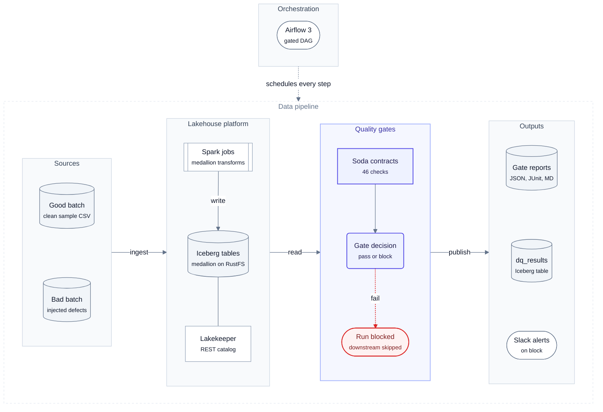
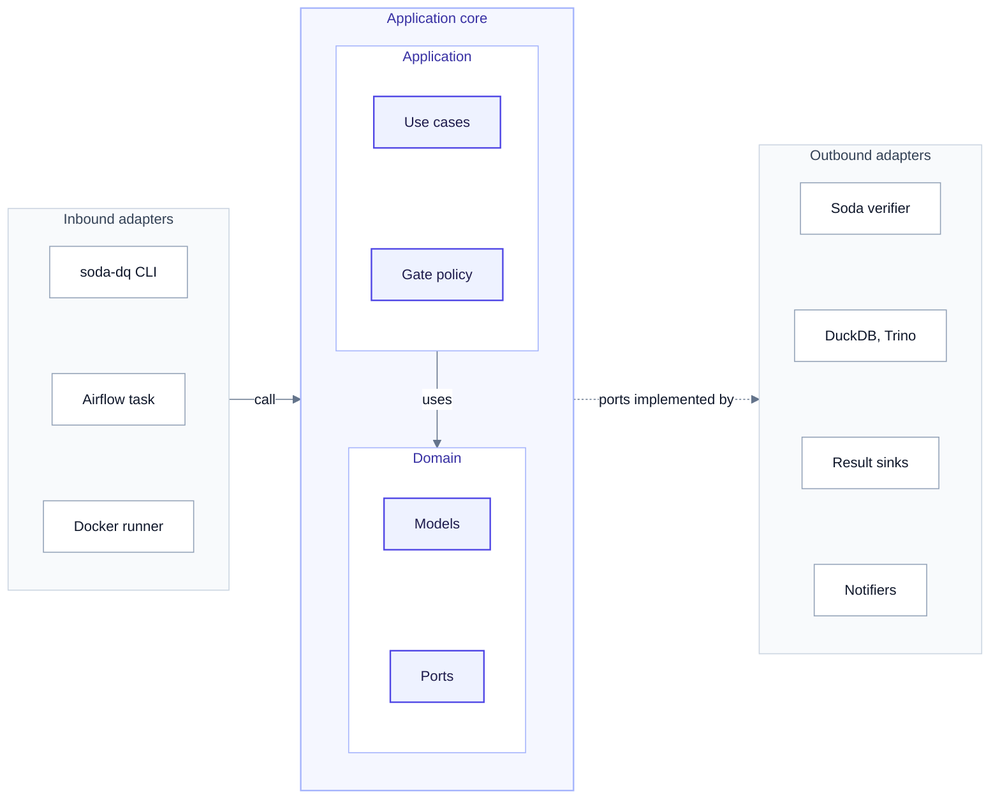
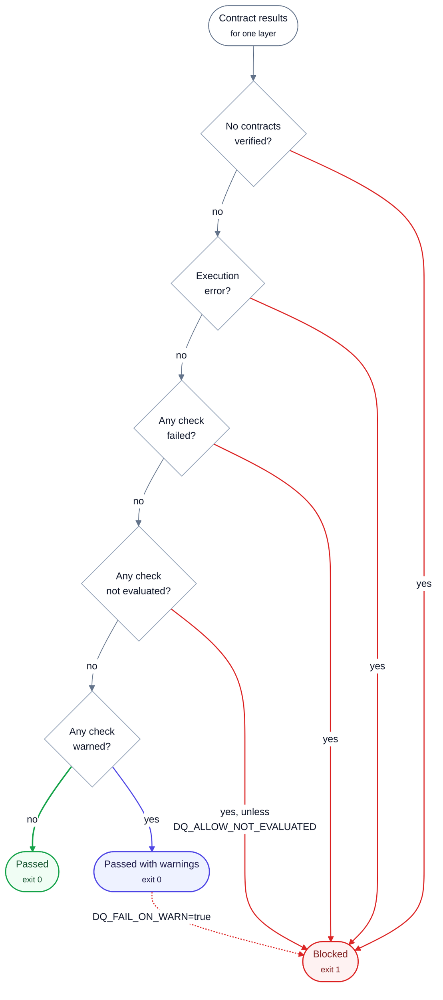
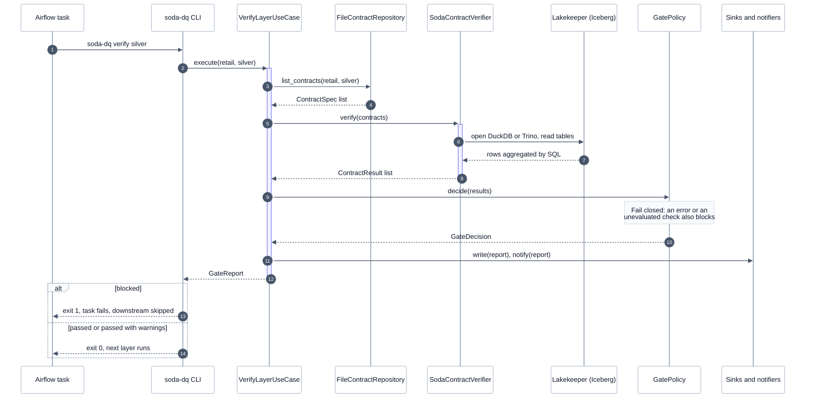
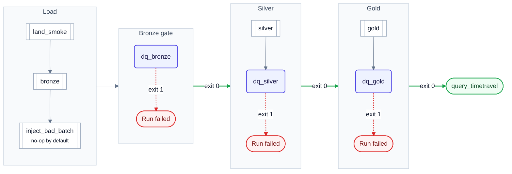
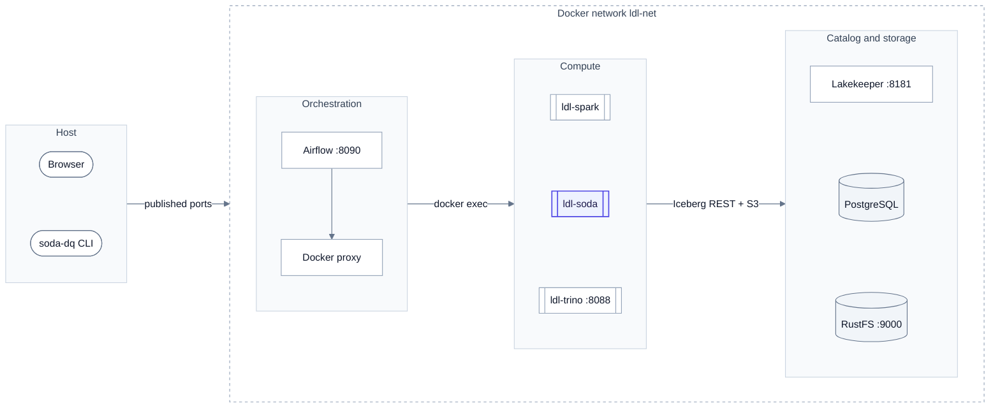
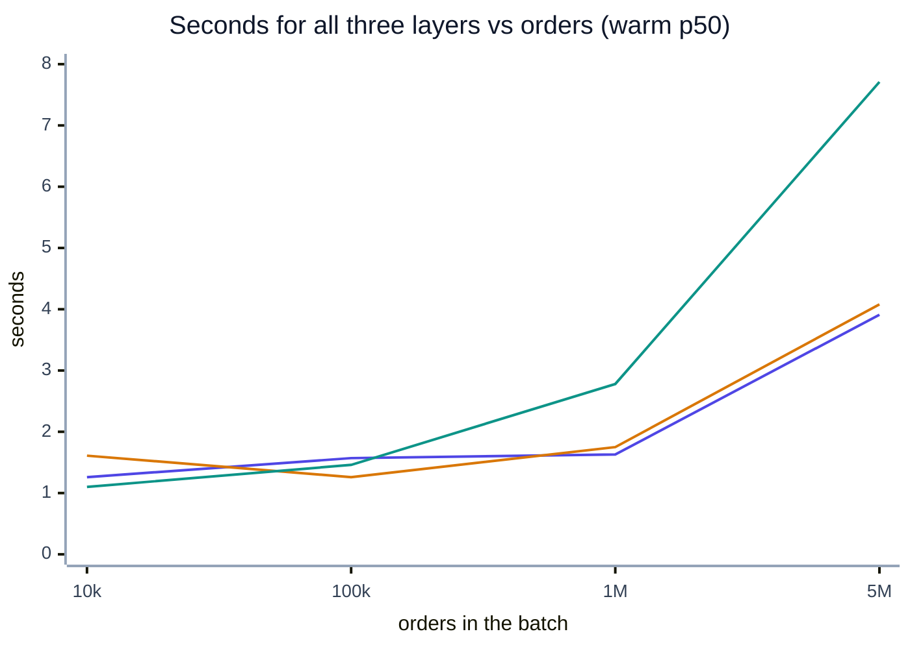
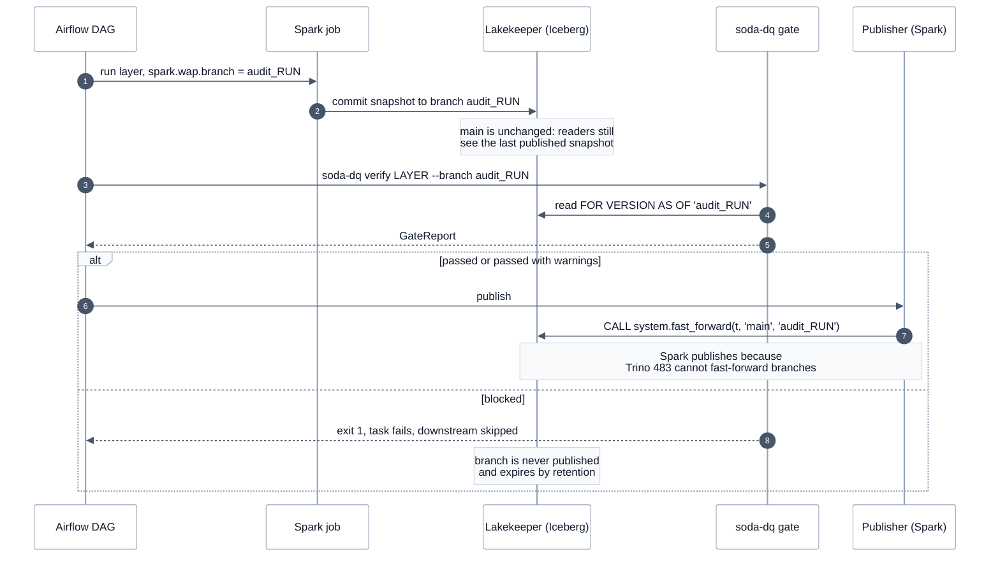

# lakehouse-quality-gates: System Design

| | |
|---|---|
| **Version** | 1.1 (release v0.3.1: documentation restructured) |
| **Status** | Accepted. Sections 12 to 14 are measured; section 17 (write-audit-publish) is proposed |
| **Author** | Santosh Shinde |
| **Date** | 2026-10-13 |
| **Repository** | [santoshshinde2012/lakehouse-quality-gates](https://github.com/santoshshinde2012/lakehouse-quality-gates) |
| **Reviewers** | Data platform owners of `local-data-lakehouse` |

> [!TIP]
> This is the end-to-end document. The same material is split into focused pages in
> [architecture/](architecture/README.md), [guides/](guides/quickstart.md) and [benchmarks/](benchmarks/README.md);
> terms are defined in the [glossary](overview/glossary.md). The [documentation hub](README.md) lists everything.

## Contents

1. [Executive summary](#1-executive-summary)
2. [Problem statement, goals and non-goals](#2-problem-statement-goals-and-non-goals)
3. [Requirements](#3-requirements)
4. [Background and tool selection](#4-background-and-tool-selection)
5. [High-level architecture](#5-high-level-architecture)
6. [Detailed design](#6-detailed-design)
7. [Data flow and sequences](#7-data-flow-and-sequences)
8. [Orchestration](#8-orchestration)
9. [Deployment topology](#9-deployment-topology)
10. [Security](#10-security)
11. [Observability](#11-observability)
12. [Benchmarks and performance analysis](#12-benchmarks-and-performance-analysis)
13. [Reliability and failure modes](#13-reliability-and-failure-modes)
14. [Scalability and capacity planning](#14-scalability-and-capacity-planning)
15. [Trade-offs and alternatives considered](#15-trade-offs-and-alternatives-considered)
16. [Known limitations and risks](#16-known-limitations-and-risks)
17. [Roadmap: write-audit-publish](#17-roadmap-write-audit-publish)
18. [Testing strategy](#18-testing-strategy)
19. [Operations runbook summary](#19-operations-runbook-summary)
20. [Appendix](#20-appendix)

---

## 1. Executive summary

> [!IMPORTANT]
> **Decision.** Keep Soda Core v4 as the gate engine and add Iceberg write-audit-publish next. Today a gate stops
> promotion but cannot hide a layer Spark has already written ([L1](#16-known-limitations-and-risks)).

`local-data-lakehouse` builds a retail medallion (bronze, silver and gold Apache Iceberg tables) with Spark,
orchestrated by Airflow 3. Before this project nothing stopped a bad batch from flowing from bronze into the
tables people query. **lakehouse-quality-gates** adds a *quality gate* after every layer: a set of
[Soda Core v4](https://docs.soda.io/) data contracts that run against the freshly written tables, and a
policy that turns their results into **pass** (promote the next layer) or **block** (fail the Airflow task,
so nothing downstream runs, and alert).

The design is a small hexagonal Python service (`soda-dq`) with one composition root, three engines behind
one port (host DuckDB, Trino, and DuckDB inside a hardened container), five pluggable result sinks and two
notifiers. It sits next to the lakehouse and changes none of its files.

**What the measurements say** (Apple M1 Pro, Docker Desktop with 8 GiB, section 12):

| Question | Answer (measured) |
|---|---|
| How long does a gate take? | Host DuckDB, warm p50 per layer: **0.4 to 0.6 s up to 1M orders, 0.5 to 2.0 s at 5M**. Slowest warm run anywhere on DuckDB: 3.6 s (container, bronze, 5M) |
| What does it cost next to the pipeline? | **4 to 5 %** of the Spark job time per layer on the lakehouse sample (about 1.1 s of gate process vs 20 to 26 s of `spark-submit`). Against a fast DuckDB writer at 1M to 5M rows, 37 to 60 % for bronze and silver |
| How much memory? | Peak client RSS **≤ 780 MiB at 5M orders** (container, bronze); under 300 MiB up to 1M |
| Does it catch bad data? | **66 of 66 gate verdicts correct** over 7 defect types × 3 rates (0.1 %, 1 %, 10 %) plus a clean control; check-level precision and recall **1.0**; reported failing-row counts equal the injected counts |
| Where does it break? | **Trino with the lakehouse's default 1 GiB heap fails at 5M orders** (`EXCEEDED_LOCAL_MEMORY_LIMIT` on the bronze and silver order checks). The gate fails *closed* (blocks) as designed, but it is a false block caused by capacity, not data |
| How does Soda compare? | Same six checks at 1M rows: Soda 0.44 s / 204 MiB, Pointblank 0.47 s / 389 MiB, datacontract-cli 1.08 s / 286 MiB, Pandera 2.83 s / 1.5 GiB, GX Core 11.5 s / 723 MiB. All five got every verdict right |

**Decision.** Keep Soda Core v4 (Elastic License 2.0, internal use is allowed) as the gate engine and
add Iceberg **write-audit-publish** on Spark next (section 17), which closes the one real correctness gap:
today a gate stops *promotion* but cannot hide a bad layer that Spark has already written with
`CREATE OR REPLACE`. The fully OSI-licensed fallback is ODCS v3.2 + datacontract-cli + Pointblank (section 4).

## 2. Problem statement, goals and non-goals

> [!NOTE]
> **At a glance.** Bad batches flowed from bronze to gold unchecked. Goal: block the right layer for every injected defect, never block clean data, and change nothing in the lakehouse.

### Problem

Spark jobs in the lakehouse overwrite each layer from the one below. A malformed file (a missing key, a
negative amount, an orphan customer, an order dated 2099) is silently carried into silver, aggregated into
gold, and served to BI. Nobody finds out until a number looks wrong, and by then several layers and
snapshots carry the problem.

### Goals

| # | Goal | Measure |
|---|---|---|
| G1 | Block promotion of a layer that violates its contract | 100% of injected blocking defects block the right gate (section 12.4) |
| G2 | Never block clean data | 0 false blocks on clean batches at every scale |
| G3 | Cheap enough to run after every layer | Gate p95 well inside the latency budget in section 3.2 |
| G4 | Contracts as reviewable code | Plain Soda contract YAML per dataset, in git, validated in CI |
| G5 | Same contracts on every engine | One contract file runs on DuckDB and Trino unchanged |
| G6 | Zero changes to `local-data-lakehouse` | Referenced by path; its git tree stays clean |
| G7 | Explainable outcomes | Every block names the contract, column, check and metric |

### Non-goals

- Anomaly detection, profiling or ML-based monitoring (Soda Cloud territory; see section 15).
- Quarantining or repairing bad rows. The gate decides; humans or upstream jobs fix.
- Multi-table atomic publishing. Iceberg has no cross-table transactions on this catalog.
- Replacing the lakehouse's original DAG. The gated DAG is a sibling (ADR 0004).
- A hosted service. This runs on a laptop or a single VM next to the lakehouse.

## 3. Requirements

> [!NOTE]
> **At a glance.** Nine functional requirements and eight SLOs. Latency, correctness and memory SLOs are met on DuckDB; overhead is met against Spark; Trino misses the 5M-order latency SLO on its default heap.

### 3.1 Functional

| ID | Requirement |
|---|---|
| F1 | Verify all contracts of one layer (`soda-dq verify <layer>`) or the whole medallion in order, stopping at the first blocked layer (`soda-dq run`) |
| F2 | Decide **passed**, **passed with warnings** or **blocked** from check outcomes with a configurable policy (section 6.4) |
| F3 | Exit codes are the API: `0` pass (warnings allowed), `1` blocked, `2` configuration or usage error |
| F4 | Run the same contracts on host DuckDB, Trino, or DuckDB inside the `ldl-soda` container, chosen by `DQ_ENGINE` |
| F5 | Write a JSON, JUnit XML and Markdown report per gate; optionally append rows to the `ops.dq_results` Iceberg table |
| F6 | Notify on problems (console always, Slack incoming webhook when configured) |
| F7 | Airflow DAG with a gate after every layer and a demo switch that injects a bad batch |
| F8 | Contract variables overridable per run (`--set MAX_ORDER_AMOUNT=50000`) |
| F9 | Validate contract syntax without data (`soda-dq validate`), runnable in CI |

### 3.2 Non-functional (SLOs)

| ID | Area | Target (SLO) | Measured (section 12) |
|---|---|---|---|
| N1 | Gate latency | p95 ≤ 10 s per layer up to 1M orders, ≤ 30 s at 5M, on the reference laptop | **Met** for host DuckDB and the container at every size (worst warm p95 3.56 s at 5M). Trino met up to 1M (worst p95 7.69 s, one outlier) and **fails** at 5M on the default 1 GiB heap (section 12.2) |
| N2 | Overhead | A gate costs less than its layer's build at ≥ 1M rows | **Met against Spark** (4 to 5 %). Against the DuckDB writer met for bronze and silver at ≥ 1M (37 to 60 %); not met for gold, whose build is a 90-row aggregate (0.16 to 0.55 s) |
| N3 | Correctness | Recall 1.0 on blocking defect categories; 0 false blocks on clean data | **Met**: 30/30 expected failing or warning checks raised, 0 unexpected, 0 false blocks on clean data |
| N4 | Memory | Gate client peak RSS ≤ 2 GiB at 5M orders (fits the 8 GiB Docker VM next to Spark and Trino) | **Met**: 684 MiB host, 780 MiB container at 5M |
| N5 | Availability | A gate that cannot run **blocks** (fail closed); no silent pass | By design: execution errors and NOT_EVALUATED block |
| N6 | Security | No long-lived storage keys; non-root, read-only container; secrets never logged | Section 10 |
| N7 | Portability | One contract set for every engine; Python 3.12; macOS and Linux | CI on Ubuntu, live runs on macOS |
| N8 | Maintainability | `ruff`, `mypy --strict`, ≥ 95% line coverage | 103 tests at 99% coverage |

## 4. Background and tool selection

> [!NOTE]
> **At a glance.** Soda Core v4 stays (score 76, ELv2). The OSI fallback is ODCS + datacontract-cli + Pointblank (score 82).

A separate landscape study ([docs/research/quality-gates-landscape.md](research/quality-gates-landscape.md),
13 Oct 2026) verified licences, versions and engine support from PyPI, GitHub and vendor docs, and ran the
same six checks in five tools. The summary:

| Tool | Licence (verified) | Trino | DuckDB | Spark | Contracts | Warn tier | Failed rows | Score /100 |
|---|---|---|---|---|---|---|---|---|
| datacontract-cli + ODCS v3.2 | MIT / Apache-2.0 | ✅ | ✅ | ✅ (DataFrame) | ODCS open standard | not exercised | counts only | **82** |
| **Soda Core v4** (chosen) | **Elastic License 2.0** | ✅ `soda-trino` | ✅ `soda-duckdb` | ✅ `soda-sparkdf` | YAML contracts | ✅ | counts (rows via diagnostics warehouse) | **76** |
| GX Core 1.x | Apache-2.0 | ✅ table assets | ✅ | ✅ | expectation suites | `mostly` | ✅ | 74 |
| Pointblank | MIT | ❌ | ✅ | ✅ | YAML | ✅ | ✅ full rows | 72 |
| dbt + Elementary | Apache-2.0 | ✅ | ✅ | ✅ | model contracts | ✅ | `store_failures` | 71 |
| Pandera | MIT | via Ibis | ✅ | ✅ | schema classes | ❌ | ✅ | 64 |

Weights: OSI licence 20, engine coverage 20, contracts-as-code 15, Airflow gating 10, failed rows 10,
anomaly detection 5, maturity 10, adoption effort 10. Licence scoring: OSI 20, source-available 8.

**Why Soda stays.** It was already adopted, it had the most compact declarative contracts and correct
verdicts in the study, it has native referential (`valid_reference_data`), freshness, schema, duplicate and
SQL metric checks with warn/fail tiers, and its Python API returns structured results that map cleanly to
our domain. The licence (ELv2, source-available) forbids offering Soda as a managed service, which this
project does not do; ADR 0001 records the acceptance. The ELv2 licence is the main thing that costs Soda
points, and the reason the OSI fallback exists.

**OSI fallback.** ODCS v3.2 contracts tested by datacontract-cli, with Pointblank for failed-row extracts,
behind the same `ContractVerifier` port. Estimated 1.5 to 2.5 weeks; nothing outside one adapter changes.

**Commercial observability** (Monte Carlo, Bigeye, Sifflet, Anomalo, Soda Cloud) was reviewed and rejected
for this laptop lakehouse: none runs locally, and the only documented Trino-family connector is a Starburst
preview.

Section 12.6 re-runs the tool comparison at 100k and 1M rows on the Mac.

## 5. High-level architecture

> [!NOTE]
> **At a glance.** A gate runs after each Spark layer; Airflow schedules both. Ports and adapters inside `soda-dq`.

Where the quality gates sit between the lakehouse layers, and what every gate run produces.

<!-- diagram:system-architecture -->

<!-- /diagram -->

**How to read it:**

- Read left to right, following the data: **Sources → Lakehouse platform → Quality gates → Outputs**.
- Indigo is this project (`soda-dq`); grey zones belong to `local-data-lakehouse` or are outputs.
- The red dotted path is a **block**: the gate fails, the Airflow task fails, nothing downstream runs.
- Airflow (top) schedules every step: the Spark job of a layer, then that layer's gate.

| Zone | Responsibility |
|---|---|
| Orchestration | Airflow 3 runs `lakehouse_retail_medallion_dq`: a Spark task per layer, then a gate task |
| Sources | CSV batches (`fixtures/good_batch`, `fixtures/bad_batch`, or generated at scale by `scripts/gen_scale_data.py`) |
| Lakehouse platform | `local-data-lakehouse`: Spark 4.1 writes Iceberg 1.12 tables to RustFS (S3) through the Lakekeeper REST catalog |
| Quality gates | `soda-dq`: renders contracts, verifies them through an engine, applies the gate policy |
| Outputs | Reports per gate, optional `ops.dq_results` Iceberg table, Slack alerts, Airflow task state |

### Code architecture

How the `soda-dq` code is layered as ports and adapters.

<!-- diagram:code-architecture -->

<!-- /diagram -->

**How to read it:**

- Inbound adapters (left) start a gate run: the CLI, the Airflow task, the Docker runner.
- The application core (indigo) holds the use cases, the gate policy, the domain models and the ports. It imports no third-party library except structlog.
- Outbound adapters (right) implement the ports: Soda, DuckDB and Trino, the sinks, the notifiers.
- Dependencies point inward. `container.py` (not drawn) is the only place that wires concrete classes.

Dependencies point inward: the domain imports only the standard library; the application imports only the
domain (and structlog); adapters implement domain ports; `container.py` is the only module that
instantiates concrete classes (ADR 0005).

## 6. Detailed design

> [!NOTE]
> **At a glance.** Rendered Soda contracts, three engines behind one port, a fail-closed policy, four sinks and two notifiers.

### 6.1 Components

| Layer | Module | Responsibility |
|---|---|---|
| Entry | `cli.py` (Typer) | `verify`, `run`, `seed`, `list`, `validate`; maps outcomes to exit codes |
| Entry | `airflow/dags/lakehouse_retail_medallion_dq.py`, `dq_operators.py` | Gate tasks as `docker exec ldl-soda soda-dq verify <layer>` |
| Composition | `container.py`, `settings.py` | Build provider, verifier, repository, sinks, notifiers from `DQ_*` settings |
| Application | `application/verify_layer.py` | `VerifyLayerUseCase` (one layer), `RunMedallionUseCase` (bronze → silver → gold, stop on block) |
| Application | `application/quality_gate.py` | `GatePolicy.decide(results) → GateDecision` |
| Domain | `domain/models.py`, `ports.py`, `errors.py` | Value objects, `Protocol` ports, error hierarchy |
| Adapter | `adapters/contracts.py` | `FileContractRepository`: discover and render contracts |
| Adapter | `adapters/soda_verifier.py` | `SodaContractVerifier`: the only module that imports Soda |
| Adapter | `adapters/datasources/*` | `DuckDBProvider`, `TrinoProvider`: open sessions, warm metadata |
| Adapter | `adapters/sinks/*`, `notifiers/*` | JSON, JUnit, Markdown, Iceberg sinks; console and Slack notifiers |

### 6.2 Data model

The domain types, the ports (Python `Protocol`s) and the adapters that implement them.

```mermaid
%%{init: {'theme':'base','themeVariables':{'fontFamily':'Inter, system-ui, -apple-system, Segoe UI, Helvetica, Arial, sans-serif','fontSize':'14px','primaryColor':'#ffffff','primaryTextColor':'#0f172a','primaryBorderColor':'#94a3b8','secondaryColor':'#f8fafc','tertiaryColor':'#f8fafc','lineColor':'#64748b','textColor':'#0f172a','clusterBkg':'#f8fafc','clusterBorder':'#cbd5e1','titleColor':'#334155','edgeLabelBackground':'#ffffff','noteBkgColor':'#f8fafc','noteTextColor':'#0f172a','noteBorderColor':'#cbd5e1','actorBkg':'#ffffff','actorBorder':'#94a3b8','actorTextColor':'#0f172a','actorLineColor':'#94a3b8','signalColor':'#475569','signalTextColor':'#0f172a','labelBoxBkgColor':'#f8fafc','labelBoxBorderColor':'#94a3b8','labelTextColor':'#0f172a','loopTextColor':'#0f172a','activationBkgColor':'#eef2ff','activationBorderColor':'#4f46e5','sequenceNumberColor':'#ffffff','classText':'#0f172a','xyChart':{'backgroundColor':'#ffffff','plotColorPalette':'#4f46e5, #d97706, #0d9488','titleColor':'#0f172a','xAxisLabelColor':'#334155','yAxisLabelColor':'#334155','xAxisLineColor':'#94a3b8','yAxisLineColor':'#94a3b8'}}}}%%
%% Title: Domain model and ports
%% Purpose: The domain types, the ports (Protocols) and the adapters that implement them
%% Last updated: 2026-10-13
%% Theme: docs/diagrams/THEME.md (shared init line above). Edit here, then run: make diagrams
classDiagram
  direction TB
  namespace domain {
    class ContractSpec {
      +name: str
      +pipeline: str
      +layer: Layer
      +dataset: str
      +references: tuple
    }
    class CheckResult {
      +name: str
      +check_type: str
      +outcome: Outcome
      +column: str
      +metrics: dict
    }
    class ContractResult {
      +contract: ContractSpec
      +checks: tuple
      +errors: tuple
    }
    class GateReport {
      +run_id: str
      +layer: Layer
      +engine: str
      +status: GateStatus
      +reasons: tuple
    }
    class ContractRepository {
      <<Protocol>>
      +list_contracts(pipeline, layer)
    }
    class ContractVerifier {
      <<Protocol>>
      +verify(contracts, variables)
    }
    class ResultSink {
      <<Protocol>>
      +write(report)
    }
    class Notifier {
      <<Protocol>>
      +notify(report)
    }
  }
  namespace application {
    class VerifyLayerUseCase {
      +execute(pipeline, layer, variables) GateReport
    }
    class GatePolicy {
      +fail_on_warn: bool
      +allow_not_evaluated: bool
      +decide(results) GateDecision
    }
  }
  namespace adapters {
    class FileContractRepository
    class SodaContractVerifier
    class JsonFileSink
    class SlackWebhookNotifier
  }
  ContractResult o-- CheckResult
  ContractResult --> ContractSpec
  GateReport o-- ContractResult
  VerifyLayerUseCase --> ContractRepository
  VerifyLayerUseCase --> ContractVerifier
  VerifyLayerUseCase --> GatePolicy
  VerifyLayerUseCase --> ResultSink
  VerifyLayerUseCase --> Notifier
  FileContractRepository ..|> ContractRepository
  SodaContractVerifier ..|> ContractVerifier
  JsonFileSink ..|> ResultSink
  SlackWebhookNotifier ..|> Notifier
  style ContractSpec fill:#eef2ff,stroke:#4f46e5,color:#1e1b4b
  style CheckResult fill:#eef2ff,stroke:#4f46e5,color:#1e1b4b
  style ContractResult fill:#eef2ff,stroke:#4f46e5,color:#1e1b4b
  style GateReport fill:#eef2ff,stroke:#4f46e5,color:#1e1b4b
  style ContractRepository fill:#f5f7ff,stroke:#4f46e5,stroke-dasharray:4 3,color:#1e1b4b
  style ContractVerifier fill:#f5f7ff,stroke:#4f46e5,stroke-dasharray:4 3,color:#1e1b4b
  style ResultSink fill:#f5f7ff,stroke:#4f46e5,stroke-dasharray:4 3,color:#1e1b4b
  style Notifier fill:#f5f7ff,stroke:#4f46e5,stroke-dasharray:4 3,color:#1e1b4b
  style VerifyLayerUseCase fill:#eef2ff,stroke:#4f46e5,color:#1e1b4b
  style GatePolicy fill:#eef2ff,stroke:#4f46e5,color:#1e1b4b
  style FileContractRepository fill:#ffffff,stroke:#94a3b8,color:#0f172a
  style SodaContractVerifier fill:#ffffff,stroke:#94a3b8,color:#0f172a
  style JsonFileSink fill:#ffffff,stroke:#94a3b8,color:#0f172a
  style SlackWebhookNotifier fill:#ffffff,stroke:#94a3b8,color:#0f172a
```

<!-- diagram:domain-model -->

<!-- /diagram -->

**How to read it:**

- Solid indigo boxes are domain and application types; dashed indigo boxes are ports.
- White boxes are adapters; one example per port is shown (see the components table for all).
- A dotted arrow with a hollow head means *implements*; a diamond means *contains*.
- Field lists are abridged; the source is `src/soda_lakehouse_dq/domain/models.py`.

| Type | Kind | Notes |
|---|---|---|
| `Layer` | `StrEnum` | `bronze`, `silver`, `gold` |
| `Outcome` | `StrEnum` | `passed`, `warned`, `failed`, `not_evaluated`, `excluded` (mapped from Soda's outcomes) |
| `GateStatus` | `StrEnum` | `passed`, `passed_with_warnings`, `blocked` |
| `ContractSpec` | frozen dataclass | Rendered contract path, dataset, referenced datasets |
| `CheckResult` | frozen dataclass | Name, type, outcome, column, metrics (`missing_count`, `invalid_count`, ...), details |
| `ContractResult` | frozen dataclass | Contract + checks + execution errors |
| `GateReport` | frozen dataclass | Run id, layer, engine, status, results, reasons, timestamp |

### 6.3 Contracts per layer

One YAML file per dataset under `contracts/retail/<layer>/`. Bronze keeps raw values, so value problems
**warn** there and are **enforced** in silver; structural problems fail at bronze.

| Layer | Dataset | Check | Type | Level |
|---|---|---|---|---|
| bronze | `orders_raw` | Schema is unchanged | schema | fail |
| bronze | `orders_raw` | Batch is not empty | row_count ≥ 1 | fail |
| bronze | `orders_raw` | Ingested within `BRONZE_MAX_AGE_HOURS` (24) | freshness on `_ingested_at` | fail |
| bronze | `orders_raw` | No order duplicated inside one source file | duplicate (`order_id`, `_source_file`) | fail |
| bronze | `orders_raw` | Every order has an id, a customer, a timestamp, an amount | missing × 4 | fail |
| bronze | `orders_raw` | Status is a known value (case-insensitive) | invalid, `LOWER(TRIM(status))` | warn |
| bronze | `orders_raw` | Amount is not negative | invalid, `valid_min: 0` | warn |
| bronze | `customers_raw` | Schema, not empty, every customer has an id | schema, row_count, missing | fail |
| bronze | `customers_raw` | Email is present | missing | warn |
| silver | `orders` | Schema, not empty | schema, row_count | fail |
| silver | `orders` | No order timestamped in the future | failed_rows | fail |
| silver | `orders` | Order id present and unique after dedup | missing, duplicate | fail |
| silver | `orders` | Customer exists in `silver.customers` | invalid, `valid_reference_data` | fail |
| silver | `orders` | Status is canonical; amount present and not negative | invalid, missing | fail |
| silver | `orders` | Amount below `MAX_ORDER_AMOUNT` (10,000) | invalid, `valid_max` | warn |
| silver | `customers` | Schema, not empty, id present and unique, name, email present, well-formed and unique, signup date present | schema, row_count, missing, duplicate, regex | fail |
| gold | `daily_order_metrics` | Schema, at least one day, one row per day, order date present | schema, row_count, duplicate, missing | fail |
| gold | `daily_order_metrics` | Cancelled + refunded never exceed orders; no future days | failed_rows | fail |
| gold | `daily_order_metrics` | Order count reconciles with `silver.orders` | metric (SQL), must be 0 | fail |
| gold | `daily_order_metrics` | Orders ≥ 1, revenue and average order value not negative | invalid | fail |
| gold | `daily_order_metrics` | Average order value ≤ `MAX_AVG_ORDER_VALUE` (1,000) | invalid | warn |

Totals: 14 bronze, 21 silver and 11 gold checks (46). Full text in [contracts.md](guides/contracts.md).

### 6.4 Gate policy semantics

How `GatePolicy` turns the check outcomes of one layer into *passed*, *passed with warnings* or *blocked*.

<!-- diagram:gate-policy -->

<!-- /diagram -->

**How to read it:**

- Questions are asked top to bottom; any *yes* on a red path **blocks** (exit code 1).
- The gate **fails closed**: no contracts, an execution error or an unevaluated check all block by default.
- The only overrides are `DQ_ALLOW_NOT_EVALUATED` and `DQ_FAIL_ON_WARN` (plus `allow_empty`, in code only).
- The policy evaluates every rule and reports **all** reasons, not just the first one.

| Situation | Default | Override |
|---|---|---|
| A check **failed** | block | none |
| A contract raised an **execution error** (SQL error, missing table) | block | none (fail closed) |
| A check is **not evaluated** (e.g. a metric could not be computed) | block | `DQ_ALLOW_NOT_EVALUATED=true` |
| A check **warned** | pass with warnings | `DQ_FAIL_ON_WARN=true` blocks |
| The layer has **no contracts** | block | `allow_empty` in code only |

Reasons are collected in a stable order (errors, failures, not evaluated, warnings) and printed, written to
every report and sent to notifiers.

### 6.5 Engine abstraction

`DataSourceProvider.open()` yields `SodaDataSources`: the Soda data-source implementations plus a
`prepare(dataset)` hook. `SodaContractVerifier` never knows which engine it talks to.

| Engine | Provider | How it connects | Dataset prefix |
|---|---|---|---|
| `duckdb` | `DuckDBProvider` | `lakehouse_client.duckdb_connect()` from the lakehouse repo: DuckDB `iceberg` extension, `ATTACH` to the Lakekeeper REST catalog with vended S3 credentials; Soda wraps the cursor (`from_existing_cursor`, ADR 0002) | `lakehouse_duckdb/<schema>/<table>` |
| `duckdb-local` | `DuckDBProvider` + `LocalMedallionBuilder` | In-memory DuckDB built from CSVs with the same SQL as the Spark jobs (CI, demos) | same |
| `trino` | `TrinoProvider` | `datasources/trino.yml` (soda-trino), Trino 483 Iceberg connector on the same catalog | `lakehouse_trino/lakehouse/<schema>/<table>` |
| container | `DuckDBProvider` in `ldl-soda` | Same as `duckdb`, inside `ldl-net`, `httplib` client, spill to tmpfs | same as `duckdb` |

### 6.6 Templating

Soda v4 does not substitute variables in the `dataset:` key, so contracts carry a `{{ dataset_root }}`
token that `FileContractRepository` renders per engine before Soda reads the file (ADR 0003). Unknown
tokens raise `ContractRenderError` (exit 2). Everything else is plain Soda syntax, including
`${var.NAME}` variables with defaults, overridable with `--set`.

### 6.7 Sinks and notifiers

| Port | Adapter | Output |
|---|---|---|
| `ResultSink` | `JsonFileSink` | `reports/<run>_<pipeline>_<layer>.json` (full report) |
| `ResultSink` | `JUnitXmlSink` | JUnit XML: one test case per check (CI-native) |
| `ResultSink` | `MarkdownSink` | Human summary; CI appends it to the job summary |
| `ResultSink` | `IcebergSink` | Appends one row per check to `ops.dq_results` through PyIceberg (`DQ_ICEBERG_SINK=true`) |
| `Notifier` | `ConsoleNotifier` | Always on |
| `Notifier` | `SlackWebhookNotifier` | HTTPS webhook only; by default only on warnings or blocks |

A notifier that raises is logged and ignored: alerting must never hide the gate result.

### 6.8 Configuration

`pydantic-settings` reads `DQ_*` environment variables and `.env`. The full table is in the
[runbook](guides/configuration.md#settings-dq_). Invalid values fail at start-up with exit 2.

### 6.9 Error handling

| Error | Raised by | Exit code | Gate effect |
|---|---|---|---|
| `ContractNotFoundError` | repository | 2 | no gate run |
| `ContractRenderError` | repository | 2 | no gate run |
| `DataSourceError` | providers | 2 | no gate run (Airflow task fails) |
| Soda execution error inside a contract | verifier → `ContractResult.errors` | 1 | block |
| `GateBlockedError` | `raise_if_blocked` (library use) | 1 | block |
| `NotificationError` | notifiers | logged | none |

## 7. Data flow and sequences

> [!NOTE]
> **At a glance.** Repository → verifier → policy → sinks. Each gate issues a fixed 3 to 5 SQL queries regardless of data size.

### 7.1 Medallion with gates

One gate after each layer; only a passing gate lets the next layer run.

<!-- diagram:medallion-gates -->

<!-- /diagram -->

**How to read it:**

- Green arrows are **pass**: the next layer is built.
- Red dotted arrows are **fail**: the run is **blocked** at that layer.
- The gates run 14 (bronze), 21 (silver) and 11 (gold) checks: 46 in total.
- A **warn** does not block unless `DQ_FAIL_ON_WARN=true`.

### 7.2 One gate run

What happens, step by step, when one layer is gated (here: silver).

<!-- diagram:gate-run-sequence -->

<!-- /diagram -->

**How to read it:**

- Numbers give the order of calls. Solid arrows are calls; dashed arrows are returns.
- Only `SodaContractVerifier` imports Soda, and only the data-source provider knows the engine (DuckDB or Trino).
- The note marks the key decision: the gate fails closed.
- The `alt` box shows the two exits: 1 (blocked) and 0 (passed, with or without warnings).

Soda issues one metadata query (schema) and one batched aggregate query per dataset, plus extra queries for
reference, failed-rows and SQL-metric checks. Measured per layer: bronze 4, silver 5, gold 3 queries
(identical on DuckDB and Trino; Trino's own query log confirms the counts, section 12).

## 8. Orchestration

> [!NOTE]
> **At a glance.** A sibling Airflow DAG with a `docker exec` gate task after each Spark task; gates never retry.

The tasks of the gated DAG and how a failed gate stops the run.

<!-- diagram:airflow-dag -->

<!-- /diagram -->

**How to read it:**

- White double-edged boxes are Spark tasks; indigo boxes are gate tasks (`docker exec ldl-soda soda-dq verify <layer>`).
- Exit 0 lets the next group run; exit 1 fails the task and every downstream task becomes `upstream_failed`.
- Gate tasks have `retries=0`: data problems do not fix themselves.
- `inject_bad_batch` does nothing unless the run is triggered with `{"inject_bad_batch": true}`.

| Concern | Design |
|---|---|
| Gate task | `BashOperator`: `docker exec ldl-soda soda-dq verify <layer>`, through the lakehouse's Docker socket proxy (exec only) |
| Retries | `retries=0` on gates: data problems do not fix themselves. Spark tasks keep the lakehouse defaults |
| Failure propagation | Exit 1 fails the task; downstream tasks become `upstream_failed` (verified live, see [results](results/README.md)) |
| Idempotency | Gates are read-only and safe to re-run. Spark layers are `CREATE OR REPLACE`, so a re-run rebuilds the layer from the one below |
| Re-run after a fix | Clear the failed `dq_<layer>` task (or the Spark task before it) in the Airflow UI |
| Backfills | The DAG is unscheduled (manual trigger, `catchup=False`), like the original. Backfills are re-runs of the whole medallion; per-partition backfills need WAP + partition-scoped contracts (section 17) |
| Demo fault injection | `inject_bad_batch` is a no-op unless the run conf has `inject_bad_batch: true`; the Jinja renders to the literal words `yes`/`no`, so no conf value reaches the shell |
| Concurrency | One DAG run at a time is assumed: layers are rebuilt in place |

## 9. Deployment topology

> [!NOTE]
> **At a glance.** One hardened `ldl-soda` container on the lakehouse network; everything else is the lakehouse.

The containers, their host ports and how they connect.

<!-- diagram:deployment -->

<!-- /diagram -->

**How to read it:**

- The dashed boundary is the Docker network `ldl-net`; `:NNNN` are host ports.
- `ldl-soda` (indigo) is this project; every other container belongs to `local-data-lakehouse`.
- Airflow reaches containers only through the Docker socket proxy, which allows `exec` and little else.
- `ldl-trino` runs only in the lakehouse's full profile with `TRINO=1`.

| Component | Image / version | Host port | Notes |
|---|---|---|---|
| Airflow api-server, scheduler, dag-processor | Apache Airflow 3 | 8090 (`AIRFLOW_API_PORT`) | Mounts our DAG through our own compose overlay |
| docker-proxy | socket proxy | none | Allowlist widened to `exec` for `ldl-soda` |
| `ldl-spark` | Spark 4.1.3, Iceberg 1.12 | none | Runs the jobs |
| `ldl-soda` | `lakehouse-quality-gates:<version>` | none | Non-root `dq`, read-only root FS, `cap_drop: ALL`, `no-new-privileges`, tmpfs `/tmp` |
| `ldl-trino` | Trino 483 | 8088 | Full profile only |
| `ldl-lakekeeper` | Lakekeeper | 8181 | Iceberg REST catalog, vends S3 credentials |
| `ldl-postgres` | PostgreSQL | none | Catalog database |
| `ldl-objectstore` | RustFS | 9000 | `s3://lake/warehouse` |

## 10. Security

> [!NOTE]
> **At a glance.** No storage keys, read-only access, non-root read-only container, secrets never logged.

| Area | Control |
|---|---|
| Storage credentials | None configured in `soda-dq`. DuckDB and Trino receive short-lived S3 credentials vended by Lakekeeper per table |
| Least privilege | The gate only reads; it never writes lakehouse tables (except `seed`, a demo command that refuses to run without `--yes`, and the opt-in `ops.dq_results` sink) |
| Container | Non-root user, read-only root filesystem, all capabilities dropped, `no-new-privileges`, digest-pinned base images, tmpfs for spills |
| Airflow → container | Through the lakehouse's socket proxy, `exec` only; task commands are built from validated, quoted constants |
| Secrets | `DQ_SLACK_WEBHOOK_URL` is a `SecretStr`, https-only, never logged; `.env` is git-ignored |
| Telemetry | `SODA_CORE_TELEMETRY_ENABLED=false` is forced |
| Supply chain | Versions pinned in `uv.lock`; pre-commit runs ruff, mypy, detect-private-key and YAML checks |
| Licence compliance | Our code: MIT. Soda Core v4: Elastic License 2.0 (source-available): internal use is allowed; offering Soda as a managed service is not. Kept out of `local-data-lakehouse`, whose rule is OSI-only dependencies (ADR 0001) |

## 11. Observability

> [!NOTE]
> **At a glance.** Reports per run, structured logs, optional `ops.dq_results` history, Slack on warn or block.

| Signal | Where | Use |
|---|---|---|
| Structured logs | structlog (`DQ_LOG_JSON=true` for JSON), events `dq.verify.start`, `dq.contract.verify`, `dq.verify.done`, `dq.notify.failed` | Debugging, log shipping |
| Gate reports | `reports/*.json`, `*.xml`, `*.md` | Audit trail per run; JUnit renders in CI |
| Iceberg history | `ops.dq_results` (one row per check: run id, created at, pipeline, layer, engine, gate status, contract, dataset, check name and type, column, outcome) | Trend queries in Trino or DuckDB, e.g. failure rate per check per week |
| Airflow | Task state, logs, durations | Gate latency per run, alert on task failure |
| Alerts | Slack webhook (on warn or block) | Human triage (runbook) |
| CI | Job summary with the Markdown reports, uploaded report artefacts | Contract changes are reviewed with their effect |

Suggested metrics when shipped to a metrics backend: `dq_gate_duration_seconds{layer,engine}`,
`dq_gate_status_total{layer,status}`, `dq_check_failed_total{contract,check}`, derived from the JSON reports
or `ops.dq_results`.

## 12. Benchmarks and performance analysis

> [!NOTE]
> **At a glance.** DuckDB gates: 0.4–0.6 s per layer to 1M orders, ≤ 780 MiB at 5M, 4–5 % of Spark time, 66/66 correct verdicts.

All numbers below are from real runs on one machine; raw data is in
[`docs/results/benchmarks/`](results/benchmarks/) (`perf_raw.csv`, `perf_raw.jsonl.gz` with every check result, `pipeline_raw.csv`,
`accuracy.csv/.jsonl`, `spark_reference.csv`, `tools.csv`, `specs.json`, `tools_versions.json`) and every
table is regenerated by `make bench-report` into [`summary.md`](results/benchmarks/summary.md). The harness
is described in [`benchmarks/README.md`](../benchmarks/README.md).

### 12.1 Method

| Item | Value |
|---|---|
| Machine | Apple M1 Pro, 10 cores, 16 GiB, macOS 26.6.2 |
| Docker | Docker 29.8.1, VM with 10 CPUs and 7.65 GiB; Trino 483 (JVM `-Xmx1G`, the lakehouse default) |
| Software | Python 3.12.9, soda-core 4.26.0, DuckDB 1.5.6 (tool comparison venv: soda-core 4.27.0) |
| Data | `scripts/gen_scale_data.py`, seed 42: 10k, 100k, 1M, 5M orders in 5 files, customers = orders / 10, 90 days |
| Engines | `duckdb` (host CLI process), `trino` (host process, Trino does the work), `container` (`ldl-soda`, read-only, DuckDB inside) |
| Runs | Per size × engine × layer: 1 cold (first after the seed) + 5 warm. Every run is a new process |
| Timings | `gate_s` = `VerifyLayerUseCase.execute` wall time (sinks off); `process s` adds interpreter start and imports |
| Stats | p50 = median of 5; **p95 = nearest rank of 5, which is the slowest warm run**; σ = population std-dev of 5 |
| Not controlled | Laptop background load, Docker Desktop VM, thermal state. Expect ±20 % run to run; see σ |

Each gate issues a fixed number of SQL queries regardless of size: **bronze 4, silver 5, gold 3** (Soda
batches the checks of a dataset into one aggregate query plus one per reference or duplicate check). Trino's
server-side count matched the client count in every run.

### 12.2 Latency

Warm p50 / p95 per gate, seconds (cold in brackets):

| orders | layer | host DuckDB | Trino | container |
|---|---|---|---|---|
| 10k | bronze | 0.44 / 0.72 (0.51) | 0.90 / 1.94 (1.53) | 0.58 / 0.65 (0.77) |
| 10k | silver | 0.45 / 0.55 (0.54) | 1.11 / 1.38 (1.27) | 0.59 / 0.73 (0.52) |
| 10k | gold | 0.37 / 0.39 (0.37) | 0.53 / 0.74 (0.63) | 0.44 / 0.58 (0.41) |
| 100k | bronze | 0.51 / 0.56 (0.70) | 0.78 / 1.31 (2.15) | 0.44 / 0.48 (1.35) |
| 100k | silver | 0.57 / 0.69 (0.58) | 0.76 / 0.86 (0.94) | 0.44 / 0.49 (0.48) |
| 100k | gold | 0.49 / 0.54 (0.63) | 0.49 / 0.63 (0.46) | 0.38 / 0.40 (0.40) |
| 1M | bronze | 0.62 / 0.67 (0.84) | 2.57 / 7.69 (2.75) | 0.66 / 0.97 (1.81) |
| 1M | silver | 0.62 / 0.79 (0.65) | 2.12 / 2.24 (6.41) | 0.64 / 0.73 (0.63) |
| 1M | gold | 0.39 / 0.43 (0.38) | 0.55 / 0.61 (0.87) | 0.45 / 0.46 (0.50) |
| 5M | bronze | 1.40 / 1.59 (1.81) | ⚠ 1.31 / 1.65 (2.48) blocked | 1.86 / 3.56 (3.54) |
| 5M | silver | 1.99 / 2.32 (1.33) | ⚠ 2.61 / 2.98 (2.61) blocked | 1.02 / 2.16 (1.53) |
| 5M | gold | 0.51 / 0.68 (0.50) | 0.50 / 0.63 (0.68) | 1.20 / 1.69 (1.13) |

Reading the table:

- **Gate time is nearly flat to 1M.** Up to 1M orders the fixed costs (opening the Iceberg catalog, loading
  metadata, Soda's planning) dominate; the scan of 22 MiB of Parquet is cheap. Going 1M → 5M (5× the data)
  roughly doubles to triples the bronze and silver gates on DuckDB. Gold reads a 90-row table and stays flat.
- **Process start-up adds 0.25 to 0.3 s on the host and about 0.7 s in the container** (`process p50` minus
  `gate p50` in the summary), which is what an Airflow task sees on top of the table above.
- **Variance is real.** The 1M Trino bronze p95 of 7.69 s is one run (σ 2.33 s) out of five whose others
  were 2.6 to 3.8 s; the container at 5M has σ up to 0.9 s. Cold runs are not consistently slower, because
  every run is a fresh process and the data was just written (OS and object-store caches are warm).
- **Trino at 5M (⚠):** the bronze and silver order checks fail with `EXCEEDED_LOCAL_MEMORY_LIMIT` on the
  lakehouse's 1 GiB Trino heap (the duplicate and reference checks hash 5M keys). Soda reports those checks as
  *not evaluated* and the gate **blocks** (fail closed). The timings are therefore of a failing gate. Fix:
  give Trino more memory (`-Xmx` and `query.max-memory-per-node`) or keep DuckDB for large batches.

All three gates, warm p50 summed, compared with the time to build all three layers (DuckDB writer, same
SQL as the Spark jobs):

Seconds for all three layers as the batch grows from 10k to 5M orders.

<!-- diagram:benchmark-scaling -->

<!-- /diagram -->

**How to read it:**

- **Indigo:** host DuckDB gates (bronze + silver + gold, warm p50 summed).
- **Amber:** the same gates in the `ldl-soda` container.
- **Teal:** the time to build the three layers (DuckDB writer running the Spark SQL).
- Trino is left out because its bronze and silver gates fail at 5M on the default 1 GiB heap. Source: [benchmark summary](results/benchmarks/summary.md).

| orders | gates, host DuckDB | gates, container | gates, Trino | build (DuckDB writer) |
|---|---|---|---|---|
| 10k | 1.26 | 1.61 | 2.54 | 1.10 |
| 100k | 1.57 | 1.26 | 2.03 | 1.46 |
| 1M | 1.63 | 1.75 | 5.23 | 2.78 |
| 5M | 3.91 | 4.08 | (blocked) | 7.71 |

### 12.3 Resources

Median of warm runs. RSS and CPU are for the gate *client* process. For `trino` the work happens in the
Trino server, whose CPU, physical input and peak memory come from Trino's query API, summed over the gate's
queries.

| orders | layer | DuckDB RSS MiB / CPU s | container RSS MiB / CPU s | Trino client RSS MiB | Trino server CPU s / scan MiB / peak MiB |
|---|---|---|---|---|---|
| 100k | bronze | 149 / 0.88 | 175 / 1.26 | 91 | 0.26 / 2 / 5 |
| 100k | silver | 142 / 0.89 | 166 / 1.21 | 92 | 0.17 / 4 / 3 |
| 1M | bronze | 294 / 1.19 | 312 / 2.28 | 91 | 2.51 / 24 / 145 |
| 1M | silver | 284 / 1.06 | 278 / 1.90 | 91 | 2.06 / 33 / 11 |
| 1M | gold | 121 / 0.75 | 145 / 1.24 | 91 | 0.04 / 0 / 1 |
| 5M | bronze | 684 / 2.95 | 780 / 7.16 | 91 | 0.90 / 117 / 179 (failed) |
| 5M | silver | 497 / 2.46 | 604 / 4.43 | 91 | 4.53 / 162 / 180 (failed) |
| 5M | gold | 119 / 0.86 | 214 / 3.19 | 91 | 0.04 / 0 / 1 |

Iceberg data sizes (Trino `$files`): bronze orders 0.2 / 2.1 / 22 / 112 MiB and silver orders
0.2 / 2.0 / 22 / 116 MiB at 10k / 100k / 1M / 5M. The Trino scan bytes show that a gate reads about 1.1 to 1.4 times
the orders table's data size (the aggregate pass plus the duplicate or reference pass); DuckDB's iceberg
extension does not expose scan bytes, and its scans are the same SQL. Host DuckDB uses more CPU than wall
time (multi-threaded scans); the container is slower per CPU-second because Docker Desktop's VM file and
network path sits between it and MinIO.

### 12.4 Detection accuracy

100k orders, host DuckDB, each defect injected alone by the generator (with ground truth in
`ground_truth.json`) at 0.1 %, 1 % and 10 % of rows (of customers for `malformed_email`), all three gates
run on every batch. A *TP* is an expected failing or warning check that fired.

| defect | expected effect | 0.1 % | 1 % | 10 % | reported count vs injected |
|---|---|---|---|---|---|
| none (control) | all pass | ✅ | — | — | — |
| missing_customer | block bronze + silver | ✅ | ✅ | ✅ | exact (100 / 1,000 / 10,000) |
| duplicate_in_file | block bronze | ✅ | ✅ | ✅ | exact |
| negative_amount | warn bronze, block silver | ✅ | ✅ | ✅ | exact |
| orphan_customer | block silver | ✅ | ✅ | ✅ | exact |
| future_timestamp | block silver + gold | ✅ | ✅ | ✅ | exact in silver; gold reports 1 (one future *day* of metrics) |
| malformed_email | block silver | ✅ | ✅ | ✅ | exact (10 / 100 / 1,000 customers) |
| unknown_status | warn bronze only | ✅ | ✅ | ✅ | exact |

**66 / 66 gate verdicts correct (22 batches × 3 layers), check-level precision 1.000 and recall 1.000
(30 TP, 0 FP, 0 FN), no false block on the clean control.** Two honest caveats: the defects are the ones the
contracts were written for, so this shows the gates do what the contracts say, not that the contracts cover
every possible defect; and the generator injects one defect type per batch, so interaction effects were not
tested. Where a check name exists in two contracts (for example *Customer id present* in silver orders and
silver customers) the raw CSV lists both counts, such as `0;100`.

### 12.5 Overhead against the pipeline

On the lakehouse's own sample, running the real Spark jobs (`spark-submit --master local[*]` inside
`ldl-spark`, three repeats):

| layer | Spark job s (median) | gate s | gate process s | gate process / Spark |
|---|---|---|---|---|
| bronze | 26.3 | 0.79 | 1.17 | **4 %** |
| silver | 23.3 | 0.76 | 1.10 | **5 %** |
| gold | 20.3 | 0.69 | 1.00 | **5 %** |

Much of Spark's time at this size is JVM and session start-up, so at sample size the ratio flatters the gate. At
scale the layers were built with DuckDB running the same SQL (Spark at 5M on this laptop was not measured),
which is a much faster writer; even against it the bronze and silver gates cost **37 to 60 %** of the build
at 1M and 5M, and the gold gate costs more than its 90-row build in absolute terms of less than 0.6 s.

### 12.6 Tool comparison

Same data (orders + customers Parquet, k = rows / 1,000 defective rows per check), same six checks
(id not null, customer not null, id unique, status in set, amount ≥ 0, customer exists), each tool on its
native local engine, fresh process per run, 3 repeats, median shown. Versions in
`tools_versions.json`.

| tool | engine | 100k process s | 100k RSS MiB | 1M process s | 1M RSS MiB | verdicts correct |
|---|---|---|---|---|---|---|
| **Soda Core v4** | DuckDB | **0.46** | **108** | **0.44** | **204** | 6/6 × 3 |
| Pointblank | Polars | 0.42 | 154 | 0.47 | 389 | 6/6 × 3 |
| datacontract-cli | DuckDB (Soda inside) | 1.12 | 194 | 1.08 | 286 | 6/6 × 3 |
| Pandera | pandas | 0.61 | 189 | 2.83 | 1,552 | 6/6 × 3 |
| GX Core | pandas | 3.38 | 294 | 11.54 | 723 | 6/6 × 3 |

All five reach the right verdicts. Counts differ by semantics, not by error: Pointblank and Pandera count
*both* rows of a duplicate pair (2k), Pointblank also reports 2k for the reference check, and GX reported 2k
for the customer-not-null check where k rows were injected. The verdicts are right; we did not root-cause
those two count differences. The first run of each tool in a fresh venv was 2.6 to 21 s
(byte-code compilation); medians exclude it by construction. The pandas-based tools grow with rows in
memory; the SQL-pushdown tools stay flat, which matches the lakehouse case where data lives in Iceberg.

### 12.7 What the numbers mean for the design

1. Host DuckDB or the container are the right default engines up to at least 5M orders per batch on a
   laptop; Trino adds 0.3 to 2 s of overhead and needs memory tuning past 1M.
2. The gate is a small fraction of a real Spark pipeline; it is not the bottleneck.
3. Fixed costs dominate below 1M, so splitting a layer into more gates is cheap, but more contracts per
   gate add queries (one aggregate per dataset plus one per reference or duplicate check).
4. Detection is exact for the defects the contracts encode; coverage, not accuracy, is the risk (FMEA 5).

## 13. Reliability and failure modes

> [!NOTE]
> **At a glance.** The gate fails closed. The top risks are a missing check (bad data passes) and the window before the gate runs.

| # | Failure mode | Effect | Detection | Severity (1-5) | Likelihood (1-5) | Mitigation |
|---|---|---|---|---|---|---|
| 1 | Lakekeeper or object store down | Gate cannot read | `DataSourceError`, exit 2, task fails | 4 | 2 | Fail closed; Airflow retry on the *Spark* task, not the gate |
| 2 | Contract references a dropped column | Schema check fails | block with schema details | 3 | 3 | Contract change in the same PR as the producer change |
| 3 | Soda raises inside a check | `ContractResult.errors` | block | 3 | 2 | Fail closed; error text in reasons |
| 4 | Metric cannot be computed | NOT_EVALUATED | block (default) | 3 | 2 | `DQ_ALLOW_NOT_EVALUATED` only as a deliberate override |
| 5 | Gate passes but data is bad (missing check) | Bad data promoted | Downstream checks (gold reconciliation), consumers | 5 | 2 | Contract review, accuracy suite in section 12.4, WAP |
| 6 | Bad layer visible before the gate runs | Readers see unaudited data for the gate's duration | Known gap | 4 | 4 | WAP (section 17) |
| 7 | Slack down | No alert | `dq.notify.failed` log | 2 | 2 | Gate result unaffected; Airflow failure alerts |
| 8 | Container killed (OOM) | Task fails | Airflow, exit code ≠ 0/1 | 3 | 1 | Measured RSS headroom (section 12.3); spill dir on tmpfs |
| 9 | Clock skew | Freshness false block | freshness check | 2 | 1 | `BRONZE_MAX_AGE_HOURS` override |
| 10 | Concurrent DAG runs | Layers rebuilt under a running gate | inconsistent results | 4 | 2 | One run at a time; WAP branches per run |
| 11 | Soda licence change | Upgrade blocked | Licence review on upgrade | 3 | 2 | Pinned versions; OSI fallback behind the same port |
| 12 | Engine out of memory (Trino 1 GiB heap at 5M orders, measured) | Checks not evaluated | block, `EXCEEDED_LOCAL_MEMORY_LIMIT` in reasons | 3 | 3 | Size Trino memory; DuckDB engine for large batches |

## 14. Scalability and capacity planning

> [!NOTE]
> **At a glance.** Cost is flat to 1M orders and grows roughly linearly after; partition-scoped contracts are the first lever.

Fitted from section 12 (host DuckDB, warm p50), with the caveat that four sizes and one machine make
this an estimate, not a model:

| Quantity | Observation | Rule of thumb |
|---|---|---|
| Gate latency | ≈ 0.4 to 0.6 s fixed; +0.2 to 0.35 s per million orders for bronze and silver above 1M | Up to ~20M orders per batch stays under 10 s per layer if the trend is linear (not measured past 5M) |
| Client memory | 120 MiB base; about +100 to +120 MiB per million orders for bronze (duplicate check) | Budget 1 GiB per gate process per 7M orders; the container's tmpfs `/tmp` spill dir must be sized to match |
| Trino | Default 1 GiB heap fails at 5M orders | Untested suggestion: ≥ 4 GiB heap and a matching `query.max-memory-per-node` before using Trino past 1M |
| Queries | Constant per contract (4 / 5 / 3) | Adding a reference or duplicate check adds one full scan of that dataset |
| Storage of results | One JSON and one Markdown report per gate and one row per check in `ops.dq_results` | Grows with checks × runs, not with data size |

Scaling options in order of cost: (1) scope contracts to the batch with a partition `filter` so cost grows
with the batch, not the table (L4); (2) run the three engines in parallel per contract; (3) move large
batches to Trino with more memory or to `soda-sparkdf` inside the Spark job, which removes the second read
entirely.

## 15. Trade-offs and alternatives considered

| Decision | Chosen | Alternatives | Why |
|---|---|---|---|
| Gate engine | Soda Core v4 | datacontract-cli + ODCS, GX Core, Pointblank, Pandera, dbt tests | Section 4: compact contracts, native referential checks, correct verdicts, fast; licence accepted for internal use |
| Where the gate runs | Separate container `ldl-soda`, triggered by Airflow | Inside the Spark job (`soda-sparkdf`), Airflow worker venv | Isolation (no dependency clash with Spark/Airflow), hardened image, same contracts on any engine |
| Default engine | DuckDB on the host/container | Trino | No JVM, lowest latency at every measured scale (section 12); Trino kept for parity and as the shared-cluster path |
| DAG strategy | Sibling gated DAG | Patch the original DAG | Zero changes to `local-data-lakehouse` (G6, ADR 0004) |
| Contract format | Soda YAML + one `{{ dataset_root }}` token | Jinja templating, Python-defined checks | Keep contracts plain Soda; one token is enough (ADR 0003) |
| Warn vs fail at bronze | Value checks warn at bronze, fail at silver | Fail everything at bronze | Bronze is raw by definition; silver is where the contract is enforced |
| Blocking semantics | Fail closed | Fail open on infrastructure errors | A gate that did not run proved nothing |
| Publishing | Gate after write (today) | WAP | WAP needs Spark-side branch writes; planned (section 17) |

## 16. Known limitations and risks

> [!NOTE]
> **At a glance.** L1, `CREATE OR REPLACE` before the gate, is the one real correctness gap; write-audit-publish closes it.

| # | Limitation / risk | Impact | Plan |
|---|---|---|---|
| L1 | **Spark writes with `CREATE OR REPLACE` before the gate runs**: the gate stops promotion to the next layer but cannot hide the layer it checked | Readers of that layer see unaudited data until the gate fails and someone rolls back | WAP (section 17); until then, roll back with `rollback_to_snapshot` (runbook) |
| L2 | Soda Core v4 is ELv2, not OSI | Redistribution needs a licence review | Pinned; OSI fallback designed (section 4) |
| L3 | No failing-row extracts without Soda's diagnostics warehouse | Triage needs a manual query (runbook has them) | Pointblank or a SQL quarantine step |
| L4 | Freshness and reference checks scan whole tables | Linear cost with table size (section 12) | Partition-scoped contracts with `filter` on the batch |
| L5 | The scale benchmark builds layers with DuckDB, not Spark | Overhead ratios at scale use DuckDB build times | Spark reference measured at the sample size (section 12.5) |
| L6 | Single-node, single-run assumptions | No concurrency control | WAP branches per run |
| L7 | Trino `CREATE BRANCH` / `FAST FORWARD` are not in OSS Trino 483 (trinodb/trino#28464 closed unmerged) | WAP publish must run on Spark | Spark `CALL system.fast_forward` |
| L8 | Trino at the lakehouse default heap (1 GiB) cannot evaluate the bronze and silver order checks at 5M orders | False blocks at large batches on the Trino engine | Raise Trino memory or use DuckDB for large batches (section 12.2) |

## 17. Roadmap: write-audit-publish

> [!NOTE]
> **At a glance.** Proposed, not built: Spark writes to an audit branch, the gate reads the branch, Spark fast-forwards `main`.

**Goal:** readers of `main` never see a batch that has not passed its gate.

How Iceberg branches would keep a layer hidden from readers until its gate passes.

<!-- diagram:wap-sequence -->

<!-- /diagram -->

**How to read it:**

- This is a **proposal**; it is not implemented yet (see [Write-audit-publish](architecture/write-audit-publish.md)).
- Numbers give the order of steps; notes mark the key decisions.
- Readers of `main` never see the `audit_RUN` branch: a blocked batch is simply never published.
- Publishing runs on Spark because Trino 483 cannot create or fast-forward branches.

### Design

1. **Table properties** (once per table, Spark): `ALTER TABLE t SET TBLPROPERTIES ('write.wap.enabled'='true')`.
2. **Write** (Spark job): `spark.conf.set("spark.wap.branch", f"audit_{run_id}")`, then the existing
   writes. On Spark 4.1 + Iceberg 1.12 a session WAP branch can create the branch (Iceberg PR #15917).
   Alternative: `INSERT INTO t.branch_audit_<run_id>`. `spark.wap.id` and `spark.wap.branch` are mutually
   exclusive (Iceberg issue #11528).
3. **Audit** (`soda-dq`): a new `--branch audit_<run_id>` option. `FileContractRepository` renders the
   dataset to a branch-aware form: DuckDB and Trino read `FOR VERSION AS OF 'audit_<run_id>'` (Trino 483
   supports reading branches); `soda-sparkdf` can read `t.branch_audit_<run_id>` in Spark instead. Reference
   datasets in the same run read the same branch.
4. **Publish** (new `Publisher` port, `SparkFastForwardPublisher` adapter, Airflow task after each gate):
   `CALL lakehouse.system.fast_forward('silver.orders', 'main', 'audit_<run_id>')`, one call per table.
5. **Rollback:** if a gate blocks, do nothing: `main` is untouched and the branch expires through
   retention (`ALTER TABLE t CREATE BRANCH ... RETAIN 7 DAYS`, Lakekeeper keeps referenced snapshots).
   If a published batch is later found bad, `CALL system.rollback_to_snapshot` or `set_current_snapshot`.
6. **Multi-table:** each table is fast-forwarded separately; there is no atomic multi-table publish on this
   catalog. Publish order follows dependencies (customers before orders), and gold is published last.

**Effort:** 3 to 5 days (Spark write changes 1 d, publisher port and DAG task 1 d, branch-aware dataset
rendering 0.5 to 1 d, live tests and docs 1 to 2 d). Requires changes in `local-data-lakehouse`'s Spark
jobs, so it needs agreement from that repo's owners.

## 18. Testing strategy

| Tier | Scope | Where | Runs in |
|---|---|---|---|
| T0 | Static: ruff (lint + format), `mypy --strict` (package, benchmarks, scripts), contract syntax (`soda-dq validate`), Mermaid sync | `make lint typecheck validate`, `tests/unit/test_diagrams.py` | pre-commit, CI |
| T1 | Unit: policy, models, repository rendering, sinks, notifiers, settings, CLI, DAG wiring, Soda result mapping (fakes for every port) | `tests/unit/` | CI |
| T2 | Integration: real Soda Core against in-memory DuckDB built from fixtures; good batch passes 46/46, bad batch blocks every layer; CLI end to end | `tests/integration/`, `make demo` | CI |
| T3 | Live: DuckDB, Trino and container gates on the running lakehouse; Airflow good and bad runs; scale and accuracy benchmarks | `make bench`, [results](results/README.md) | Manual on the reference Mac |

Coverage: 103 tests, 99% line coverage of `soda_lakehouse_dq`. CI also builds the image and runs the demo
gates inside it.

## 19. Operations runbook summary

| Situation | Action |
|---|---|
| Gate blocked | Read `reports/<run>_retail_<layer>.md`; query offending rows (runbook has queries); fix data, contract or threshold; clear the failed task |
| Gate errored (exit 2) | Check `DQ_LDL_REPO_PATH`, Lakekeeper (`:8181`), Trino (`:8088`), container health (`docker ps`) |
| Bad layer already visible | `CALL lakehouse.system.rollback_to_snapshot('silver.orders', <id>)` in Spark, then re-run |
| Threshold too tight for one run | `soda-dq verify silver --set MAX_ORDER_AMOUNT=50000` |
| Warnings should block | `DQ_FAIL_ON_WARN=true` |
| Benchmarks | `make bench` (live stack up, `make dq-up`), then `make bench-report` |

Full runbook: [runbook.md](guides/runbook.md).

## 20. Appendix

### 20.1 Glossary

Every term (gate, contract, layer, check, block, warn, engine, sink, WAP, p95, ...) is defined once in the
[glossary](overview/glossary.md).

### 20.2 References

- Soda Core: <https://docs.soda.io/> · release notes <https://docs.soda.io/release-notes/soda-core> · licence <https://github.com/sodadata/soda-core/blob/main/LICENSE> · Trino support <https://github.com/sodadata/soda-core/pull/2585>
- Apache Iceberg branching: <https://iceberg.apache.org/docs/latest/branching/> · Spark procedures <https://iceberg.apache.org/docs/latest/spark-procedures/> · WAP branch issue <https://github.com/apache/iceberg/issues/11528> · PR <https://github.com/apache/iceberg/pull/15917>
- Trino Iceberg connector: <https://trino.io/docs/current/connector/iceberg.html> · branch DDL PR (closed) <https://github.com/trinodb/trino/pull/28464>
- Lakekeeper: <https://docs.lakekeeper.io/docs/latest/table-maintenance/>
- DuckDB Iceberg extension: <https://duckdb.org/docs/stable/core_extensions/iceberg/overview>
- datacontract-cli / ODCS: <https://docs.datacontract.com/> · <https://bitol-io.github.io/open-data-contract-standard/>
- Great Expectations Core: <https://docs.greatexpectations.io/> · Pointblank <https://posit-dev.github.io/pointblank/> · Pandera <https://pandera.readthedocs.io/>
- AWS WAP with Iceberg branching: <https://aws.amazon.com/blogs/big-data/build-write-audit-publish-pattern-with-apache-iceberg-branching-and-aws-glue-data-quality/>
- Landscape study: [research/quality-gates-landscape.md](research/quality-gates-landscape.md)

### 20.3 ADR index

| ADR | Title | Status |
|---|---|---|
| [0001](adr/0001-soda-core-v4-proprietary-licence.md) | Use Soda Core v4 despite its non-OSI licence | accepted (amended: licence is ELv2) |
| [0002](adr/0002-duckdb-existing-cursor.md) | DuckDB through an existing cursor | accepted |
| [0003](adr/0003-dataset-root-token.md) | `{{ dataset_root }}` token | accepted |
| [0004](adr/0004-separate-gated-dag.md) | Separate gated DAG; WAP later | accepted |
| [0005](adr/0005-ports-and-adapters.md) | Ports and adapters | accepted |
